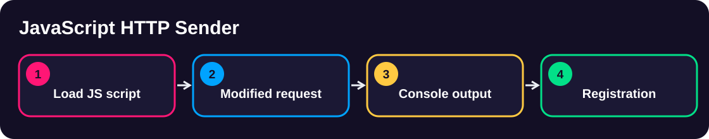
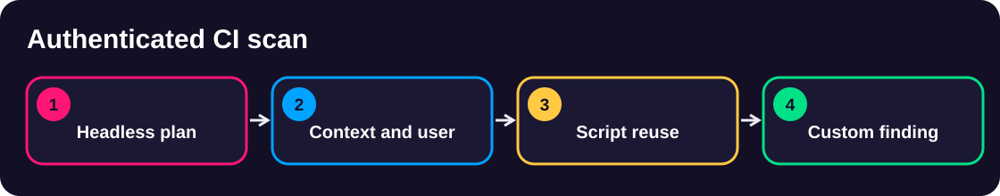
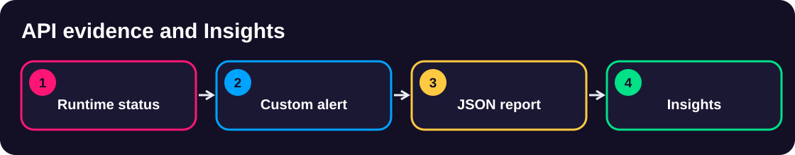

<div align="center">

# 🛡️ Script Development with OWASP ZAP

### From Verifiable Findings to Automated Security Gates

<p>Six independent Globomantics security labs · FastAPI · PostgreSQL · MongoDB · ZAP 2.17.0</p>


<p><b>Clone → Prepare your Mac → Select a demo → Execute four named steps → Verify → Clean up</b></p>
</div>

> [!WARNING]
> **Authorized environment only.** These exercises intentionally use vulnerable code. Scan only the bundled local Globomantics training application; never scan unrelated systems.

## 🚀 Start Here — One-Time Mac Setup

<table>
<tr><td width="72"><b>01</b></td><td><b>Get the project</b><pre>git clone https://github.com/rupeshtiwari/pluralsight-script-development-with-zap.git
cd pluralsight-script-development-with-zap</pre></td></tr>
<tr><td><b>02</b></td><td><b>Check and install prerequisites</b><pre>./setup/setup-macos.sh</pre>Checks Homebrew, Colima, Docker CLI/Compose, Python 3, and the pinned ZAP container. Prints a readiness table; saves a log under <code>setup/logs/</code>.</td></tr>
<tr><td><b>03</b></td><td><b>Choose your demo's starter branch</b><pre>git fetch origin
git switch m1-demo1-before</pre>Use the matching <code>m1-demoN-before</code> or <code>m2-demoN-before</code> branch from the catalog below.</td></tr>
<tr><td><b>04</b></td><td><b>Run the selected demo</b><pre>cd demos/module1-demos/m1-demo1-targeted-injection-xss-csrf
./scripts/demo_up.sh
./steps/01-run-targeted-injection-scan.sh</pre>Follow that demo's four named commands in its own README. Some demos use <code>demo_reset.sh</code> for a completely fresh vulnerable build.</td></tr>
<tr><td><b>05</b></td><td><b>Verify and clean up</b><pre>./scripts/preflight_check.sh
./scripts/demo_down.sh</pre>Review the actual evidence and generated log in <code>logs/</code>. For ZAP Script Console steps, verify the real GUI output.</td></tr>
</table>

> [!TIP]
> **Each demo runs independently.** You do not need to complete a different demo first. Module 2 starter branches contain their required Module 1 script prerequisites. Use a separate checkout or worktree when working on more than one demo.

## 📚 Complete Demo Catalog

<table>
<thead><tr><th>Module</th><th>Demo</th><th>Hands-On Exercise</th><th>Learning Objectives</th><th>Branches</th></tr></thead>
<tbody>
<tr><td><b>01</b></td><td><b>1</b></td><td><a href="demos/module1-demos/m1-demo1-targeted-injection-xss-csrf/README.md"><b>Targeted Injection, XSS & CSRF</b></a></td><td>EO1a · EO1b · EO1c</td><td><code>m1-demo1-before</code> → <code>m1-demo1-after</code></td></tr>
<tr><td><b>01</b></td><td><b>2</b></td><td><a href="demos/module1-demos/m1-demo2-javascript-http-sender/README.md"><b>JavaScript HTTP Sender</b></a></td><td>EO2a</td><td><code>m1-demo2-before</code> → <code>m1-demo2-after</code></td></tr>
<tr><td><b>01</b></td><td><b>3</b></td><td><a href="demos/module1-demos/m1-demo3-python-scanning-authentication/README.md"><b>Python Rules & Authentication</b></a></td><td>EO2b · EO2c</td><td><code>m1-demo3-before</code> → <code>m1-demo3-after</code></td></tr>
<tr><td><b>02</b></td><td><b>1</b></td><td><a href="demos/module2-demos/m2-demo1-authenticated-zap-github-actions/README.md"><b>Authenticated ZAP in GitHub Actions</b></a></td><td>EO3a</td><td><code>m2-demo1-before</code> → <code>m2-demo1-after</code></td></tr>
<tr><td><b>02</b></td><td><b>2</b></td><td><a href="demos/module2-demos/m2-demo2-zap-api-scan-evidence/README.md"><b>ZAP API & Scan Evidence</b></a></td><td>EO3b</td><td><code>m2-demo2-before</code> → <code>m2-demo2-after</code></td></tr>
<tr><td><b>02</b></td><td><b>3</b></td><td><a href="demos/module2-demos/m2-demo3-security-quality-gates/README.md"><b>Security Quality Gates</b></a></td><td>EO3c</td><td><code>m2-demo3-before</code> → <code>m2-demo3-after</code></td></tr>
</tbody></table>

### Module 1 — Validate and Extend ZAP

[**Module 1 overview →**](demos/module1-demos/README.md)

<a href="demos/module1-demos/m1-demo1-targeted-injection-xss-csrf/README.md"></a>

<sub>Generated using ChatGPT</sub>

<a href="demos/module1-demos/m1-demo2-javascript-http-sender/README.md"></a>

<sub>Generated using ChatGPT</sub>

<a href="demos/module1-demos/m1-demo3-python-scanning-authentication/README.md"></a>

<sub>Generated using ChatGPT</sub>

### Module 2 — Automate and Gate Findings

[**Module 2 overview →**](demos/module2-demos/README.md)

<a href="demos/module2-demos/m2-demo1-authenticated-zap-github-actions/README.md"></a>

<sub>Generated using ChatGPT</sub>

<a href="demos/module2-demos/m2-demo2-zap-api-scan-evidence/README.md"></a>

<sub>Generated using ChatGPT</sub>

<a href="demos/module2-demos/m2-demo3-security-quality-gates/README.md"></a>

<sub>Generated using ChatGPT</sub>


## 🧩 System Architecture

<div align="center">


<sub>Illustrative architecture · Generated using ChatGPT</sub>

</div>

<details><summary><b>Why These Folders Exist</b></summary>

| Folder | Purpose |
|---|---|
| `setup/` | Mac prerequisites, environment readiness and installation logs |
| `demos/` | The six independent, concept-named learner walkthroughs |
| `runtime/` | Shared training application, ZAP container, fixtures and common scripts |
| `docs/` | Learner diagrams, approved course outline and reference material |

`docker-compose.yaml`, `.env`, `CLAUDE.md`, `.gitignore` and `README.md` remain at the root because Docker, Git, Claude Code or first-time learners use those standard locations.
</details>

## 📁 Repository Layout

```text
.
├── README.md                           Start here
├── setup/       One-time Mac prerequisites and readiness
│   ├── setup-macos.sh
│   └── logs/                           Generated on your machine, not committed
├── demos/
│   ├── module1-demos/
│   │   ├── README.md
│   │   ├── m1-demo1-targeted-injection-xss-csrf/
│   │   ├── m1-demo2-javascript-http-sender/
│   │   └── m1-demo3-python-scanning-authentication/
│   └── module2-demos/
│       ├── README.md
│       ├── m2-demo1-authenticated-zap-github-actions/
│       ├── m2-demo2-zap-api-scan-evidence/
│       └── m2-demo3-security-quality-gates/
├── runtime/                            Shared local training runtime
│   ├── app/                            FastAPI + database fixtures
│   ├── zap/                            OWASP ZAP container entrypoint
│   ├── data/                           Training payloads
│   └── scripts/                        Shared lifecycle and quality checks
├── docs/                               Course outline and learner references
├── .github/workflows/                  Reproducible GitHub Actions examples
├── docker-compose.yaml                 Local multi-service stack
└── .env                                Non-production training configuration
```

### Every Demo Uses the Same Four-Step Pattern

```text
demos/module1-demos/m1-demo1-targeted-injection-xss-csrf/
  README.md          Learner instructions and observable results
  steps/             Four concept-named executable commands
  scripts/           Setup, reset, preflight, teardown; internal step engine
  logs/              Local run results (ignored by Git)
```

Examples of easy-to-narrate commands:

```bash
./steps/01-run-targeted-injection-scan.sh
./steps/02-verify-reflected-xss-contexts.sh
./steps/03-test-cross-session-csrf-token.sh
./steps/04-reconcile-security-alerts.sh
```

Each named script runs the same validated step logic as the course's internal runner. The preflight invokes that same source of truth rather than independently implementing test behavior.

## 🧪 Student Workflow and Reference Solutions

- Start in your demo's `*-before` branch. It contains the prepared prerequisites, not that demo's completed authored solution.
- Execute the four named steps, inspect actual console/API/report evidence, and compare observations with the README.
- Run `./scripts/preflight_check.sh` to collect a local evidence transcript. **A static example or predicted console line is never a substitute for live ZAP output.**
- Compare with `*-after` without overwriting work: `git diff m1-demo1-before..m1-demo1-after -- demos/module1-demos/m1-demo1-targeted-injection-xss-csrf`.
- Some demos are operational (not source-authoring); their proof is the live ZAP finding or report, not a source-file delta.

## 🛠️ Technical Baseline

| Component | Baseline |
|---|---|
| Scanner | OWASP ZAP 2.17.0, pinned container digest |
| Runtime | macOS (Apple Silicon), Homebrew, Colima and Docker Compose |
| Application | Python / FastAPI, PostgreSQL, MongoDB |
| Scripting | JavaScript HTTP Sender; Jython scanning and authentication scripts |
| Automation | ZAP Automation Framework, ZAP API, GitHub Actions on `ubuntu-24.04` |
| ZAP GUI | http://localhost:8080/zap/ |
| Local application | http://localhost:8000/ |
| ZAP API and proxy | http://localhost:8090 |

Some ports and generated metrics are demo-specific and must be checked from the actual run.

---

<div align="center">

<b>Learn the mechanism. Execute the request. Verify the result.</b>

Maintained by <a href="https://github.com/rupeshtiwari">Rupesh Tiwari</a>

</div>
