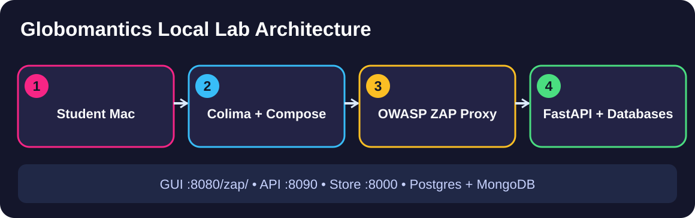
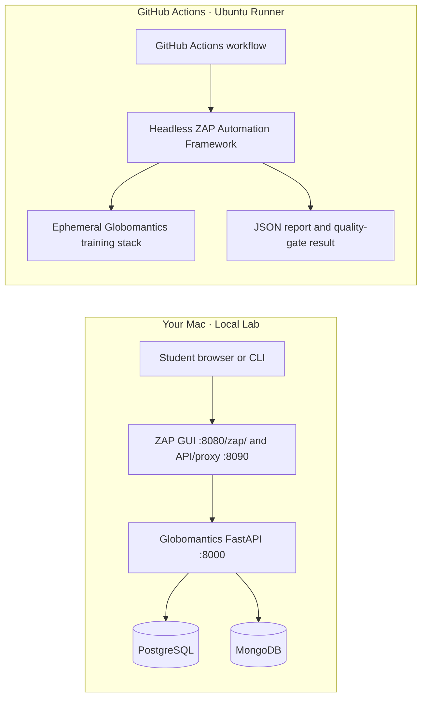
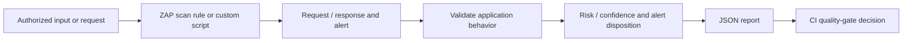
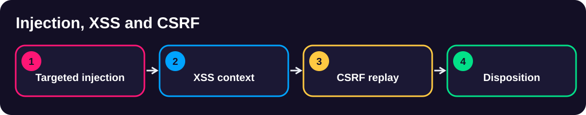
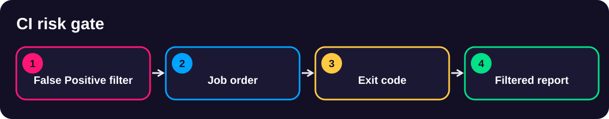

<div align="center">

# 🛡️ Script Development with OWASP ZAP

### Find The Real Risk. Prove The Result. Automate The Decision.

Learn to move beyond generic vulnerability scans in six practical Globomantics security exercises.


**Start a demo independently · Run four named steps · Inspect real evidence · Compare your result**



<sub>Illustrative architecture · Generated using ChatGPT · The actual findings come from your lab</sub>

</div>

## Watch the course and follow along

<div align="center">


**Script Development with ZAP · Video course on Pluralsight**

Follow the video lessons, pause at each demonstrated step, and execute the matching scripts in this repository. Every demo README explains the commands and observations even without access to the course outline.

**Course video link: To be added after Pluralsight publishes the course.** The repository Developer will replace this label with the verified direct course URL. No unpublished or guessed address is provided.

</div>

## Why Does This Project Exist?

Imagine you're responsible for releasing the **Globomantics Store**. Its search endpoint accepts customer input, its accounts use two databases, its profile page requires login, and its build pipeline must not ship a serious vulnerability. A conventional scan can produce hundreds of alerts, but those alerts don't answer the questions a developer or application-security engineer must resolve.

<table>
<tr><th>Real Engineering Problem</th><th>What You Need to Prove</th></tr>
<tr><td>❓ An alert says <b>injection</b></td><td>Which input, query or shell boundary is unsafe, and what did the application actually do?</td></tr>
<tr><td>❓ User input appears in an HTML response</td><td>Does the output context make a reflected-XSS payload dangerous, or is it merely reflected?</td></tr>
<tr><td>❓ An endpoint accepts an anti-CSRF token</td><td>Does the token belong to the correct session, and is the state-changing request rejected when it should be?</td></tr>
<tr><td>❓ A scan reports no problems on a profile page</td><td>Did the scanner log in successfully, or did it only test the login wall?</td></tr>
<tr><td>❓ The CI build passed or failed</td><td>Which actual finding and threshold produced that decision? Was a known benign alert filtered correctly?</td></tr>
</table>

**The goal is not to generate more alerts. It is to connect the request, application behavior, security finding, and engineering decision with evidence you can reproduce.**

## What Is OWASP ZAP?

**OWASP ZAP (Zed Attack Proxy)** is an open-source web application security-testing tool. It can intercept HTTP requests and responses, run passive and active checks, expose results through an API, and execute custom scripts. Its Automation Framework lets you run the same controlled security checks without a GUI, for example inside GitHub Actions.

In these labs you'll use ZAP to:
- test deliberately vulnerable application endpoints with *focused*, authorized scan rules
- observe real HTTP requests and responses, rather than trusting an alert title alone
- extend requests with JavaScript and create a Python/Jython scanning rule
- authenticate to a protected page without manually copying a cookie
- query scan evidence, generate JSON reports, and enforce a meaningful build gate

The training target is local and purpose-built. **Use these techniques only against the supplied Globomantics application or other systems you're explicitly authorized to test.**

## What you will learn, grouped by demonstration

You don't need the separate course outline. The six demonstrations follow one engineering story: identify an application weakness, confirm it using HTTP evidence, then automate the security decision.

### Module 1 · Demo 1, Injection, XSS and CSRF

You will focus the scanner on the store's unsafe inputs and then validate each finding using the request, response and resulting application state.

- Configure specialized SQL, NoSQL and command-injection checks *(EO1a)*
- Test reflected cross-site scripting using the correct output context *(EO1b)*
- Investigate CSRF tokens reused across authenticated sessions *(EO1c)*

[Start Module 1 Demo 1 →](demos/module1-demos/m1-demo1-targeted-injection-xss-csrf/README.md)

### Module 1 · Demo 2, JavaScript HTTP Sender

You will write a JavaScript extension that adds a stable marker to an authorized HTTP request. You will confirm the change in ZAP History, verify the Script Console line, and check the reusable registration *(EO2a)*.

[Start Module 1 Demo 2 →](demos/module1-demos/m1-demo2-javascript-http-sender/README.md)

### Module 1 · Demo 3, Python scanning and authentication

You will create an application-specific Jython active-scan rule *(EO2b)* and a separate scripted login *(EO2c)*. An authenticated request and a fresh named alert prove the two mechanisms work together.

[Start Module 1 Demo 3 →](demos/module1-demos/m1-demo3-python-scanning-authentication/README.md)

### Module 2 · Demo 1, Authenticated CI scanning

You will configure an Automation Framework plan that runs ZAP headlessly in GitHub Actions *(EO3a)*. The evidence is a correctly authenticated target, the original reused scripts, and the named custom finding in the report.

[Start Module 2 Demo 1 →](demos/module2-demos/m2-demo1-authenticated-zap-github-actions/README.md)

### Module 2 · Demo 2, ZAP API and reporting

You will query ZAP programmatically *(EO3b)*, confirm a completed scan, inspect the named alert, reconcile the official JSON report and interpret scan-effectiveness Insights.

[Start Module 2 Demo 2 →](demos/module2-demos/m2-demo2-zap-api-scan-evidence/README.md)

### Module 2 · Demo 3, Security quality gates

You will use a scoped alert filter and a threshold-based build gate *(EO3c)* to ensure a reviewed False Positive does not conceal a remaining High-risk issue. The final report and actual exit code explain the CI decision.

[Start Module 2 Demo 3 →](demos/module2-demos/m2-demo3-security-quality-gates/README.md)

## See The System Before Running It

The **local lab** and the **hosted CI pipeline** are separate environments. ZAP talks only to the training application inside the chosen environment.



<details>
<summary><b>How the security evidence flows</b></summary>



An alert alone is a *signal*. Confirming the request and response turns it into evidence. A gate only becomes trustworthy when its report and actual process exit code agree.
</details>

## Start In Five Steps

These instructions assume a Mac with internet access, and basic comfort with a terminal.

<table>
<tr><td width="50">①</td><td><b>Get the project</b><pre>git clone https://github.com/rupeshtiwari/pluralsight-script-development-with-zap.git
cd pluralsight-script-development-with-zap</pre></td></tr>
<tr><td>②</td><td><b>Prepare your Mac once</b><pre>./setup/setup-macos.sh</pre>The script checks or installs Homebrew, Docker CLI and Compose, Colima, Python, and pulls the pinned ZAP image. Check its readiness report before running a lab. Logs go into <code>setup/logs/</code>.</td></tr>
<tr><td>③</td><td><b>Select the demo you want to learn</b><pre>git fetch origin
git switch m1-demo1-before</pre>Each <code>*-before</code> branch is an independent exercise starter. You can choose any other demo from the table below.</td></tr>
<tr><td>④</td><td><b>Run its four understandable commands</b><pre>cd demos/module1-demos/m1-demo1-targeted-injection-xss-csrf
./scripts/lab-reset.sh
./steps/01-run-targeted-injection-scan.sh</pre>Follow that demo's README for Steps 2–4 and exactly what evidence should appear.</td></tr>
<tr><td>⑤</td><td><b>Observe the result and clean up</b><pre>./scripts/lab-down.sh</pre>Record the actual displayed evidence.</td></tr>
</table>

> 🧪 **Self-test first.** Before you follow the steps by hand, run the self-test to confirm every step works and prints the expected output. It just runs the real steps for you so you can fix any setup issue before you begin:
>
> ```bash
> (cd "$(git rev-parse --show-toplevel)" && ./preflight-check)            # the whole course, every demo, in order (runs from anywhere)
> (cd "$(git rev-parse --show-toplevel)" && ./preflight-check --m1)       # a whole module (--m1 / --m2), or one demo (--m1d1 … --m2d3)
> ```

**Different demo?** Return to the repository root, save any personal changes, switch to its `*-before` branch, then follow its own README. Don't reuse scan history from another demo.

## Your Six Hands-On Demos

<table>
<thead><tr><th>Demo</th><th>Scenario / Outcome</th><th>Objectives</th><th>Student Guide</th></tr></thead>
<tbody>
<tr><td><b>M1 · Demo 1</b></td><td>Validate SQL, MongoDB, command injection; investigate reflected XSS and cross-session CSRF</td><td>EO1a · EO1b · EO1c</td><td><a href="demos/module1-demos/m1-demo1-targeted-injection-xss-csrf/README.md">Open Injection, XSS & CSRF Lab →</a></td></tr>
<tr><td><b>M1 · Demo 2</b></td><td>Make a real outbound request carry a JavaScript-generated marker</td><td>EO2a</td><td><a href="demos/module1-demos/m1-demo2-javascript-http-sender/README.md">Open JavaScript HTTP Sender Lab →</a></td></tr>
<tr><td><b>M1 · Demo 3</b></td><td>Use a custom Jython rule and scripted login to assess a protected page</td><td>EO2b · EO2c</td><td><a href="demos/module1-demos/m1-demo3-python-scanning-authentication/README.md">Open Python & Authentication Lab →</a></td></tr>
<tr><td><b>M2 · Demo 1</b></td><td>Execute the authenticated ZAP plan on a GitHub Actions runner</td><td>EO3a</td><td><a href="demos/module2-demos/m2-demo1-authenticated-zap-github-actions/README.md">Open Authenticated CI Scan Lab →</a></td></tr>
<tr><td><b>M2 · Demo 2</b></td><td>Query scan status and a custom alert; reconcile the JSON report and Insights</td><td>EO3b</td><td><a href="demos/module2-demos/m2-demo2-zap-api-scan-evidence/README.md">Open ZAP API & Evidence Lab →</a></td></tr>
<tr><td><b>M2 · Demo 3</b></td><td>Filter a known benign alert and block a release on the remaining High risk</td><td>EO3c</td><td><a href="demos/module2-demos/m2-demo3-security-quality-gates/README.md">Open Security Quality Gate Lab →</a></td></tr>
</tbody>
</table>

<div align="center">
<table><tr>
<td width="50%"><a href="demos/module1-demos/README.md"></a><p align="center"><b>Module 1 · Validate and Extend</b></p></td>
<td width="50%"><a href="demos/module2-demos/README.md"></a><p align="center"><b>Module 2 · Automate and Enforce</b></p></td>
</tr></table>
</div>

<sub>The workflow illustrations above were generated using ChatGPT; they do not show real scan output.</sub>

## Which Branch Do I Use?

| Branch | Purpose |
|---|---|
| `main` | Generic course foundation and navigation, without completed exercise solutions |
| `m1-demo1-before` … `m2-demo3-before` | Start the chosen exercise with its own prerequisites |
| `m1-demo1-after` … `m2-demo3-after` | See the completed reference or compare your work without overwriting it |

Each demo's README lists the branch-specific source, commands, expected evidence, and comparison instructions. Some activities produce **runtime evidence rather than source-code changes**.

## Find Your Way Around The Repository

<table>
<thead><tr><th>Location</th><th>What Is There?</th><th>When To Use It</th></tr></thead>
<tbody>
<tr><td>🧰 <code>setup/</code></td><td>Mac preparation and prerequisite checks</td><td>Before your first demo or when diagnosing a missing tool</td></tr>
<tr><td>🎯 <code>demos/module1-demos/</code></td><td>Targeted scanning, JavaScript, Python and authentication exercises</td><td>Learning to inspect and extend ZAP</td></tr>
<tr><td>⚙️ <code>demos/module2-demos/</code></td><td>Headless automation, API evidence and CI quality gates</td><td>Learning repeatable security testing</td></tr>
<tr><td>🧱 <code>runtime/app/</code></td><td>FastAPI training application and its intentionally vulnerable endpoints</td><td>Understanding the source of a finding</td></tr>
<tr><td>🐳 <code>runtime/zap/</code> + <code>runtime/scripts/</code></td><td>ZAP entrypoint and shared start, reset and validation tools</td><td>Running or troubleshooting the local stack</td></tr>
<tr><td>🗃️ <code>runtime/data/</code></td><td>Training inputs and sample payloads</td><td>Examining example test data</td></tr>
<tr><td>📖 <code>docs/</code></td><td>Diagrams, learner references and course reference information</td><td>Understanding architecture or security terminology</td></tr>
<tr><td>🔁 <code>.github/workflows/</code></td><td>GitHub Actions automation and validation workflows</td><td>Understanding hosted CI scans and results</td></tr>
<tr><td>📄 <code>docker-compose.yaml</code> + <code>.env</code></td><td>Local lab's service configuration and training-only values</td><td>Investigating ports or startup issues</td></tr>
</tbody>
</table>

<details>
<summary><b>What lives inside each demo folder?</b></summary>

| Path | Purpose |
|---|---|
| `README.md` | Exact student instructions and evidence to inspect |
| `steps/01-*.sh` through `steps/04-*.sh` | Four short commands with meaningful, readable names |
| `scripts/lab-up.sh`, `lab-reset.sh`, `lab-down.sh` | Start, reset and stop that demo's environment |
| `scripts/_steps.sh` | Implementation used by the named steps |
| `logs/` | Locally generated validation logs |

</details>

## Common Problems And What To Check

<details>
<summary><b>Homebrew, Colima or Docker is missing</b></summary>

From the repository root run `./setup/setup-macos.sh` again, read the readiness table, and follow the exact missing-component instruction. For the Docker daemon, try `docker info` and `colima status`. Never assume a successful install means the VM is running.
</details>

<details>
<summary><b>The application, ZAP GUI or API is unavailable</b></summary>

From the selected demo directory start with `./scripts/lab-up.sh` (or `lab-reset.sh` where its README specifies), wait for readiness, then check `docker compose ps` from the repository root. The local interfaces are the training app at <http://localhost:8000/>, ZAP GUI at <http://localhost:8080/zap/>, and ZAP API/proxy at <http://localhost:8090/>. Check for host-port conflicts before starting multiple demo stacks on one computer.
</details>

<details>
<summary><b>A script, alert, report, or Insights result is missing</b></summary>

Confirm you checked out the correct demo branch, completed the preceding step, and produced fresh traffic. The `before` branch may intentionally omit the completed script or plan, create it as the exercise directs. Run the demo preflight and read its actual failed assertion in `logs/`; do not substitute a screenshot, stale finding, or generic statistics. A ZAP Script Console message must be verified in the GUI.
</details>

<details>
<summary><b>GitHub Actions has a failed run or no report</b></summary>

Open the workflow on the corresponding `*-after` branch and check its commit SHA, job steps and artifact list. For quality-gate exercises a failed job can be **intentional**, but only if the report shows the expected remaining risk and the process exit code matches the configured gate. A startup or missing-plan failure is not a valid security gate result.
</details>

## Ready To Begin?

Open [**Module 1 · Targeted Security Testing**](demos/module1-demos/README.md) or [**Module 2 · Security Automation**](demos/module2-demos/README.md), choose a single demo and follow its own commands. You do not need access to a separate outline.

---

<div align="center">

### ⚠️ Educational and Training Use Only

</div>

> **This repository is an intentionally vulnerable, controlled training environment** created to teach OWASP ZAP scripting, security testing, scan automation, reporting, and evidence-based security decisions.
>
> - The Globomantics application, security configurations, credentials, scripts, and CI examples exist **for demonstration and learning only**.
> - This project is **not production-ready** and must not be deployed, exposed, or reused as a production application or security-testing platform.
> - The examples are **intentionally simplified** to make specific security concepts observable and reproducible; they have not been validated against production datasets, enterprise traffic, or real-world deployment requirements.
> - **Security weaknesses are included deliberately.** An insecure implementation here is part of the exercise, not an endorsement of that implementation.
> - **Use this project only in an isolated, authorized lab.** Never point its active scanning scripts at systems you do not have explicit permission to test.
>
> The objective is to build security-testing knowledge and sound engineering judgment, not to provide production-certified code or replace established security assurance processes.

<div align="center"><sub>Maintained by <a href="https://github.com/rupeshtiwari">Rupesh Tiwari</a> · Authorized Globomantics practice only</sub></div>
