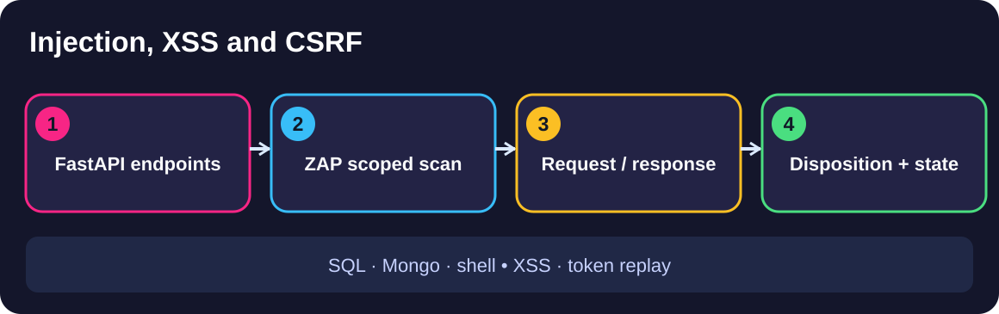
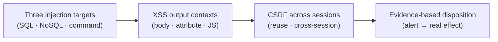

# Module 1 · Demo 1 — Validate injection, XSS and CSRF

<div align="center">




<sub>Illustrative architecture · Generated using ChatGPT; only live requests and reports prove findings</sub>

</div>

<!-- demo-navigation:start -->
<p align="center"><b>Student exercise · Demo 1 of 6</b></p>
<p align="center">
  <a href="../../../README.md"></a>
  <a href="https://github.com/rupeshtiwari/pluralsight-script-development-with-zap/blob/m1-demo2-before/demos/module1-demos/m1-demo2-javascript-http-sender/README.md"></a>
</p>
<!-- demo-navigation:end -->

## Your scenario

A scan of the Globomantics Store just came back with a wall of alerts, and someone has to decide what is actually broken before the team can act. That someone is you. A severity label on its own is not a decision — a "High" that you cannot reproduce wastes a developer's afternoon, and a real defect buried in the list ships to production. What turns an alert into a decision is a request you sent, a response you read, and a change you can see in the application.

So in this demo you and I are not going to collect alerts — we are going to *prove* three specific defects and write down why each one is real. We will narrow ZAP to the injection rules that matter for three different endpoints, watch a reflected-XSS payload come back unescaped in the exact context it was injected into, replay a CSRF token where it should have been rejected, and finish by reconciling every finding against what the app actually did. The source code is open in VS Code the whole time, because you cannot explain a finding you have not traced back to the line that caused it.

## Your learning goals

You will follow one investigation from choosing focused scan rules through confirming the application's real behavior:

1. Find where SQL, MongoDB and operating-system command inputs cross unsafe boundaries *(EO1a)*
2. Validate reflected XSS using the output context and ZAP's injected request *(EO1b)*
3. Test whether CSRF tokens protect the intended authenticated session *(EO1c)*

No separate course outline is required to complete this lab — each step states what you are checking and why.

## Your evidence path



Read it as one investigation. Each step hands the next one its evidence, and the last step is where scanner output becomes an engineering decision you can defend in review.

## Start your lab

The Mac prerequisite installer, `setup/setup-macos.sh`, is a **one-time** preparation task explained in the [course README](../../../README.md) — you do not reinstall tools per demo. Each demo then starts its **own** local stack.

<details open>
<summary><b>Open the exact branch, folder and runtime for Module 1 Demo 1</b></summary>

**Where:** the VS Code integrated Terminal, starting in the root of your existing local repository. This demo shows source code, so work in VS Code throughout.

```bash
cd "$HOME/pluralsight-script-development-with-zap"
git fetch origin
git switch m1-demo1-before
cd demos/module1-demos/m1-demo1-targeted-injection-xss-csrf
./scripts/demo_reset.sh
```

**Expected start:** the reset script prints a clean-slate message and brings up the vulnerable Globomantics build. Continue only after it reports readiness — a failed startup is not one of the four teaching steps.

**Interfaces:** [Globomantics app — localhost:8000](http://localhost:8000/) · [ZAP GUI — localhost:8080/zap/](http://localhost:8080/zap/) · [ZAP API/proxy — localhost:8090](http://localhost:8090/). Open only the interface a step calls for. Use VS Code with `runtime/app/main.py` open and the integrated Terminal; the script prints the real ZAP findings in that terminal.

</details>

## Your four steps

<details open>
<summary><b>Step 1 — Run one targeted injection scan</b> · SQL · NoSQL · command</summary>

### What you are learning

Configure a focused policy of SQL, NoSQL and command-injection rules, and understand why one generic alert total hides three different defects. *(EO1a)*

### What we examine, and why

Before you scan, read the code you are about to attack. In `runtime/app/main.py`, bring up the three sinks:

- `./scripts/show_code.sh sqli` → the `search` endpoint builds a SQL query by **string-formatting** the `q` parameter straight into the statement. That is the SQL-injection boundary.
- `./scripts/show_code.sh nosql` → the `account` endpoint passes the `username` value into a **MongoDB** query as a structure, so an operator like `$ne` changes *which documents match*, not just one value.
- `./scripts/show_code.sh cmd` → `admin_ping` hands the `host` parameter to the **operating-system shell**, so a `;` turns one argument into two commands.

Three different interpreters — a SQL database, a document database, and a shell — reached by three different parameters. That is why the policy enables a focused family of rules (`40018 40019 40020 40021 40022 40027` for SQL, `40033` for MongoDB NoSQL, `90020 90037` for OS command) instead of everything: a narrow policy finds these three boundaries fast and keeps the result readable.

**Predict before you run:** you expect the policy to report those rule IDs enabled, and exactly one alert on each endpoint — a SQL alert on `/search (q)`, a NoSQL alert on `/api/account (username)`, and a command alert on `/admin/ping (host)`. Hold that prediction and check it against the engine.

### Run command

**Where:** the VS Code integrated Terminal, in `demos/module1-demos/m1-demo1-targeted-injection-xss-csrf`.

```bash
./steps/01-run-targeted-injection-scan.sh
```

Then open [ZAP — localhost:8080/zap/](http://localhost:8080/zap/) → **Alerts**, select each SQL, NoSQL and command finding, and read its **Request** and **Response** — match the rule to its `q`, `username` or `host` parameter.

### Expected result (the script's output contract — not your run)

Rule IDs and parameter names come from the demo; the `<…>` risk/confidence values must be read from your own output.

<table>
<thead><tr><th>Displayed field</th><th>Expected value or example</th><th>What to inspect</th></tr></thead>
<tbody>
<tr><td><b>Policy rules enabled</b></td><td><code>40018 40019 40020 40021 40022 40027 40033 90020 90037</code></td><td>A focused injection policy, not everything</td></tr>
<tr><td><b>SQL injection · /search (q)</b></td><td><code>alert 40018 · &lt;live risk&gt;/&lt;live confidence&gt;</code></td><td>Correlate the SQL alert with <code>q</code></td></tr>
<tr><td><b>NoSQL injection · /api/account (username)</b></td><td><code>alert 40033 · &lt;live risk&gt;/&lt;live confidence&gt;</code></td><td>Correlate NoSQL with <code>username</code></td></tr>
<tr><td><b>Command injection · /admin/ping (host)</b></td><td><code>alert 90020 · &lt;live risk&gt;/&lt;live confidence&gt;</code></td><td>Correlate OS command with <code>host</code></td></tr>
<tr><td><b>Result</b></td><td><code>✔ PASS targeted scan raised all three injection alerts</code></td><td>Only a pass with three real findings</td></tr>
</tbody></table>

### Investigate, then decide

Line each alert up with the source you read: the `40018` on `q` is the string-formatted SQL query; the `40033` on `username` is the Mongo operator reaching the document match; the `90020` on `host` is the shell. The decision this authorizes: *a targeted policy, mapped to known sinks, gives you three reproducible leads* — not a severity number you have to take on faith.

**On FAIL:** the script names which endpoint did not alert. Fix that — wrong branch, app not reset, or the sink changed — rather than claiming an alert appeared.

**Next:** you have leads. Now prove one of them the careful way, by matching the payload to its output context.

</details>

<details>
<summary><b>Step 2 — Validate reflected XSS in the correct context</b> · body · attribute · JS string</summary>

### What you are learning

Test reflected XSS against the **output context**, then let ZAP confirm it — because the right payload changes with where the input lands. *(EO1b)*

### What we examine, and why

Open the `greet` endpoint (`./scripts/show_code.sh xss`, around lines 257–277 of `runtime/app/main.py`). The same `name` value is written into the page in **three different places**: inside the HTML body, inside a quoted HTML attribute, and inside a JavaScript string. Each place needs a different escape to break out of it — `<script>` in the body, `">` to close an attribute, `";` to close a JS string. A payload that works in one context does nothing in another, which is exactly why "did it reflect?" is not the same question as "can it execute?"

The step sends one context-matched request per sink and shows the response line each lands in, then runs ZAP's reflected-XSS rule `40012` against `name` to get the engine's own confirmation.

**Predict before you run:** you expect all three context-matched payloads to come back **unescaped** in their matching response lines, and ZAP `40012` to fire on `name` with the exact payload it injected echoed in the evidence. If a payload came back encoded, that context is *not* the vulnerable one.

### Run command

**Where:** the VS Code integrated Terminal, in the same demo folder.

```bash
./steps/02-verify-reflected-xss-contexts.sh
```

Then open [ZAP — localhost:8080/zap/](http://localhost:8080/zap/) → **History**, find the matching `/greet` request, and read **Request**/**Response** so you can see the injected `name` value sitting in the output context.

### Expected result (the script's output contract — not your run)

The injected payload is run-specific — read it from your output; the rule ID, parameter and alert name are the demo's.

<table>
<thead><tr><th>Displayed field</th><th>Expected value or example</th><th>What to inspect</th></tr></thead>
<tbody>
<tr><td><b>HTML body · request → response</b></td><td><code>GET /greet?name=&lt;script&gt;alert(1)&lt;/script&gt;</code> reflected in the body</td><td>The body sink</td></tr>
<tr><td><b>HTML attribute · request → response</b></td><td><code>GET /greet?name="&gt;&lt;svg onload=alert(1)&gt;</code> reflected in the attribute</td><td>The quoted-attribute sink</td></tr>
<tr><td><b>JavaScript string · request → response</b></td><td><code>GET /greet?name=";alert(1);//</code> reflected in the script</td><td>The JS-string sink</td></tr>
<tr><td><b>ZAP alert</b></td><td><code>Cross Site Scripting (Reflected) · &lt;live risk&gt;/&lt;live confidence&gt;</code></td><td>The named rule <code>40012</code></td></tr>
<tr><td><b>Affected parameter · payload</b></td><td><code>name</code> · <code>&lt;actual injected payload&gt;</code></td><td>Use the real payload from your run</td></tr>
<tr><td><b>Result</b></td><td><code>✔ PASS context-matched payloads reflected unescaped; rule 40012 confirmed</code></td><td>A real payload and reflected evidence</td></tr>
</tbody></table>

### Investigate, then decide

Map each injected payload to the response line it appears in, and confirm `40012` cited the same `name` parameter. The lesson to carry: *reflection in the matching context is the proof, and the context dictates the payload* — "it reflected" alone is not a browser executing script. The decision: this is a confirmed reflected XSS on `name`, reproducible with a named rule and a captured payload.

**On FAIL:** read the diagnostic — a context that came back encoded or a missing `40012` — and verify branch and app state instead of asserting the finding.

**Next:** move from reading output to changing state — a CSRF token that should stop a cross-session request, and doesn't.

</details>

<details>
<summary><b>Step 3 — Replay a CSRF token across sessions</b> · reuse · cross-session</summary>

### What you are learning

Show that a CSRF token which *looks* enforced can still fail if it is neither single-use nor bound to its session. *(EO1c)*

### What we examine, and why

Open `change_email` and the token-issuing helper (`./scripts/show_code.sh csrf`). The endpoint does check for a token — so a naive look says "protected." But read how the token is validated: it is accepted as long as it is a token the app issued, with no check that it has been used before or that it belongs to *this* cookie's session. Those two missing checks are the whole defect, and controls are how you expose them: a legitimate request should pass, a missing token should be rejected, and then the two abuse cases — the **same token used twice**, and a token from **session A submitted with session B's cookie** — should both be rejected but will not be.

The step runs all four and shows session B's stored email before and after, so the proof is a status code *and* a changed record, never a status code alone.

**Predict before you run:** valid token → `200`; missing token → `403`; then the two that *should* be `403` but come back `200` — the replayed used token (changing the email once) and the cross-session token (changing it again). Watch the email field move with each accepted abuse.

### Run command

**Where:** the VS Code integrated Terminal, in the same demo folder.

```bash
./steps/03-test-cross-session-csrf-token.sh
```

Keep the valid-token control, missing-token control, replay, cross-session request and the before/after email rows visible together. The browser form at [localhost:8000/account/email](http://localhost:8000/account/email) is context, not the proof — the terminal rows are.

### Expected result (the script's output contract — not your run)

<table>
<thead><tr><th>Displayed field</th><th>Expected value or example</th><th>What to inspect</th></tr></thead>
<tbody>
<tr><td><b>Valid token (session B's own, first use)</b></td><td><code>200</code></td><td>Legitimate control accepted</td></tr>
<tr><td><b>Missing token</b></td><td><code>403</code></td><td>Missing-token control rejected</td></tr>
<tr><td><b>Replayed used token (same token, second use)</b></td><td><code>200 (should be rejected)</code></td><td>Token is not single-use</td></tr>
<tr><td><b>Email after the replay</b></td><td><code>alice@globomantics.example → &lt;changed address&gt;</code></td><td>State actually changed</td></tr>
<tr><td><b>Token from session A with B's cookie</b></td><td><code>200 (should be rejected)</code></td><td>Token is not session-bound</td></tr>
<tr><td><b>Email after the cross-session request</b></td><td><code>&lt;attacker address&gt;</code></td><td>The victim's record was overwritten</td></tr>
<tr><td><b>Result</b></td><td><code>✔ PASS used token accepted again and a cross-session token accepted — tokens are neither single-use nor session-bound</code></td><td>Status <b>and</b> changed email</td></tr>
</tbody></table>

### Investigate, then decide

The two controls prove the app really does check for a token; the two abuse cases prove the check is the wrong one. Tie each accepted `200` back to the missing validation you read in `change_email`. The decision: *this is a true CSRF defect — the token is present but not enforced as single-use or session-bound* — and you can show the overwritten email to prove it.

**On FAIL:** a control that did not behave (valid ≠ `200`, missing ≠ `403`) means the app state is wrong, not the finding. Reset and re-run rather than reporting a bypass you did not see.

**Next:** bring all four findings together and turn them into a disposition you could hand to a reviewer.

</details>

<details>
<summary><b>Step 4 — Reconcile the findings with application behavior</b> · alert → real effect</summary>

### What you are learning

Turn each ZAP alert and the CSRF case into a recorded, evidence-backed disposition — the artifact a team can actually review. *(EO1a · EO1b · EO1c)*

### What we examine, and why

A rule ID is a lead; a disposition is a decision with the evidence attached. Keep `runtime/app/main.py` open and read the disposition template at `docs/alert-disposition-template.md`. The step walks each finding back to the concrete effect that makes it a **True Positive**: the SQL alert to the database's own parse error, the NoSQL alert to a change in how many account records matched, the command alert to a harmless marker the injected shell command printed, the XSS alert to the unescaped reflection, and the CSRF case to the token accepted twice. A "normal ping" or a bare alert is explicitly *not* enough — the effect is the proof.

**Predict before you run:** you expect every finding to reconcile as a True Positive against a real effect, and the step to write a disposition record to `logs/alert-disposition.md`. If any finding cannot be tied to an effect, it is not ready to ship as confirmed.

### Run command

**Where:** the VS Code integrated Terminal, in the same demo folder.

```bash
./steps/04-reconcile-security-alerts.sh
```

Use [ZAP — localhost:8080/zap/](http://localhost:8080/zap/) → **Alerts** and the matching **Request/Response** to corroborate each finding, and open `logs/alert-disposition.md` in VS Code to read the decision the step recorded.

### Expected result (the script's output contract — not your run)

The error text and account counts are run-specific; read them from your output. Each row must reconcile against a real effect.

<table>
<thead><tr><th>Displayed field</th><th>Expected value or example</th><th>What to inspect</th></tr></thead>
<tbody>
<tr><td><b>40018 SQL injection · /search (q)</b></td><td><code>True Positive — DB error: &lt;actual SQL parse error&gt;</code></td><td>Request/response supports the SQL issue</td></tr>
<tr><td><b>40033 NoSQL injection · /api/account (username)</b></td><td><code>True Positive — accounts &lt;before&gt; → &lt;after&gt;</code></td><td>Operator injection changed the match count</td></tr>
<tr><td><b>90020 Command injection · /admin/ping (host)</b></td><td><code>True Positive — injected shell marker: ZAP_CMD_PROOF</code></td><td>The injected host request, not a normal ping</td></tr>
<tr><td><b>40012 Reflected XSS · /greet (name)</b></td><td><code>True Positive — payload reflected unescaped</code></td><td>The real payload and response evidence</td></tr>
<tr><td><b>CSRF · /account/email (csrf_token)</b></td><td><code>True Positive — used token accepted twice (200, 200)</code></td><td>Status and the changed email</td></tr>
<tr><td><b>Disposition record written</b></td><td><code>logs/alert-disposition.md</code></td><td>A reviewable artifact, not a recollection</td></tr>
<tr><td><b>Result</b></td><td><code>✔ PASS every alert and the CSRF case reconciled and recorded</code></td><td>Evidence before disposition</td></tr>
</tbody></table>

### Investigate, then decide

Read the disposition record and confirm each line names an effect, not just a severity. The decision this whole demo was building to: *you ship confirmed defects with their evidence, and you set aside anything you could not reproduce* — the database parse error, the account-count change, the `ZAP_CMD_PROOF` marker, the reflected payload, and the twice-accepted token are what make these five findings defensible.

**On FAIL:** a finding that would not reconcile is information, not an obstacle — record it as unconfirmed and investigate, rather than forcing a disposition.

**Next:** you have a complete, evidence-backed result for all three injection classes plus XSS and CSRF.

</details>

<!-- student-achievement:start -->
## What you achieved

You can now explain each learning objective with the evidence you captured — not a severity label:

1. **(EO1a) You located three different injection boundaries in one focused scan.** ZAP raised SQL `40018` on `/search (q)`, MongoDB NoSQL `40033` on `/api/account (username)`, and OS command `90020` on `/admin/ping (host)` — each one mapped back to the exact sink you read in `main.py`.
2. **(EO1b) You confirmed reflected XSS by output context, not by guesswork.** ZAP rule `40012` fired on `name` at `/greet` with a context-matched payload reflected unescaped — proof the input reaches the page unsafely, not that a browser popped an alert.
3. **(EO1c) You showed the CSRF token is neither single-use nor session-bound.** Valid token `200`, missing token `403`, yet a replayed token and a cross-session token both returned `200` and overwrote the victim's stored email from `alice@globomantics.example`.
4. **(EO1a · EO1b · EO1c) You turned alerts into an evidence-backed disposition.** Each finding reconciled to a real effect — the database parse error, the account-count change, the injected marker `ZAP_CMD_PROOF`, the reflected payload, and the twice-accepted token — and the decision was written to `logs/alert-disposition.md`.

**How to apply it:** this is how you triage any scan — map each alert to its sink in the source, reproduce the effect, and record a disposition with evidence — so your team acts on confirmed defects instead of a severity list.

**Your final check:** explain each numbered outcome using *your own* captured evidence from this run. A README example, a missing result, or an earlier run does not satisfy this exercise.
<!-- student-achievement:end -->

## Finish your lab

After Step 4 you should be able to say *why* each finding deserves a confirmed disposition from real evidence — not just recall the command that produced it.

Stop the demo's containers from the same demo directory:

```bash
./scripts/demo_down.sh
```

The `m1-demo1-after` branch holds the completed reference. Preserve any exercise changes first, then compare without modifying files: `git diff m1-demo1-before..m1-demo1-after -- demos/module1-demos/m1-demo1-targeted-injection-xss-csrf`. For an operational demo like this one, the meaningful difference is the captured scan evidence, not source files.

<!-- demo-navigation:start -->
<p align="center"><b>Student exercise · Demo 1 of 6</b></p>
<p align="center">
  <a href="../../../README.md"></a>
  <a href="https://github.com/rupeshtiwari/pluralsight-script-development-with-zap/blob/m1-demo2-before/demos/module1-demos/m1-demo2-javascript-http-sender/README.md"></a>
</p>
<!-- demo-navigation:end -->

[← Module 1 demo catalog](../README.md) · [← Course home](../../../README.md)
