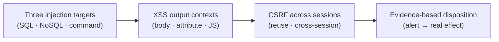

# Module 1 · Demo 1, Validate injection, XSS and CSRF

> ⚡ **Run from anywhere (shortcut).** You keep landing at the repo root, which is fine: the `./lab` helper there picks THIS demo from your branch, so you never fight directories.
>
> ```bash
> cd "$HOME/pluralsight-script-development-with-zap"   # the repo root (where ./lab lives)
> ./lab up      # start the lab (first time; waits until ready)
> ./lab run run-targeted-injection-scan   # run the first check (use the matching script name below)
> ./lab down    # stop the lab when you are done
> ```
>
> The walk-through below shows each command as `./steps/0N-...sh` (run inside the demo folder); `./lab run <name>` runs that same step from the repo root (it cd’s into the demo folder for you).
>
> 🧪 **Self-test before you start.** `preflight-check` runs every step and confirms each one works and prints the expected output, so you can fix any setup issue before you begin.
> ```bash
> (cd "$(git rev-parse --show-toplevel)" && ./preflight-check --m1d1)   # just this demo — runs from anywhere
> (cd "$(git rev-parse --show-toplevel)" && ./preflight-check)          # or the whole course, every demo in order
> ```


<div align="center">


<sub>Illustrative architecture · Generated using ChatGPT; only live requests and reports prove findings</sub>

</div>

<!-- demo-navigation:start -->
<p align="center"><b>Student exercise · Demo 1 of 6</b></p>
<p align="center">
  <a href="../../../README.md"></a>
  <a href="https://github.com/rupeshtiwari/pluralsight-script-development-with-zap/blob/m1-demo2-before/demos/module1-demos/m1-demo2-javascript-http-sender/README.md"></a>
</p>
<!-- demo-navigation:end -->

## Your scenario

A scan of the Globomantics Store just came back with a wall of alerts, and someone has to decide what is actually broken before the team can act. That someone is you. A severity label on its own is not a decision, a "High" that you cannot reproduce wastes a developer's afternoon, and a real defect buried in the list ships to production. What turns an alert into a decision is a request you sent, a response you read, and a change you can see in the application.

So in this demo you and I are not going to collect alerts, we are going to *prove* three specific defects and write down why each one is real. We will narrow ZAP to the injection rules that matter for three different endpoints, watch a reflected-XSS payload come back unescaped in the exact context it was injected into, send another session’s CSRF token where it should have been rejected, and finish by reconciling every finding against what the app actually did. Use the vulnerable application source as optional reference when you need to trace an input. The recorded code view focuses on the scan-policy function.

## Your learning goals

You will follow one investigation from choosing focused scan rules through confirming the application's real behavior:

1. Find where SQL, MongoDB and operating-system command inputs cross unsafe boundaries *(EO1a)*
2. Validate reflected XSS using the output context and ZAP's injected request *(EO1b)*
3. Test whether CSRF tokens protect the intended authenticated session *(EO1c)*

No separate course outline is required to complete this lab, each step states what you are checking and why.

## Your evidence path



Read it as one investigation. Each step hands the next one its evidence, and the last step is where scanner output becomes an engineering decision you can defend in review.

## Start your lab

The Mac prerequisite installer, `setup/setup-macos.sh`, is a **one-time** preparation task explained in the [course README](../../../README.md), you do not reinstall tools per demo. Each demo then starts its **own** local stack.

<details open>
<summary><b>Open the exact branch, folder and runtime for Module 1 Demo 1</b></summary>

**Where:** the VS Code integrated Terminal, starting in the root of your existing local repository. You trace findings back to the vulnerable source as you go, so keep VS Code open.

```bash
cd "$HOME/pluralsight-script-development-with-zap"
git fetch origin
git switch m1-demo1-before
(cd demos/module1-demos/m1-demo1-targeted-injection-xss-csrf && ./scripts/lab-reset.sh)
```

**Expected start:** the reset script prints a clean-slate message and brings up the vulnerable Globomantics build. Continue only after it reports readiness, a failed startup must be fixed before starting the numbered steps.

**Interfaces:** <a href="http://localhost:8000/" target="_blank" rel="noopener">Globomantics app, localhost:8000</a> · <a href="http://localhost:8080/zap/" target="_blank" rel="noopener">ZAP GUI, localhost:8080/zap/</a> · <a href="http://localhost:8090/" target="_blank" rel="noopener">ZAP API/proxy, localhost:8090</a>. Open only the interface a step calls for. Use VS Code with `runtime/app/main.py` open and the integrated Terminal; the script prints the real ZAP findings in that terminal.

</details>

## Your steps

<!-- source-focus:start -->
## Read the code that supports this exercise

Paths below are relative to this demo folder. Open the named file in VS Code and find the function or YAML block; inspect only the part that explains the current check.

| File | Function or block | What to understand |
|---|---|---|
| `scripts/_steps.sh` | `build_policy_quiet()` | Read how this policy disables its rules, then enables the selected injection rules. Compare that configuration with the enabled-rule output. |

The `steps/` folder contains the commands you run; `scripts/` contains their implementation. Files identified as copied references become available after the existing reference-copy step.

<!-- source-focus:end -->

<!-- learner-command-steps:start -->

Follow one numbered action set at a time. Opening the terminal, pasting a command and pressing Enter belong to the same step. Reading its source and interpreting its result stay with that step. Script filenames retain their stable 01–04 identifiers. Check numbers printed by the scripts identify those underlying lab checks, not the parent step numbers below. The numbered walkthrough steps also include entering the folder, reference copies and reruns where needed.

| Step | Action |
|---|---|
| [Step 1](#step-1) | directory change command |
| [Step 2](#step-2) | targeted injection scan script |
| [Step 3](#step-3) | reflected xss contexts script |
| [Step 4](#step-4) | cross session csrf token script |
| [Step 5](#step-5) | reconcile security alerts script |

<a id="step-1"></a>

## Step 1: directory change command

1. Open the VS Code integrated Terminal at the repository root after the lab setup above.
2. Paste this command and press Enter.

```bash
cd demos/module1-demos/m1-demo1-targeted-injection-xss-csrf
```

Confirm the returned prompt is inside `demos/module1-demos/m1-demo1-targeted-injection-xss-csrf` before running the first check. Stop if the directory change fails. This folder entry is Step 1; pasting and executing each later command is one new step, with its teaching and results kept together.

<a id="step-2"></a>

## Step 2: targeted injection scan script

<details>
<summary><b>Teaching, command and result</b></summary>

### What you are learning

Configure a focused policy of SQL, NoSQL and command-injection rules, and understand why one generic alert total hides three different defects. *(EO1a)*

### What we examine, and why

Before you scan, read the code you are about to attack. In `runtime/app/main.py`, bring up the three sinks:

- `./scripts/show_code.sh sqli` → the `search` endpoint builds a SQL query by **string-formatting** the `q` parameter straight into the statement. That is the SQL-injection boundary.
- `./scripts/show_code.sh nosql` → the `account` endpoint passes the `username` value into a **MongoDB** query as a structure, so an operator like `$ne` changes *which documents match*, not just one value.
- `./scripts/show_code.sh cmd` → `admin_ping` hands the `host` parameter to the **operating-system shell**, so a `;` turns one argument into two commands.

Three different interpreters, a SQL database, a document database, and a shell, reached by three different parameters. That is why the policy enables a focused family of rules (`40018 40019 40020 40021 40022 40027` for SQL, `40033` for MongoDB NoSQL, `90020 90037` for OS command) instead of everything: a narrow policy finds these three boundaries fast and keeps the result readable.

**Predict before you run:** you expect the policy to report those rule IDs enabled, and exactly one alert on each endpoint, a SQL alert on `/search (q)`, a NoSQL alert on `/api/account (username)`, and a command alert on `/admin/ping (host)`. Hold that prediction and check it against the engine.

### Run command

**Where:** the VS Code integrated Terminal, in `demos/module1-demos/m1-demo1-targeted-injection-xss-csrf`.

```bash
./steps/01-run-targeted-injection-scan.sh
```

Then open <a href="http://localhost:8080/zap/" target="_blank" rel="noopener">ZAP, localhost:8080/zap/</a> → **Alerts**, select each SQL, NoSQL and command finding, and read its **Request** and **Response**, match the rule to its `q`, `username` or `host` parameter.

### Expected result (the exact terminal output, verified in the lab)

Every value below is deterministic and identical on every machine and every run: the rule IDs, the parameters, and the `High/Medium`-style risk/confidence ratings. Your terminal prints exactly this:

```text
✔ PASS  targeted scan raised all three injection alerts
```

| OBSERVED FIELD | ACTUAL VALUE |
|---|---|
| Policy m1demo1 · rules ZAP reports enabled | `40018 40019 40020 40021 40022 40027 40033 90020 90037` |
| SQL injection · /search (q) | `alert 40018 · High/Medium` |
| NoSQL injection · /api/account (username) | `alert 40033 · High/High` |
| Command injection · /admin/ping (host) | `alert 90020 · High/Medium` |

### Read your output, then decide

Read the output from the top, because each line is there for a reason.

- The **Policy rules enabled** line should list exactly `40018 … 90037`. Notice what that line *proves*: you scanned a **focused** family of injection rules, not the whole rule set, so the three findings under it are signal, not a pile you now have to triage. This is the "narrow policy, readable result" idea from the code you read, made visible.
- Then the three alert lines. Each names its parameter, so you can walk it straight back to the sink you opened: `40018` on `/search (q)` is the string-formatted SQL query in `search`; `40033` on `/api/account (username)` is the Mongo operator reaching the document match in `account`; `90020` on `/admin/ping (host)` is the shell in `admin_ping`. Same scan, three different interpreters, that is why one "alert total" would have hidden three separate defects.
- The `✔ PASS` line appears **only because all three fired**. If one endpoint had stayed silent the script would have stopped, so a pass here is itself evidence, not a formality.

**What this establishes:** a targeted policy mapped to known sinks gives you three reproducible leads, not a severity number you take on faith. Hold on to the three parameters (`q`, `username`, `host`); the rest of the demo proves them one class at a time.

**On FAIL:** the script names which endpoint did not alert. Fix that, wrong branch, app not reset, or the sink changed, rather than claiming an alert appeared.

**Next:** you have leads. Now prove one of them the careful way, by matching the payload to its output context.

</details>

<a id="step-3"></a>

## Step 3: reflected xss contexts script

<details>
<summary><b>Teaching, command and result</b></summary>

### What you are learning

Test reflected XSS against the **output context**, then let ZAP confirm it, because the right payload changes with where the input lands. *(EO1b)*

### What we examine, and why

Open the `greet` endpoint (`./scripts/show_code.sh xss`, around lines 257–277 of `runtime/app/main.py`). The same `name` value is written into the page in **three different places**: inside the HTML body, inside a quoted HTML attribute, and inside a JavaScript string. Each place needs a different escape to break out of it, `<script>` in the body, `">` to close an attribute, `";` to close a JS string. A payload that works in one context does nothing in another, which is exactly why "did it reflect?" is not the same question as "can it execute?"

The step sends one context-matched request per sink and shows the response line each lands in, then runs ZAP's reflected-XSS rule `40012` against `name` to get the engine's own confirmation.

**Predict before you run:** you expect all three context-matched payloads to come back **unescaped** in their matching response lines, and ZAP `40012` to fire on `name` with the exact payload it injected echoed in the evidence. If a payload came back encoded, that context is *not* the vulnerable one.

### Run command

**Where:** the VS Code integrated Terminal, in the same demo folder.

```bash
./steps/02-verify-reflected-xss-contexts.sh
```

Then open <a href="http://localhost:8080/zap/" target="_blank" rel="noopener">ZAP, localhost:8080/zap/</a> → **History**, find the matching `/greet` request, and read **Request**/**Response** so you can see the injected `name` value sitting in the output context.

### Expected result (the exact terminal output, verified in the lab)

The alert name, the rule, the `name` parameter and the `High/Medium` rating are deterministic. The three response-body rows are a fixed 90-character window centred on your payload, so each shows it reflected **unescaped** in that context. The only thing that varies between runs is the letter-case of the payload ZAP injects (ZAP randomises it, for example `scrIpt`/`scRipt`). Your terminal prints exactly this:

```text
✔ PASS  all three context-matched payloads reflected unescaped, and ZAP rule 40012 confirmed reflected XSS on 'name'
```

| OBSERVED FIELD | ACTUAL VALUE |
|---|---|
| HTML body · request | `GET /greet?name=<script>alert(1)</script>` |
| HTML body · response body | `/header><main class="wrap"><div class="card"><p>Hello <script>alert(1)</script></p><input type="text" value="<script>alert(1` |
| HTML attribute · request | `GET /greet?name="><svg onload=alert(1)>` |
| HTML attribute · response body | `><svg onload=alert(1)></p><input type="text" value=""><svg onload=alert(1)>"><script>var greeting = ""><svg onload=alert` |
| JavaScript string · request | `GET /greet?name=";alert(1);//` |
| JavaScript string · response body | `ype="text" value="";alert(1);//"><script>var greeting = "";alert(1);//"; </script></div></main><footer class="foot"` |
| Alert | `Cross Site Scripting (Reflected) · High/Medium` |
| Affected parameter | `name` |
| Payload ZAP injected | `</p><scrIpt>alert(1);</scRipt><p>` |
| Evidence (reflected in the response) | `</p><scrIpt>alert(1);</scRipt><p>` |

### Read your output, then decide

In the last step a scan *reported* a lead; here your output has to show the lead is real, line by line.

- The three request / response-body pairs are the heart of it. For each one, find your injected `name` value sitting **unescaped** in the response, a `<script>` in the body row, a broken-out attribute in the attribute row, a closed JS string in the script row. Why three rows and not one? Because the same input lands in three different places, and each needed a different payload to escape it. Seeing the payload return unescaped connects that input to its output context. It does not show JavaScript executing in a browser.
- The **ZAP alert** row (`40012` on `name`) is the engine agreeing with you independently. Notice it cites the *same* parameter you just traced, your manual reading and ZAP's automated rule are pointing at one defect, from two directions.
- The **payload** row is run-specific on purpose: read it from *your* output, not from this page, so the evidence is yours.

**What this establishes:** this is a confirmed reflected XSS on `name`, reproducible with a named rule and a captured payload, and, unlike step 2's lead, you have now *watched* it reflect. The method also carries forward: the context dictates the payload, every time.

**On FAIL:** read the diagnostic, a context that came back encoded or a missing `40012`, and verify branch and app state instead of asserting the finding.

**Next:** move from reading output to changing state, a CSRF token that should stop a cross-session request, and doesn't.

</details>

<a id="step-4"></a>

## Step 4: cross session csrf token script

<details>
<summary><b>Teaching, command and result</b></summary>

### What you are learning

Use valid, missing, reused and cross-session tokens to test what the protection enforces. The decisive defect here is accepting a token that belongs to another session. *(EO1c)*

### What we examine, and why

If you inspect `change_email` and the token-issuing helper (`./scripts/show_code.sh csrf`) as optional reference, notice that the endpoint accepts any token the application issued. A legitimate request should pass and a missing token should fail. Reusing the same token tells you whether it is single-use; session-based CSRF tokens may legitimately be reusable. Sending session A's token with session B's cookie tests a different requirement: whether the token is bound to the correct session.

The step runs all four and shows session B's stored email before and after, so the proof is a status code *and* a changed record, never a status code alone.

**Predict before you run:** a valid token should return `200`, and a missing token should return `403`. What should happen when the token belongs to another session? That request should be rejected. Inspect its response and the stored email together; the same-session replay is a separate reuse check.

### Run command

**Where:** the VS Code integrated Terminal, in the same demo folder.

```bash
./steps/03-test-cross-session-csrf-token.sh
```

Keep the valid-token control, missing-token control, replay, cross-session request and the before/after email rows visible together. The browser form at <a href="http://localhost:8000/account/email" target="_blank" rel="noopener">localhost:8000/account/email</a> is context, not the proof, the terminal rows are.

### Expected result (the exact terminal output, verified in the lab)

The captured run shows session B's email moving from `alice@globomantics.example` to `replayed@evil.example` and then to `attacker@evil.example`. Compare the status codes and stored addresses with your run. The helper's captured PASS line is:

```text
✔ PASS  the used token was accepted again (200) and changed the email; a token from another session was also accepted, tokens are neither single-use nor session-bound
```

| OBSERVED FIELD | ACTUAL VALUE |
|---|---|
| valid token (session B's own, first use) | `200` |
| missing token | `403` |
| replayed used token (same token, second use) | `200  (should be rejected)` |
| session B's email: before → after the replay | `alice@globomantics.example → replayed@evil.example` |
| token from session A, submitted with session B's cookie | `200  (should be rejected)` |
| session B's email after the cross-session request | `attacker@evil.example` |

> **Interpret the helper labels carefully.** The preserved output labels the replay as “should be rejected.” That reflects the lab's stricter single-use expectation, not a universal CSRF requirement. [OWASP permits per-session tokens](https://cheatsheetseries.owasp.org/cheatsheets/Cross-Site_Request_Forgery_Prevention_Cheat_Sheet.html#synchronizer-token-pattern). The cross-session token and resulting email change are the security evidence here.

### Read your output, then decide

Steps 2 and 3 read values off the screen; this step changes a record, so read the output as a before/after story.

- Start with the two **controls**. `Valid token → 200` and `Missing token → 403` show that the endpoint checks for a token. You can then investigate which token properties it actually validates.
- Compare the **reuse** and **cross-session** rows. Both return `200` in this training app, but they establish different facts. Reuse shows that the token is not single-use. Accepting another session's token exposes the missing session binding.
- Read the **email before → after** rows. The change after the cross-session request confirms that the wrongly accepted token caused a state change. A bare `200` would not establish that effect.

**What this establishes:** the missing-token control shows that a token check exists, while the cross-session email change shows that it fails to bind the token to the correct session. You now have a concrete failure to carry into the final disposition, alongside the injection and reflected-output evidence.

**On FAIL:** a control that did not behave (valid ≠ `200`, missing ≠ `403`) means the app state is wrong, not the finding. Reset and re-run rather than reporting a bypass you did not see.

**Next:** bring all four findings together and turn them into a disposition you could hand to a reviewer.

</details>

<a id="step-5"></a>

## Step 5: reconcile security alerts script

<details>
<summary><b>Teaching, command and result</b></summary>

### What you are learning

Turn each ZAP alert and the CSRF case into a recorded, evidence-backed disposition, the artifact a team can actually review. *(EO1a · EO1b · EO1c)*

### What we examine, and why

A rule ID is a lead; a disposition is a decision with the evidence attached. Use `runtime/app/main.py` and `docs/alert-disposition-template.md` as optional references when you inspect the disposition. The step walks each finding back to the concrete effect that makes it a **True Positive**: the SQL alert to the database's own parse error, the NoSQL alert to a change in how many account records matched, the command alert to a harmless marker the injected shell command printed, the XSS alert to the unescaped reflection, and the CSRF summary to same-session token reuse. For CSRF, combine that summary with the cross-session email change you captured in step 4; reuse alone does not establish the defect. A bare alert is not enough to support the disposition.

**Predict before you run:** you expect every finding to reconcile as a True Positive against a real effect, and the step to write a disposition record to `logs/alert-disposition.md`. If any finding cannot be tied to an effect, it is not ready to ship as confirmed.

### Run command

**Where:** the VS Code integrated Terminal, in the same demo folder.

```bash
./steps/04-reconcile-security-alerts.sh
```

Use <a href="http://localhost:8080/zap/" target="_blank" rel="noopener">ZAP, localhost:8080/zap/</a> → **Alerts** and the matching **Request/Response** to corroborate each finding, and open `logs/alert-disposition.md` in VS Code to read the decision the step recorded.

### Expected result (the exact terminal output, verified in the lab)

Every value is deterministic for these fixed inputs: the Postgres parse error, the account count `1 → 4`, the injected marker `ZAP_CMD_PROOF`, and each `True Positive` disposition. Your terminal prints exactly this:

```text
✔ PASS  every ZAP alert and the CSRF case reconciled with observed behavior and recorded
```

| OBSERVED FIELD | ACTUAL VALUE |
|---|---|
| 40018 SQL injection · /search (q) | `True Positive, DB error: unterminated quoted string at or near "'"` |
| 40033 NoSQL injection · /api/account (username) | `True Positive, accounts 1 → 4` |
| 90020 Command injection · /admin/ping (host) | `True Positive, injected shell marker: ZAP_CMD_PROOF` |
| 40012 Reflected XSS · /greet (name) | `True Positive, payload reflected unescaped` |
| CSRF · /account/email (csrf_token) | `True Positive, used token accepted twice (200, 200)` |
| Disposition record written | `logs/alert-disposition.md` |

> **CSRF evidence boundary:** this final command repeats the same-session replay and labels it True Positive. That row alone is not sufficient to establish a CSRF defect. Retain step 4's cross-session result and stored-email change with the disposition record.

### Read your output, then decide

This is where the three steps converge, so read the table as the receipt for the whole investigation.

- Each row pairs a finding with the **real effect** that makes it a True Positive, and every one of those effects is something you produced in an earlier step: the SQL alert → the database's own parse error; the NoSQL alert → the change in how many account records matched; the command alert → the `ZAP_CMD_PROOF` marker the injected shell printed; the XSS alert → the unescaped reflection from step 3; the CSRF summary → same-session token reuse. For the CSRF defect, keep the separate cross-session email-change evidence from step 4 beside this summary. A severity label or reuse count alone does not establish session binding.
- The **Disposition record written** line (`logs/alert-disposition.md`) is the deliverable. Open it: it turns everything you watched on screen into a reviewable artifact, so the decision outlives this terminal session.
- The `✔ PASS` line means every finding reconciled against an effect. A finding with no effect would not be here, which is exactly the discipline the step is teaching.

**What this establishes:** you ship confirmed defects *with* their evidence and set aside anything you could not reproduce. That is the decision the whole demo was building toward, and it is why the earlier steps insisted on effects, not alert titles.

**On FAIL:** a finding that would not reconcile is information, not an obstacle, record it as unconfirmed and investigate, rather than forcing a disposition.

**Next:** you have a complete, evidence-backed result for all three injection classes plus XSS and CSRF.

</details>

<!-- learner-command-steps:end -->

<!-- student-achievement:start -->
## What you achieved

You can now explain each learning objective with the evidence you captured, not a severity label:

1. **(EO1a) You located three different injection boundaries in one focused scan.** ZAP raised SQL `40018` on `/search (q)`, MongoDB NoSQL `40033` on `/api/account (username)`, and OS command `90020` on `/admin/ping (host)`, each one mapped back to the exact sink you read in `main.py`.
2. **(EO1b) You confirmed reflected XSS by output context, not by guesswork.** ZAP rule `40012` fired on `name` at `/greet` with a context-matched payload reflected unescaped, proof the input reaches the page unsafely, not that a browser popped an alert.
3. **(EO1c) You distinguished token reuse from a session-binding failure.** The valid-token and missing-token controls returned `200` and `403`. A token from another session was accepted and changed the stored email. Same-session reuse alone would not prove that defect.
4. **(EO1a · EO1b · EO1c) You turned alerts into an evidence-backed disposition.** Each finding reconciled to a real effect, the database parse error, the account-count change, the injected marker `ZAP_CMD_PROOF`, the reflected payload, and the cross-session email change captured in step 4. The reconciliation summary was written to `logs/alert-disposition.md`.

**How to apply it:** this is how you triage any scan, map each alert to its sink in the source, reproduce the effect, and record a disposition with evidence, so your team acts on confirmed defects instead of a severity list.

**Your final check:** explain each numbered outcome using *your own* captured evidence from this run. A README example, a missing result, or an earlier run does not satisfy this exercise.
<!-- student-achievement:end -->

## Finish your lab

After Step 5 you should be able to say *why* each finding deserves a confirmed disposition from real evidence, not just recall the command that produced it.

Stop the demo's containers from the same demo directory:

```bash
cd "$HOME/pluralsight-script-development-with-zap/demos/module1-demos/m1-demo1-targeted-injection-xss-csrf"
./scripts/lab-down.sh
```

The `m1-demo1-after` branch holds the completed reference. Preserve any exercise changes first, then compare without modifying files: `git diff m1-demo1-before..m1-demo1-after -- demos/module1-demos/m1-demo1-targeted-injection-xss-csrf`. For an operational demo like this one, the meaningful difference is the captured scan evidence, not source files.

<!-- demo-navigation:start -->
<p align="center"><b>Student exercise · Demo 1 of 6</b></p>
<p align="center">
  <a href="../../../README.md"></a>
  <a href="https://github.com/rupeshtiwari/pluralsight-script-development-with-zap/blob/m1-demo2-before/demos/module1-demos/m1-demo2-javascript-http-sender/README.md"></a>
</p>
<!-- demo-navigation:end -->

[← Module 1 demo catalog](../README.md) · [← Course home](../../../README.md)
