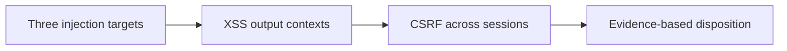

# Module 1 · Demo 1 — Validate injection, XSS and CSRF

<div align="center">


<sub>Illustrative architecture · Generated using ChatGPT; only live requests and reports prove findings</sub>

</div>

<!-- demo-navigation:start -->
<p align="center"><b>Student exercise · Demo 1 of 6</b></p>
<p align="center">
  <a href="../../../README.md"></a>
  <a href="https://github.com/rupeshtiwari/pluralsight-script-development-with-zap/blob/m1-demo2-before/demos/module1-demos/m1-demo2-javascript-http-sender/README.md"></a>
</p>
<!-- demo-navigation:end -->

## Your Scenario

You are reviewing a security scan for the Globomantics Store. A long alert list does not tell you which input is unsafe or whether a finding is reproducible. Your team needs a request, response and application effect it can investigate.

**Your practical goal:** I will guide you through one focused investigation. You will narrow SQL, MongoDB and command-injection checks, inspect XSS output contexts, test CSRF session ownership, and record evidence-backed dispositions.

## Your Learning Goals

You will follow a single investigation from selecting focused scan rules through checking actual application responses:

- Find where SQL, MongoDB and operating-system command inputs cross unsafe boundaries *(EO1a)*
- Validate reflected XSS using the output context and ZAP's injected request *(EO1b)*
- Test whether CSRF tokens protect the intended authenticated session *(EO1c)*

No separate course outline is required to complete this lab.

## Your Evidence Path



## Start Your Lab

This step starts the actual vulnerable Globomantics web application and ZAP container. The Mac prerequisite installer, `setup/setup-macos.sh`, is a **one-time preparation task** explained in the [course README](../../../README.md). You do not need to reinstall tools for every demo.

<details open>
<summary><b>Start Module 1 Demo 1 — exact branch, folder and runtime</b></summary>

**Where:** macOS Terminal or the VS Code integrated terminal, starting in the root of your existing local repository.

```bash
cd "$HOME/pluralsight-script-development-with-zap"
git fetch origin
git switch m1-demo1-before
cd demos/module1-demos/m1-demo1-targeted-injection-xss-csrf
./scripts/demo_reset.sh
```

**Expected startup:** the script waits for the local services. For a reset it prints a clean-slate message and brings up the vulnerable build. Continue only after it reports readiness; a failed startup is not part of the four teaching steps.

**Open these actual interfaces:** [Globomantics app — localhost:8000](http://localhost:8000/) · [ZAP GUI — localhost:8080/zap/](http://localhost:8080/zap/) · [ZAP API/proxy — localhost:8090](http://localhost:8090/). Open only the interface called for by the current step. Use VS Code with the source editor and integrated terminal for this lab. The script prints the real ZAP findings in the terminal.

</details>

## Your Four Steps

<details open>
<summary><b>Step 1: Run one targeted injection scan</b> — Three injection targets</summary>

### Learning Goal

The search, account and administrative endpoints reach three different execution boundaries; a generic alert total hides those differences.

**Learning focus:** Configure specialized SQL, NoSQL and command-injection checks *(EO1a)*

### Demo Workspace

**Open VS Code.** Use File → Open Folder to open the repository. In the editor open `runtime/app/main.py`. In the integrated Terminal, inspect the three prepared views by running `./scripts/show_code.sh sqli`, `./scripts/show_code.sh nosql` and `./scripts/show_code.sh cmd`. Keep source functions `search`, `account` and `admin_ping` accessible.

<!-- student-location:start -->
**Run in:** VS Code integrated Terminal.

```bash
cd "$HOME/pluralsight-script-development-with-zap/demos/module1-demos/m1-demo1-targeted-injection-xss-csrf"
```
<!-- student-location:end -->

### Run Command

**Where to type it:** the VS Code integrated Terminal, while your current directory is `demos/module1-demos/m1-demo1-targeted-injection-xss-csrf`.

```bash
./steps/01-run-targeted-injection-scan.sh
```

<!-- student-proof:start -->
**Where your result appears:** Stay in the same terminal for the scan table. Then open the browser at http://localhost:8080/zap/; select Alerts and each current SQL, MongoDB and command finding. Open its Request and Response views.

**Inspect this evidence:** Rule identity and the corresponding q, username or host parameter; capture the actual risk and confidence plus affected URL.
<!-- student-proof:end -->

### Expected Results

The table shows the actual **field names and expected type of evidence** produced by the existing script. These are examples, **not results claimed from your computer**. Rule IDs and stable parameter names come from the demo; variable risk, request IDs and counters must be read from your live output.

<table>
<thead><tr><th>Displayed field</th><th>Example or expected value</th><th>What to check</th></tr></thead>
<tbody>
<tr><td><b>Policy rules enabled</b></td><td><code>SQL-injection family + NoSQL 40033 + command 90020/90037</code></td><td>Confirm the policy is focused</td></tr>
<tr><td><b>SQL injection · /search (q)</b></td><td><code>alert 40018 or 40022 · &lt;live risk&gt;/&lt;live confidence&gt;</code></td><td>Correlate the SQL alert with q</td></tr>
<tr><td><b>NoSQL injection · /api/account (username)</b></td><td><code>alert 40033 · &lt;live risk&gt;/&lt;live confidence&gt;</code></td><td>Correlate NoSQL with username</td></tr>
<tr><td><b>Command injection · /admin/ping (host)</b></td><td><code>alert 90020 or 90037 · &lt;live risk&gt;/&lt;live confidence&gt;</code></td><td>Correlate OS command with host</td></tr>
<tr><td><b>Result</b></td><td><code>✔ PASS targeted scan raised all three injection alerts</code></td><td>Only pass with three actual findings</td></tr>
</tbody></table>

**Do not continue on FAIL.** Read the command's diagnostic text and verify the right branch, app state, and script source instead of claiming an alert appeared.

### Interpret Results

Three different request parameters are now associated with targeted ZAP findings. The risk/confidence fields report the current engine's result; the mere presence of an alert is not yet a defensible confirmation of all three defects.

**How this connects:** Now validate the page-output context rather than treating every reflected input as XSS.

</details>

<details>
<summary><b>Step 2: Validate reflected XSS in the correct context</b> — XSS output contexts</summary>

### Learning Goal

The `name` input appears in an HTML element, an attribute and a JavaScript string. The right test changes with the output context.

**Learning focus:** Test context-specific reflected XSS *(EO1b)*

### Demo Workspace

**Remain in VS Code.** Open `runtime/app/main.py` at the `greet` endpoint (approximately lines 257–277). In its integrated Terminal run `./scripts/show_code.sh xss` to see the source fragment.

<!-- student-location:start -->
**Run in:** VS Code integrated Terminal.

```bash
cd "$HOME/pluralsight-script-development-with-zap/demos/module1-demos/m1-demo1-targeted-injection-xss-csrf"
```
<!-- student-location:end -->

### Run Command

**Where to type it:** the same VS Code integrated Terminal, while your current directory is `demos/module1-demos/m1-demo1-targeted-injection-xss-csrf`.

```bash
./steps/02-verify-reflected-xss-contexts.sh
```

<!-- student-proof:start -->
**Where your result appears:** After the terminal context check, switch to http://localhost:8080/zap/; select History, the matching /greet request, then Request and Response. Match the injected name value to the output context.

**Inspect this evidence:** Exact injected payload, name parameter and reflected response; do not call reflection browser execution.
<!-- student-proof:end -->

### Expected Results

The table shows the actual **field names and expected type of evidence** produced by the existing script. These are examples, **not results claimed from your computer**. Rule IDs and stable parameter names come from the demo; variable risk, request IDs and counters must be read from your live output.

<table>
<thead><tr><th>Displayed field</th><th>Example or expected value</th><th>What to check</th></tr></thead>
<tbody>
<tr><td><b>HTML body</b></td><td><code>&lt;p&gt;Hello zzMARKzz</code></td><td>Inspect the body sink</td></tr>
<tr><td><b>HTML attribute</b></td><td><code>value="zzMARKzz"</code></td><td>Inspect the quoted attribute sink</td></tr>
<tr><td><b>JavaScript string</b></td><td><code>var greeting = "zzMARKzz"</code></td><td>Inspect the JavaScript string sink</td></tr>
<tr><td><b>Alert</b></td><td><code>Cross Site Scripting (Reflected)</code></td><td>Look for the named ZAP alert</td></tr>
<tr><td><b>Affected parameter</b></td><td><code>name</code></td><td>Confirm the input</td></tr>
<tr><td><b>Payload ZAP injected</b></td><td><code>&lt;actual injected payload&gt;</code></td><td>Use the real payload from this run</td></tr>
<tr><td><b>Result</b></td><td><code>✔ PASS ZAP confirmed reflected XSS on name</code></td><td>A real payload and reflected evidence are required</td></tr>
</tbody></table>

**Do not continue on FAIL.** Read the command's diagnostic text and verify the right branch, app state, and script source instead of claiming an alert appeared.

### Interpret Results

The first three lines map the input to three output contexts. ZAP then attempts a context-specific payload and reports the affected parameter and evidence; raw reflection alone is not proof of executable script in a browser.

**How this connects:** Next, move from output encoding to a state-changing request that depends on CSRF session ownership.

</details>

<details>
<summary><b>Step 3: Replay a CSRF token across two sessions</b> — CSRF across sessions</summary>

### Learning Goal

A token check can exist yet fail if the server accepts a token from one person's session with another person's cookie.

**Learning focus:** Exercise CSRF bypass conditions in the email-change workflow *(EO1c)*

### Demo Workspace

**Remain in VS Code.** Open `runtime/app/main.py` at `change_email` and the token-issuing helper. In the integrated Terminal run `./scripts/show_code.sh csrf` before running the security step.

<!-- student-location:start -->
**Run in:** VS Code integrated Terminal.

```bash
cd "$HOME/pluralsight-script-development-with-zap/demos/module1-demos/m1-demo1-targeted-injection-xss-csrf"
```
<!-- student-location:end -->

### Run Command

**Where to type it:** the VS Code integrated Terminal, while your current directory is `demos/module1-demos/m1-demo1-targeted-injection-xss-csrf`.

```bash
./steps/03-test-cross-session-csrf-token.sh
```

<!-- student-proof:start -->
**Where your result appears:** Stay in the same terminal. Keep the valid-token control, missing-token control, cross-session request and before/after email rows visible together. The browser form at http://localhost:8000/account/email is context, not proof of the shell session.

**Inspect this evidence:** Actual HTTP states and account email mutation from the same test; explain session ownership rather than claiming a single-use-token test.
<!-- student-proof:end -->

### Expected Results

The table shows the actual **field names and expected type of evidence** produced by the existing script. These are examples, **not results claimed from your computer**. Rule IDs and stable parameter names come from the demo; variable risk, request IDs and counters must be read from your live output.

<table>
<thead><tr><th>Displayed field</th><th>Example or expected value</th><th>What to check</th></tr></thead>
<tbody>
<tr><td><b>Valid token, session B</b></td><td><code>200</code></td><td>Legitimate control accepted</td></tr>
<tr><td><b>Missing token</b></td><td><code>403</code></td><td>Missing-token control rejected</td></tr>
<tr><td><b>Before cross-session request</b></td><td><code>alice@globomantics.example</code></td><td>Check actual stored state</td></tr>
<tr><td><b>Session A token with B cookie</b></td><td><code>200 (should be rejected)</code></td><td>Spot the cross-session bypass</td></tr>
<tr><td><b>After cross-session request</b></td><td><code>attacker@evil.example</code></td><td>State actually changed</td></tr>
<tr><td><b>Result</b></td><td><code>✔ PASS token was accepted across sessions</code></td><td>Proof requires status AND changed email</td></tr>
</tbody></table>

**Do not continue on FAIL.** Read the command's diagnostic text and verify the right branch, app state, and script source instead of claiming an alert appeared.

### Interpret Results

Controls show the application is checking for a token. The cross-session request nevertheless succeeds and changes the victim's stored email, showing the token is not adequately associated with its issuing session.

**How this connects:** The final step reconciles these observations with the alerts and records an actionable disposition.

</details>

<details>
<summary><b>Step 4: Reconcile the findings with application behavior</b> — Evidence-based disposition</summary>

### Learning Goal

The team must not ship an alert list that lacks reproducible evidence for each stated vulnerability.

**Learning focus:** Apply the three security checks to a final engineering disposition *(EO1a · EO1b · EO1c)*

### Demo Workspace

**Use VS Code with integrated Terminal.** Keep `runtime/app/main.py` open. Read the student disposition template at `docs/alert-disposition-template.md` from the repository root. Return to the demo Terminal before running the step.

<!-- student-location:start -->
**Run in:** VS Code integrated Terminal.

```bash
cd "$HOME/pluralsight-script-development-with-zap/demos/module1-demos/m1-demo1-targeted-injection-xss-csrf"
```
<!-- student-location:end -->

### Run Command

**Where to type it:** the VS Code integrated Terminal, while your current directory is `demos/module1-demos/m1-demo1-targeted-injection-xss-csrf`.

```bash
./steps/04-reconcile-security-alerts.sh
```

<!-- student-proof:start -->
**Where your result appears:** Stay in the same terminal for the disposition rows. Use http://localhost:8080/zap/ Alerts and the corresponding Request/Response to corroborate the current finding; open docs/alert-disposition-template.md in VS Code to record the reviewed decision.

**Inspect this evidence:** Database error, changed account count, harmless injected shell marker and XSS request/response; normal ping is not injection proof.
<!-- student-proof:end -->

### Expected Results

The table shows the actual **field names and expected type of evidence** produced by the existing script. These are examples, **not results claimed from your computer**. Rule IDs and stable parameter names come from the demo; variable risk, request IDs and counters must be read from your live output.

<table>
<thead><tr><th>Displayed field</th><th>Example or expected value</th><th>What to check</th></tr></thead>
<tbody>
<tr><td><b>SQL injection 40018 · /search</b></td><td><code>confirmed — DB error: &lt;actual SQL error&gt;</code></td><td>Request/response supports SQL issue</td></tr>
<tr><td><b>NoSQL injection 40033 · /api/account</b></td><td><code>confirmed — accounts &lt;before&gt; → &lt;after&gt;</code></td><td>Operator injection affects record count</td></tr>
<tr><td><b>Command injection 90020/90037 · /admin/ping</b></td><td><code>injected shell marker: ZAP_CMD_PROOF (only when observed)</code></td><td>Also inspect the injected host request; a normal ping is insufficient</td></tr>
<tr><td><b>XSS reflected · /greet</b></td><td><code>confirmed — unencoded reflection</code></td><td>Confirm actual injected payload and response evidence</td></tr>
<tr><td><b>Result</b></td><td><code>✔ PASS all four findings reconciled with app behavior</code></td><td>Check the evidence before disposition</td></tr>
</tbody></table>

**Do not continue on FAIL.** Read the command's diagnostic text and verify the right branch, app state, and script source instead of claiming an alert appeared.

### Interpret Results

A raw rule ID is a lead; its actual request and application effect support the engineer's final decision. Do not use routine ping output alone as proof of shell-command injection.

**How this connects:** The investigation closes with documented findings that can be reviewed rather than mere scanner severity labels.

</details>

<!-- student-achievement:start -->
## What You Achieved

After completing the four checks and inspecting the required evidence, you can explain which input crosses each unsafe boundary. You can distinguish an alert from confirmation, show the token/session failure, and support a disposition with the actual request and response.

**Your final check:** Explain the result using your own captured evidence. A README example, missing result or earlier run does not satisfy this exercise.
<!-- student-achievement:end -->

## Finish Your Lab

After Step 4, you should be able to explain why a rule or alert deserves a confirmed disposition from real evidence rather than only recalling a command.

**Stop the demo's containers** from the same demo directory:

```bash
./scripts/demo_down.sh
```

To inspect the finished example, switch to `m1-demo1-after` **after preserving any exercise changes**. Compare without modifying files using `git diff m1-demo1-before..m1-demo1-after -- demos/module1-demos/m1-demo1-targeted-injection-xss-csrf`. For operational-only demos, the important difference may be live scan evidence rather than source code.

<!-- demo-navigation:start -->
<p align="center"><b>Student exercise · Demo 1 of 6</b></p>
<p align="center">
  <a href="../../../README.md"></a>
  <a href="https://github.com/rupeshtiwari/pluralsight-script-development-with-zap/blob/m1-demo2-before/demos/module1-demos/m1-demo2-javascript-http-sender/README.md"></a>
</p>
<!-- demo-navigation:end -->

[← Module 1 demo catalog](../README.md) · [← Course home](../../../README.md)

