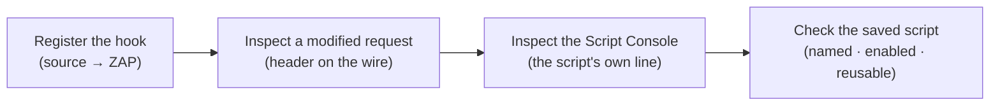

# Module 1 · Demo 2, Extend ZAP with JavaScript

> ⚡ **Run from anywhere (shortcut).** You keep landing at the repo root, which is fine: the `./lab` helper there picks THIS demo from your branch, so you never fight directories.
>
> ```bash
> cd "$HOME/pluralsight-script-development-with-zap"   # the repo root (where ./lab lives)
> ./lab up      # start the lab (first time; waits until ready)
> ./lab run load-javascript-http-sender   # run the first check (use the matching script name below)
> ./lab down    # stop the lab when you are done
> ```
>
> The walk-through below shows each command as `./steps/0N-...sh` (run inside the demo folder); `./lab run <name>` runs that same step from the repo root (it cd’s into the demo folder for you).
>
> 🧪 **Self-test before you start.** `preflight-check` runs every step and confirms each one works and prints the expected output, so you can fix any setup issue before you begin.
> ```bash
> ./preflight-check --m1d2      # just this demo
> ./preflight-check             # or the whole course, every demo in order
> ```


<div align="center">


<sub>Illustrative architecture · Generated using ChatGPT; only live requests and reports prove findings</sub>

</div>

<!-- demo-navigation:start -->
<p align="center"><b>Student exercise · Demo 2 of 6</b></p>
<p align="center">
  <a href="https://github.com/rupeshtiwari/pluralsight-script-development-with-zap/blob/m1-demo1-before/demos/module1-demos/m1-demo1-targeted-injection-xss-csrf/README.md"></a>
  <a href="https://github.com/rupeshtiwari/pluralsight-script-development-with-zap/blob/m1-demo3-before/demos/module1-demos/m1-demo3-python-scanning-authentication/README.md"></a>
</p>
<!-- demo-navigation:end -->

## Your scenario

Globomantics wants every request your security tests send to be identifiable, so that when traffic shows up in a log, the team can tell *authorized ZAP testing* apart from a real user and apart from an actual attacker. The obvious instinct is to write a script. But here is the trap I want you to feel in this demo: a JavaScript file sitting in the repository proves *nothing*. It has not run. It has not touched a single request. A saved file and a working extension are two completely different claims.

So you and I are going to earn the second claim. You will write a ZAP HTTP Sender script that stamps a marker header onto every outgoing message, and then we will refuse to believe it until we have seen three independent pieces of evidence: the header on a request ZAP actually sent, the script's own diagnostic line in ZAP's live Script Console, and the enabled registration that Module 2's automation will later call by name. The script's source is open in front of you the whole time, because the point is to understand *where in ZAP's message lifecycle your code runs*, not to copy a file.

## Your learning goals

You will extend ZAP at a real message hook and then verify it by observable effects:

1. Write and register an HTTP Sender JavaScript script in ZAP *(EO2a)*
2. Prove the outgoing header, live console output and enabled registration of that same script *(EO2a)*

No separate course outline is required, each step states what you are checking and why.

## Your evidence path



Each step is a *different* kind of proof. Registration is identity, the header is behavior, the console line is the script reporting its own work, and the saved registration is reuse. Together they close every gap between "a file exists" and "my code runs on real traffic."

## Start your lab

The Mac prerequisite installer, `setup/setup-macos.sh`, is a **one-time** preparation task explained in the [course README](../../../README.md). Each demo then starts its **own** local stack.

<details open>
<summary><b>Open the exact branch, folder and runtime for Module 1 Demo 2</b></summary>

**Where:** the VS Code integrated Terminal, starting in the root of your existing local repository.

```bash
cd "$HOME/pluralsight-script-development-with-zap"
git fetch origin
git switch m1-demo2-before
(cd demos/module1-demos/m1-demo2-javascript-http-sender && ./scripts/lab-up.sh)
```

**Expected start:** the startup script brings up the Globomantics app and ZAP and reports readiness. Continue only after it does, a failed startup must be fixed before starting the numbered steps.

**Interfaces:** <a href="http://localhost:8000/" target="_blank" rel="noopener">Globomantics app, localhost:8000</a> · <a href="http://localhost:8080/zap/" target="_blank" rel="noopener">ZAP GUI, localhost:8080/zap/</a> · <a href="http://localhost:8090/" target="_blank" rel="noopener">ZAP API/proxy, localhost:8090</a>. You author the script in **VS Code** (`zap-scripts/globomantics-marker.js`) and inspect its effects in **ZAP's browser GUI** (History and Script Console). The `-before` branch deliberately ships without the finished JavaScript, create it from the example before expecting the verification steps to pass.

</details>

## Your steps

<!-- learner-command-steps:start -->

Follow one numbered action set at a time. Opening the terminal, pasting a command and pressing Enter belong to the same step. Reading its source and interpreting its result stay with that step. Script filenames retain their stable 01–04 identifiers. Check numbers printed by the scripts identify those underlying lab checks, not the parent step numbers below. The numbered walkthrough steps also include entering the folder, reference copies and reruns where needed.

| Step | Action |
|---|---|
| [Step 1](#step-1) | directory change command |
| [Step 2](#step-2) | load javascript http sender script |
| [Step 3](#step-3) | reference copy command |
| [Step 4](#step-4) | load javascript http sender script |
| [Step 5](#step-5) | prove outbound marker header script |
| [Step 6](#step-6) | live script console |
| [Step 7](#step-7) | enabled script registration |

<a id="step-1"></a>

## Step 1: directory change command

[All steps](#your-steps) · [Next step 2 →](#step-2)

1. Open the VS Code integrated Terminal at the repository root after the lab setup above.
2. Paste this command and press Enter.

```bash
cd demos/module1-demos/m1-demo2-javascript-http-sender
```

Confirm the returned prompt is inside `demos/module1-demos/m1-demo2-javascript-http-sender` before running the first check. Stop if the directory change fails. This folder entry is Step 1; pasting and executing each later command is one new step, with its teaching and results kept together.

[All steps](#your-steps) · [Next step 2 →](#step-2)

<a id="step-2"></a>

## Step 2: load javascript http sender script

[← Previous step 1](#step-1) · [All steps](#your-steps) · [Next step 3 →](#step-3)

<details>
<summary><b>Teaching, command and result</b></summary>

### What you are learning

Why a verification step cannot pass before the file exists, and what the non-alarming author gate looks like. *(EO2a)*

### Run it. The first run stops on purpose.

Do this in the **VS Code integrated Terminal**:

```bash
./steps/01-load-javascript-http-sender.sh
```

It stops with a **yellow `✍️ AUTHOR THIS FIRST`** message (not red, not an error): on the `m1-demo2-before` branch `zap-scripts/globomantics-marker.js` does not exist yet, `zap-scripts/` holds only a `.gitkeep`. That yellow gate is the cue to author the file, which is the whole point of this exercise.

**Next:** bring the finished file in with one command.

</details>

[← Previous step 1](#step-1) · [All steps](#your-steps) · [Next step 3 →](#step-3)

<a id="step-3"></a>

## Step 3: reference copy command

[← Previous step 2](#step-2) · [All steps](#your-steps) · [Next step 4 →](#step-4)

<details>
<summary><b>Teaching, command and result</b></summary>

### What you are learning

The exercise is to understand the script, not to type it from memory, so in one step you copy the finished file in and then read it. Where in ZAP's message lifecycle your code runs, read straight from the source, that understanding *is* the objective. *(EO2a)*

### Part A, in the VS Code terminal: copy the script in with one command

Copy-paste this exactly. It copies the finished script into your working folder from the completed branch, verifies the file is there, and prints a success line. You **stay on the `-before` branch**, there is no branch switch:

```bash
(cd "$(git rev-parse --show-toplevel)" && git show origin/m1-demo2-after:demos/module1-demos/m1-demo2-javascript-http-sender/zap-scripts/globomantics-marker.js > demos/module1-demos/m1-demo2-javascript-http-sender/zap-scripts/globomantics-marker.js && test -s demos/module1-demos/m1-demo2-javascript-http-sender/zap-scripts/globomantics-marker.js && echo "Script copied: zap-scripts/globomantics-marker.js" || { echo "Copy failed: zap-scripts/globomantics-marker.js is missing or empty"; false; })
```

**Confirm the copy worked.** The terminal prints exactly:

```text
Script copied: zap-scripts/globomantics-marker.js
```

If instead you see `Copy failed: …`, the file did not arrive, re-run the command before continuing; do not move on until you see the success line. The `zap-scripts/` folder is mounted into the ZAP container, so the file you just brought in is exactly what `./steps/01` loads in Step 4.

### Part B, in the VS Code editor: open the file and read what each part does

> [!IMPORTANT]
> **The code shown below is file content, not terminal output. Do not paste this JavaScript into the terminal. The script has not been loaded into ZAP yet.** You run the copy command above in the terminal; you read the code below in the editor.

Open `zap-scripts/globomantics-marker.js` in VS Code and read it:

```javascript
// Globomantics HTTP Sender script (GraalVM JavaScript).
// ZAP runs this for every message it sends. It marks each outbound request
// with a fixed header and prints a named line to the Script Console, so a
// later Automation Framework run can call this same saved script.
// Authorized use only: exercised against the local Globomantics training app.

var MARKER_HEADER = "X-Globomantics-Marker";
var MARKER_VALUE  = "GLOBO-DEMO";
var CONSOLE_TAG   = "[globo-marker]";

var ScriptVars = Java.type("org.zaproxy.zap.extension.script.ScriptVars");

// Called just before ZAP sends a request.
function sendingRequest(msg, initiator, helper) {
    msg.getRequestHeader().setHeader(MARKER_HEADER, MARKER_VALUE);
    var line = CONSOLE_TAG + " added " + MARKER_HEADER + ": " + MARKER_VALUE +
               " to " + msg.getRequestHeader().getURI().toString();
    print(line);
    // Keep the exact line ZAP printed, so it can be read back through the API.
    ScriptVars.setGlobalVar("globo.marker.lastLine", line);
}

// Called when ZAP receives a response. This demo only marks outbound requests.
function responseReceived(msg, initiator, helper) {
}
```

### What we examine, and why

Read the parts that make it an HTTP Sender script, not just any JavaScript:

- **`sendingRequest(msg, initiator, helper)`**, this is the hook. ZAP calls it for *every message it is about to send*, which is exactly the moment to stamp a header. (There is a matching `responseReceived` for the other direction.) Understanding that the function name *is* the contract with ZAP is the whole lesson of the step.
- **`MARKER_HEADER` / `MARKER_VALUE`**, the constants `X-Globomantics-Marker` and `GLOBO-DEMO`, kept at the top so the marker is one obvious thing to change.
- **`msg.getRequestHeader().setHeader(...)`**, the line that actually mutates the outgoing request. Reading this is how you know the script *changes* traffic rather than just observing it.
- **`print(...)` and `ScriptVars`**, the script writes its own line to the Script Console and stashes it in a global so Step 6 can read it back from ZAP.

Loading this file registers it with ZAP's **Graal.js** engine as an `httpsender` action. Registration means ZAP knows the script and will call `sendingRequest`, but it has not called it yet.

**Next:** run the step again, and this time it passes.

</details>

[← Previous step 2](#step-2) · [All steps](#your-steps) · [Next step 4 →](#step-4)

<a id="step-4"></a>

## Step 4: load javascript http sender script

[← Previous step 3](#step-3) · [All steps](#your-steps) · [Next step 5 →](#step-5)

<details>
<summary><b>Teaching, command and result</b></summary>

### What you are learning

Register the JavaScript HTTP Sender hook, and understand why the file is only now an extension ZAP will call on outgoing messages. *(EO2a)*

**Predict before you run:** you expect ZAP to list `globomantics-marker` as type `httpsender`, engine `Graal.js`, enabled `true`, loaded from `/zap-scripts/globomantics-marker.js`. Note what you do **not** yet have: a request that carried it.

### Run the SAME command again. Now it passes.

```bash
./steps/01-load-javascript-http-sender.sh
```

Then open <a href="http://localhost:8080/zap/" target="_blank" rel="noopener">ZAP, localhost:8080/zap/</a> → **Scripts → HTTP Sender → globomantics-marker** and read its name, engine and enabled state.

### Expected result (the exact terminal output, verified in the lab)

Your terminal prints exactly this. Every value is the real captured output, verified in the lab and identical on every machine (only ZAP's randomised payload casing and run-specific IDs can vary):

```text
✔ PASS  script is a valid HTTP Sender action and registered in ZAP
```

| OBSERVED FIELD | ACTUAL VALUE |
|---|---|
| Saved source file | `zap-scripts/globomantics-marker.js  (sha256 e6edb39b8faa)` |
| sendingRequest() adds | `X-Globomantics-Marker: GLOBO-DEMO` |
| Registered in ZAP | `globomantics-marker · type httpsender · engine Graal.js · enabled true` |
| Source | `loaded from /zap-scripts/globomantics-marker.js` |

### Investigate, then decide

Match the registered `httpsender` type to the `sendingRequest` hook you read in the source, that is why ZAP will call it on outgoing messages. The decision: *the script is loaded and enabled, so it is ready, but "ready" is a promise, not evidence.* You have earned exactly one claim so far: identity.

**On FAIL:** the diagnostic names the gap, a syntax error, the wrong hook name, or an unloaded file. Fix the source rather than asserting it registered.

**Next:** force ZAP to send a request and prove the hook actually fired.

</details>

[← Previous step 3](#step-3) · [All steps](#your-steps) · [Next step 5 →](#step-5)

<a id="step-5"></a>

## Step 5: prove outbound marker header script

[← Previous step 4](#step-4) · [All steps](#your-steps) · [Next step 6 →](#step-6)

<details>
<summary><b>Teaching, command and result</b></summary>

### What you are learning

Confirm the hook ran by finding its header on a request ZAP actually sent, not by trusting that it loaded. *(EO2a)*

### What we examine, and why

This step sends a fresh request through ZAP and then reads the *outbound* message back. The thing to examine is the request line and its headers: a new `GET /greet?name=marker-<id>` carrying `X-Globomantics-Marker: GLOBO-DEMO`. The `marker-<id>` is unique per run on purpose, it guarantees you are looking at *this* request, not a stale one left in History, which is the single most common way people fool themselves here.

Why does this matter more than loading it? Because registration and execution fail independently. A script can be enabled and still never fire (wrong initiator, disabled mid-session, an exception swallowed). The header on the wire is the first evidence that `sendingRequest` truly ran.

**Predict before you run:** you expect a brand-new `/greet?name=marker-<id>` request whose headers include `X-Globomantics-Marker: GLOBO-DEMO`. If the header is missing, the hook did not run on this message, a different problem from "it didn't load."

### Run command

**Where:** the VS Code integrated Terminal, in the same demo folder.

```bash
./steps/02-prove-outbound-marker-header.sh
```

Then open <a href="http://localhost:8080/zap/" target="_blank" rel="noopener">ZAP, localhost:8080/zap/</a> → **History**, select the newest `/greet?name=marker-…` request, and read its **Request** panel so you see the header on the message ZAP sent.

### Expected result (the exact terminal output, verified in the lab)

Your terminal prints exactly this. Every value is the real captured output, verified in the lab and identical on every machine (only ZAP's randomised payload casing and run-specific IDs can vary):

```text
✔ PASS  the script added X-Globomantics-Marker to the outbound request
```

| OBSERVED FIELD | ACTUAL VALUE |
|---|---|
| Outbound request | `GET http://app:8000/greet?name=marker-<unique per run> HTTP/1.1` |
| Header added by the script | `X-Globomantics-Marker: GLOBO-DEMO` |

### Investigate, then decide

Confirm the `marker-<id>` in ZAP's History matches the one the terminal reported, same request, not a lookalike. The decision: *the hook executes on live traffic.* You now hold a second, stronger claim: behavior, not just identity.

**On FAIL:** a missing header means the hook did not run on this request. Check it is enabled and that the request went through ZAP's proxy, do not claim a modification you cannot see.

**Next:** have the script tell you, in its own words, what it did, and read that in ZAP's Script Console.

</details>

[← Previous step 4](#step-4) · [All steps](#your-steps) · [Next step 6 →](#step-6)

<a id="step-6"></a>

## Step 6: live script console

[← Previous step 5](#step-5) · [All steps](#your-steps) · [Next step 7 →](#step-7)

<details>
<summary><b>Teaching, command and result</b></summary>

### What you are learning

Read the diagnostic line the script prints, from ZAP's live Script Console, and understand why a predicted string in the terminal is not the same as console proof. *(EO2a)*

### What we examine, and why

A good automation script reports what it did. This one calls `print(...)` inside `sendingRequest`, so every marked request leaves a line like `[globo-marker] added X-Globomantics-Marker: GLOBO-DEMO to <url>` in ZAP's **Script Console**. The step reads that line *back from ZAP* for the request it just triggered.

Here is the discipline I want you to keep: the terminal can happily print the *expected* format, that proves nothing, it is just a string. The evidence is the line that appears in ZAP's own Script Console, carrying *this run's* request URL. Trusting the terminal's expected line instead of the console is exactly the kind of self-deception this course trains you out of.

**Predict before you run:** you expect a fresh `[globo-marker] … to …/greet?name=marker-<id>` line in the Script Console whose URL matches the request from this run. An empty console, or a line from an older request, is not a pass.

### Run command

**Where:** the VS Code integrated Terminal, in the same demo folder.

```bash
./steps/03-check-live-script-console.sh
```

Then switch to <a href="http://localhost:8080/zap/" target="_blank" rel="noopener">ZAP, localhost:8080/zap/</a> → **Scripts → Script Console** and find the fresh line whose request URL matches this run.

### Expected result (the exact terminal output, verified in the lab)

Your terminal prints exactly this. Every value is the real captured output, verified in the lab and identical on every machine (only ZAP's randomised payload casing and run-specific IDs can vary):

```text
✔ PASS  the script printed its named line for this request; the same line is in ZAP's Script Console
```

| OBSERVED FIELD | ACTUAL VALUE |
|---|---|
| Request that triggered the script | `GET http://app:8000/greet?name=marker-<unique per run> HTTP/1.1` |
| Line the script printed (read back from ZAP) | `[globo-marker] added X-Globomantics-Marker: GLOBO-DEMO to http://app:8000/greet?name=marker-<unique per run>` |

### Investigate, then decide

Line the console URL up with the `marker-<id>` from Step 5, same request, reported by the script itself. The decision: *the script observably executed and reported its own work*, which is what makes it trustworthy to reuse. Never let the terminal's expected-format line stand in for the live console.

**On FAIL:** no fresh console line means the print did not run or you are reading an old line. Re-trigger and read the console, rather than accepting the terminal's expected string.

**Next:** confirm the script is saved and enabled under a stable name, so Module 2's automation can call it.

</details>

[← Previous step 5](#step-5) · [All steps](#your-steps) · [Next step 7 →](#step-7)

<a id="step-7"></a>

## Step 7: enabled script registration

[← Previous step 6](#step-6) · [All steps](#your-steps)

<details>
<summary><b>Teaching, command and result</b></summary>

### What you are learning

Confirm the script's stable name, type, engine and enabled state, the identity the Automation Framework will reuse by name in Module 2. *(EO2a)*

### What we examine, and why

Reusable automation does not point at a file path and hope; it calls a *registered, named* script. This step reads back the registration ZAP holds, `globomantics-marker`, type `httpsender`, engine `Graal.js`, enabled `true`, sourced from `/zap-scripts/globomantics-marker.js`, and shows the exact script-job identity Module 2's Automation Framework plan will use. The reason to look now is forward-looking: in Module 2 Demo 1 a plan will say `name: globomantics-marker`, and it only works because that name resolves to this enabled script.

**Predict before you run:** you expect `globomantics-marker · httpsender · Graal.js · enabled true`, and the Module-2 reuse line naming the same script. This is a session-scoped registration, not a claim that it survives destroying the container.

### Run command

**Where:** the VS Code integrated Terminal, in the same demo folder.

```bash
./steps/04-verify-enabled-script-registration.sh
```

Then open <a href="http://localhost:8080/zap/" target="_blank" rel="noopener">ZAP, localhost:8080/zap/</a> → **Scripts → HTTP Sender → globomantics-marker** and read its name, type and engine from the same live session.

### Expected result (the exact terminal output, verified in the lab)

Your terminal prints exactly this. Every value is the real captured output, verified in the lab and identical on every machine (only ZAP's randomised payload casing and run-specific IDs can vary):

```text
✔ PASS  script saved and registered as an enabled HTTP Sender, ready for the Automation Framework
```

| OBSERVED FIELD | ACTUAL VALUE |
|---|---|
| Registered name | `globomantics-marker` |
| Type · engine · enabled | `httpsender · Graal.js · true` |
| Saved file | `/zap-scripts/globomantics-marker.js in ZAP = zap-scripts/globomantics-marker.js in the demo folder (sha256 e6edb39b8faa)` |
| name | `globomantics-marker · type: httpsender · engine: Graal.js · source: /zap-scripts/globomantics-marker.js` |

### Investigate, then decide

Confirm the name and type match what the Module-2 reuse line expects. The decision: *the extension is reusable by name*, the final gap between "a working script in this session" and "a building block the pipeline calls" is closed.

**On FAIL:** a wrong name or disabled state breaks Module 2's plan. Fix the registration now rather than discovering it two demos later.

**Next:** you have source, a modified request, a live console line, and a reusable registration, four independent proofs that your code runs.

</details>

[← Previous step 6](#step-6) · [All steps](#your-steps)

<!-- learner-command-steps:end -->

<!-- student-achievement:start -->
## What you achieved

You can now explain each learning objective with the evidence you captured:

1. **(EO2a) You extended ZAP at the HTTP Sender hook.** You authored `globomantics-marker.js` around `sendingRequest`, and ZAP registered it as type `httpsender` on the `Graal.js` engine, enabled.
2. **(EO2a) You proved the script changed real traffic, three independent ways.** The header `X-Globomantics-Marker: GLOBO-DEMO` appeared on a ZAP-sent `/greet?name=marker-…` request, the live Script Console printed the fresh `[globo-marker] …` line the script wrote for that request, and the enabled registration was confirmed by name for Module 2 to reuse.

**How to apply it:** this is the pattern for any custom ZAP behavior, hook the right lifecycle point, then prove execution on the wire and in the console before you trust it in a pipeline. "The file is saved" is never the finish line.

**Your final check:** explain each numbered outcome using *your own* captured evidence from this run. A README example, a missing result, or an earlier run does not satisfy this exercise.
<!-- student-achievement:end -->

## Finish your lab

After Step 7 you should be able to explain how the JavaScript hook changed a real proxied request, from the header, the console line and the registration, not from recalling a command.

Stop the demo's containers from the same demo directory:

```bash
cd "$HOME/pluralsight-script-development-with-zap/demos/module1-demos/m1-demo2-javascript-http-sender"
./scripts/lab-down.sh
```

The `m1-demo2-after` branch holds the completed reference, including the finished `globomantics-marker.js`. Preserve your changes first, then compare without modifying files: `git diff m1-demo2-before..m1-demo2-after -- demos/module1-demos/m1-demo2-javascript-http-sender`.

<!-- demo-navigation:start -->
<p align="center"><b>Student exercise · Demo 2 of 6</b></p>
<p align="center">
  <a href="https://github.com/rupeshtiwari/pluralsight-script-development-with-zap/blob/m1-demo1-before/demos/module1-demos/m1-demo1-targeted-injection-xss-csrf/README.md"></a>
  <a href="https://github.com/rupeshtiwari/pluralsight-script-development-with-zap/blob/m1-demo3-before/demos/module1-demos/m1-demo3-python-scanning-authentication/README.md"></a>
</p>
<!-- demo-navigation:end -->

[← Module 1 demo catalog](../README.md) · [← Course home](../../../README.md)
