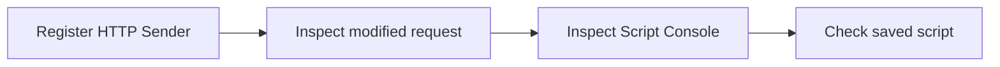

# Module 1 · Demo 2 — Extend ZAP with JavaScript

<div align="center">


<sub>Illustrative architecture · Generated using ChatGPT; only live requests and reports prove findings</sub>

</div>

<!-- demo-navigation:start -->
<p align="center"><b>Student exercise · Demo 2 of 6</b></p>
<p align="center">
  <a href="https://github.com/rupeshtiwari/pluralsight-script-development-with-zap/blob/m1-demo1-before/demos/module1-demos/m1-demo1-targeted-injection-xss-csrf/README.md"></a>
  <a href="https://github.com/rupeshtiwari/pluralsight-script-development-with-zap/blob/m1-demo3-before/demos/module1-demos/m1-demo3-python-scanning-authentication/README.md"></a>
</p>
<!-- demo-navigation:end -->

## Your Scenario

You need to distinguish authorized security-test traffic from normal Store requests. Saving a JavaScript file does not prove ZAP modified a message. You must show the hook, the outgoing header and its live diagnostic line.

**Your practical goal:** I will guide you from the HTTP Sender template to a reusable request marker. You will write and register the hook, inspect a modified request, verify the live Script Console output, and confirm the enabled script identity.

## Your Learning Goals

You will extend ZAP through a real message hook and then verify it with observable effects:

- Write and register an HTTP Sender JavaScript script in ZAP *(EO2a)*
- Prove the outgoing header, live console output and enabled registration of that same script *(EO2a)*

No separate course outline is required to complete this lab.

## Your Evidence Path



## Start Your Lab

This step starts the actual vulnerable Globomantics web application and ZAP container. The Mac prerequisite installer, `setup/setup-macos.sh`, is a **one-time preparation task** explained in the [course README](../../../README.md). You do not need to reinstall tools for every demo.

<details open>
<summary><b>Start Module 1 Demo 2 — exact branch, folder and runtime</b></summary>

**Where:** macOS Terminal or the VS Code integrated terminal, starting in the root of your existing local repository.

```bash
cd "$HOME/pluralsight-script-development-with-zap"
git fetch origin
git switch m1-demo2-before
cd demos/module1-demos/m1-demo2-javascript-http-sender
./scripts/demo_up.sh
```

**Expected startup:** the script waits for the local services. For a reset it prints a clean-slate message and brings up the vulnerable build. Continue only after it reports readiness; a failed startup is not part of the four teaching steps.

**Open these actual interfaces:** [Globomantics app — localhost:8000](http://localhost:8000/) · [ZAP GUI — localhost:8080/zap/](http://localhost:8080/zap/) · [ZAP API/proxy — localhost:8090](http://localhost:8090/). Open only the interface called for by the current step. Use VS Code to author the script and ZAP's browser GUI to inspect its History and Script Console. The starter branch intentionally lacks the completed JavaScript; create it following the script example before expecting the verification commands to pass.

</details>

## Your Four Steps

<details open>
<summary><b>Step 1: Load the JavaScript HTTP Sender script</b> — Register HTTP Sender</summary>

### Learning Goal

A JavaScript file cannot modify traffic merely by existing in the repository.

**Learning focus:** Develop a JavaScript extension at the request-sending boundary *(EO2a)*

### Demo Workspace

**Open VS Code.** Create or inspect `zap-scripts/globomantics-marker.js` in the demo directory. Locate `sendingRequest()`, `MARKER_HEADER`, `MARKER_VALUE` and `setHeader()`. Then open the VS Code integrated Terminal in this demo directory.

<!-- student-location:start -->
**Run in:** VS Code integrated Terminal.

```bash
cd "$HOME/pluralsight-script-development-with-zap/demos/module1-demos/m1-demo2-javascript-http-sender"
```
<!-- student-location:end -->

### Run Command

**Where to type it:** the VS Code integrated Terminal, while your current directory is `demos/module1-demos/m1-demo2-javascript-http-sender`.

```bash
./steps/01-load-javascript-http-sender.sh
```

<!-- student-proof:start -->
**Where your result appears:** Stay in the terminal for registration output. Then open http://localhost:8080/zap/ and select Scripts, HTTP Sender, globomantics-marker.

**Inspect this evidence:** Actual name, detected JavaScript engine and enabled registration; declared marker format is not yet observed traffic.
<!-- student-proof:end -->

### Expected Results

The table shows the actual **field names and expected type of evidence** produced by the existing script. These are examples, **not results claimed from your computer**. Rule IDs and stable parameter names come from the demo; variable risk, request IDs and counters must be read from your live output.

<table>
<thead><tr><th>Displayed field</th><th>Example or expected value</th><th>What to check</th></tr></thead>
<tbody>
<tr><td><b>Script name</b></td><td><code>globomantics-marker (HTTP Sender · &lt;detected JavaScript engine&gt;)</code></td><td>Script registered in ZAP</td></tr>
<tr><td><b>Marker header it adds</b></td><td><code>X-Globomantics-Marker: GLOBO-DEMO</code></td><td>Exact header and value</td></tr>
<tr><td><b>Named console line it prints</b></td><td><code>[globo-marker] added X-Globomantics-Marker ... to &lt;url&gt;</code></td><td>Expected script print format</td></tr>
<tr><td><b>Result</b></td><td><code>✔ PASS script is a valid HTTP Sender action and loaded</code></td><td>Script registered; traffic not yet proven</td></tr>
</tbody></table>

**Do not continue on FAIL.** Read the command's diagnostic text and verify the right branch, app state, and script source instead of claiming an alert appeared.

### Interpret Results

Loading and enabling a script is separate from sending an HTTP message. The output establishes script identity, type and intended modification only.

**How this connects:** Send a fresh request through ZAP to prove the hook executed.

</details>

<details>
<summary><b>Step 2: Prove the marker on an outbound request</b> — Inspect modified request</summary>

### Learning Goal

Script registration does not prove that an HTTP request actually passed through the hook.

**Learning focus:** Verify observable request modification *(EO2a)*

### Demo Workspace

**Open ZAP GUI** at `http://localhost:8080/zap/` in a browser. Select **History**, then the newest `/greet?name=marker-...` request, and open its **Request** panel. Use the VS Code integrated Terminal for the command.

<!-- student-location:start -->
**Run in:** VS Code integrated Terminal.

```bash
cd "$HOME/pluralsight-script-development-with-zap/demos/module1-demos/m1-demo2-javascript-http-sender"
```
<!-- student-location:end -->

### Run Command

**Where to type it:** the VS Code integrated Terminal, while your current directory is `demos/module1-demos/m1-demo2-javascript-http-sender`.

```bash
./steps/02-prove-outbound-marker-header.sh
```

<!-- student-proof:start -->
**Where your result appears:** Run in the terminal, then switch to http://localhost:8080/zap/. Select History, the newest /greet?name=marker- request matching this take, then Request.

**Inspect this evidence:** Actual X-Globomantics-Marker header and its value in that captured request.
<!-- student-proof:end -->

### Expected Results

The table shows the actual **field names and expected type of evidence** produced by the existing script. These are examples, **not results claimed from your computer**. Rule IDs and stable parameter names come from the demo; variable risk, request IDs and counters must be read from your live output.

<table>
<thead><tr><th>Displayed field</th><th>Example or expected value</th><th>What to check</th></tr></thead>
<tbody>
<tr><td><b>Outbound request</b></td><td><code>GET /greet?name=marker-&lt;live ID&gt; ...</code></td><td>Fresh message, not a prior run</td></tr>
<tr><td><b>Header added by the script</b></td><td><code>X-Globomantics-Marker: GLOBO-DEMO</code></td><td>Inspect Request panel and terminal</td></tr>
<tr><td><b>Result</b></td><td><code>✔ PASS script added header to outgoing request</code></td><td>Real outbound traffic carries marker</td></tr>
</tbody></table>

**Do not continue on FAIL.** Read the command's diagnostic text and verify the right branch, app state, and script source instead of claiming an alert appeared.

### Interpret Results

The header in the actual ZAP-captured request proves the JavaScript hook modified traffic. Request identifiers may vary, while the marker name and value remain stable.

**How this connects:** Now establish that the script also printed its named console message.

</details>

<details>
<summary><b>Step 3: Verify the live Script Console output</b> — Inspect Script Console</summary>

### Learning Goal

A terminal can show a predicted console string without actually observing ZAP's Script Console.

**Learning focus:** Validate the script's emitted diagnostic output *(EO2a)*

### Demo Workspace

**Keep ZAP GUI open** at `http://localhost:8080/zap/`. Open **Scripts → Script Console** and inspect fresh lines after the command. The command itself runs in the integrated Terminal.

<!-- student-location:start -->
**Run in:** VS Code integrated Terminal.

```bash
cd "$HOME/pluralsight-script-development-with-zap/demos/module1-demos/m1-demo2-javascript-http-sender"
```
<!-- student-location:end -->

### Run Command

**Where to type it:** the VS Code integrated Terminal, while your current directory is `demos/module1-demos/m1-demo2-javascript-http-sender`.

```bash
./steps/03-check-live-script-console.sh
```

<!-- student-proof:start -->
**Where your result appears:** Trigger the request in the terminal; then switch to http://localhost:8080/zap/ and open Scripts, Script Console. Select the fresh line with the matching request URL.

**Inspect this evidence:** Fresh [globo-marker] line from the GUI; the terminal EXPECTED-format line does not count as console proof.
<!-- student-proof:end -->

### Expected Results

The table shows the actual **field names and expected type of evidence** produced by the existing script. These are examples, **not results claimed from your computer**. Rule IDs and stable parameter names come from the demo; variable risk, request IDs and counters must be read from your live output.

<table>
<thead><tr><th>Displayed field</th><th>Example or expected value</th><th>What to check</th></tr></thead>
<tbody>
<tr><td><b>Expected format (terminal)</b></td><td><code>[globo-marker] added X-Globomantics-Marker: GLOBO-DEMO to &lt;url&gt;</code></td><td>Terminal explicitly says expected format</td></tr>
<tr><td><b>Real Script Console</b></td><td><code>[globo-marker] ... to &lt;actual fresh request URL&gt;</code></td><td>MUST inspect in GUI; not captured by shell</td></tr>
<tr><td><b>Result</b></td><td><code>✔ PASS fresh marked request; verify live console</code></td><td>Terminal PASS alone does not prove GUI print</td></tr>
</tbody></table>

**Do not continue on FAIL.** Read the command's diagnostic text and verify the right branch, app state, and script source instead of claiming an alert appeared.

### Interpret Results

Compare the expected print format with the new line that actually appears in ZAP Script Console. Do not confuse the shell's expected format with live script execution proof.

**How this connects:** Confirm the script remains registered and enabled in this ZAP session.

</details>

<details>
<summary><b>Step 4: Verify the script registration</b> — Check saved script</summary>

### Learning Goal

Reusable automation needs a stable named script and a verifiable enabled state.

**Learning focus:** Confirm configured JavaScript extension state *(EO2a)*

### Demo Workspace

**Open ZAP GUI** → **Scripts → HTTP Sender → globomantics-marker**. Keep its name/type/engine visible. Then return to VS Code Terminal for the command.

<!-- student-location:start -->
**Run in:** VS Code integrated Terminal.

```bash
cd "$HOME/pluralsight-script-development-with-zap/demos/module1-demos/m1-demo2-javascript-http-sender"
```
<!-- student-location:end -->

### Run Command

**Where to type it:** the VS Code integrated Terminal, while your current directory is `demos/module1-demos/m1-demo2-javascript-http-sender`.

```bash
./steps/04-verify-enabled-script-registration.sh
```

<!-- student-proof:start -->
**Where your result appears:** Inspect terminal registration fields; then return to http://localhost:8080/zap/, Scripts, HTTP Sender, globomantics-marker.

**Inspect this evidence:** Registered name, type, engine and enabled state from the same live ZAP session.
<!-- student-proof:end -->

### Expected Results

The table shows the actual **field names and expected type of evidence** produced by the existing script. These are examples, **not results claimed from your computer**. Rule IDs and stable parameter names come from the demo; variable risk, request IDs and counters must be read from your live output.

<table>
<thead><tr><th>Displayed field</th><th>Example or expected value</th><th>What to check</th></tr></thead>
<tbody>
<tr><td><b>Registered name</b></td><td><code>globomantics-marker</code></td><td>Stable name reused by automation</td></tr>
<tr><td><b>Type</b></td><td><code>httpsender</code></td><td>Correct hook category</td></tr>
<tr><td><b>Enabled</b></td><td><code>true</code></td><td>Script active in current ZAP session</td></tr>
<tr><td><b>Path (repo)</b></td><td><code>zap-scripts/globomantics-marker.js</code></td><td>Current script source</td></tr>
<tr><td><b>Result</b></td><td><code>✔ PASS script registered and enabled</code></td><td>Registration is ready for reuse</td></tr>
</tbody></table>

**Do not continue on FAIL.** Read the command's diagnostic text and verify the right branch, app state, and script source instead of claiming an alert appeared.

### Interpret Results

The script has a stable source path, a valid HTTP Sender type, and enabled registration. This is not a claim it persists after the container is destroyed.

**How this connects:** The demo finishes with source, modified request, console message and registration all independently observed.

</details>

<!-- student-achievement:start -->
## What You Achieved

After all four checks and the live Script Console inspection, you can extend ZAP at the HTTP Sender hook and prove an actual message was changed. You can reuse the saved script name and path without confusing current registration with persistence after container teardown.

**Your final check:** Explain the result using your own captured evidence. A README example, missing result or earlier run does not satisfy this exercise.
<!-- student-achievement:end -->

## Finish Your Lab

After Step 4, you should be able to explain how the JavaScript hook affected a real proxied request from real evidence rather than only recalling a command.

**Stop the demo's containers** from the same demo directory:

```bash
./scripts/demo_down.sh
```

To inspect the finished example, switch to `m1-demo2-after` **after preserving any exercise changes**. Compare without modifying files using `git diff m1-demo2-before..m1-demo2-after -- demos/module1-demos/m1-demo2-javascript-http-sender`. For operational-only demos, the important difference may be live scan evidence rather than source code.

**Course-wide validation:** The Developer can run `./setup/run-all-demo-preflights.sh` **once from the repository root** to validate all six completed demo branches and produce real evidence bundles. It is not another script to run after each step.

<!-- demo-navigation:start -->
<p align="center"><b>Student exercise · Demo 2 of 6</b></p>
<p align="center">
  <a href="https://github.com/rupeshtiwari/pluralsight-script-development-with-zap/blob/m1-demo1-before/demos/module1-demos/m1-demo1-targeted-injection-xss-csrf/README.md"></a>
  <a href="https://github.com/rupeshtiwari/pluralsight-script-development-with-zap/blob/m1-demo3-before/demos/module1-demos/m1-demo3-python-scanning-authentication/README.md"></a>
</p>
<!-- demo-navigation:end -->

[← Module 1 demo catalog](../README.md) · [← Course home](../../../README.md)

