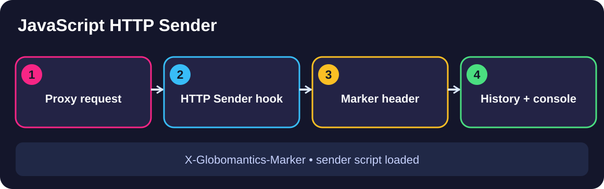

# Write a JavaScript security script in ZAP

<div align="center"><sub>Generated using ChatGPT · diagram is illustrative</sub></div>


<div align="center">

 


<sub>Illustrative learning workflow — verify actual evidence in the running environment.</sub>
</div>

## Start This Demo Independently

```bash
git clone https://github.com/rupeshtiwari/pluralsight-script-development-with-zap.git
cd pluralsight-script-development-with-zap
git switch m1-demo2-after
./setup/setup-macos.sh
cd demos/module1-demos/m1-demo2-javascript-http-sender
./scripts/demo_up.sh
```

**Branch role:** Completed reference implementation; run the steps against a fresh local ZAP session. Follow the four numbered steps below. `./scripts/preflight_check.sh` stores a timestamped log in `logs/`; verify any separate ZAP GUI/Script Console evidence directly. When finished, run `./scripts/demo_down.sh`.

**Compare without overwriting work:** `git diff m1-demo2-before..m1-demo2-after -- demos/module1-demos/m1-demo2-javascript-http-sender`.

> [!IMPORTANT]
> Restrict all vulnerability testing to the supplied authorized Globomantics application.

---


<div align="center">

  

### JavaScript HTTP Sender


<sub>Learning path illustration; real findings and API values come from your local run.</sub>

</div>

> [!IMPORTANT]
> **Authorized practice only:** Run scans against the Globomantics training application supplied with this repository. Do not target unrelated systems.

## Start This Demo Independently

Use a separate checkout for this exercise; no previous demo or another student's runtime is required.

```bash
git clone https://github.com/rupeshtiwari/pluralsight-script-development-with-zap.git
cd pluralsight-script-development-with-zap
git switch m1-demo2-after
./setup/setup-macos.sh
cd demos/module1-demos/m1-demo2-javascript-http-sender
./scripts/demo_up.sh
```

**Environment:** ZAP GUI and Terminal. Use the numbered commands below in the displayed sequence. Wait for each actual result before advancing. Scan duration and request counts may vary.

**Completed reference:** `m1-demo2-after` contains the final implementation assets. Use it to compare your results; do not assume a previous session's alerts are present.

**Check your result:** `./scripts/preflight_check.sh` saves a timestamped log under `logs/`. Some GUI observations, particularly Script Console output, must also be checked in the live ZAP GUI.

**Clean up:** `./scripts/demo_down.sh`

**Compare safely:** First commit or copy your own work, then compare this branch with `m1-demo2-before` using `git diff m1-demo2-before..m1-demo2-after -- demos/module1-demos/m1-demo2-javascript-http-sender`. This does not change your working tree.

---


Use a JavaScript **HTTP Sender** script to add a request marker and print an identifiable console message. Prove the result in ZAP rather than relying only on a successful Terminal command.

> **Authorized target:** Only the local Globomantics training application. Do not use this workflow against systems without authorization.

## Applications and exact locations

| Application | Open / navigate | Why it is on screen |
|---|---|---|
| macOS Terminal | Repository root, then `demos/module1-demos/m1-demo2-javascript-http-sender` | Run the exact numbered commands and see the checks |
| ZAP GUI (Webswing) | [http://localhost:8080/zap/](http://localhost:8080/zap/) | Show the **Scripts** tree, script editor and Script Console; inspect HTTP History / request details when available |
| Local Globomantics app | [http://localhost:8000/](http://localhost:8000/) | Authorized target; the probe runs against its `/greet` endpoint through the ZAP proxy |
| Script source file | [zap-scripts/globomantics-marker.js](zap-scripts/globomantics-marker.js) | Exact source used by the demo; optionally open in VS Code **only for showing source** |

**Where things run:** Terminal + ZAP GUI are all you need; VS Code is optional, for viewing source. The GUI runs on port **8080**; the ZAP API / proxy the Terminal scripts use runs on port **8090** — both are the same ZAP container. An HTTP request generated in the Terminal may appear in ZAP's history; a console line must be checked in the **actual Script Console**, not inferred from a Terminal expectation.

## Setup

From the **repository root**, install the environment once if not already installed:

```bash
./setup/setup-macos.sh
```

Then start Clip 4 from the repository root:

```bash
cd demos/module1-demos/m1-demo2-javascript-http-sender
./scripts/demo_up.sh
```

**Wait** for the healthy `Up` result. Open the [ZAP GUI](http://localhost:8080/zap/) and locate its **Scripts** area; keep a Terminal ready at `demos/module1-demos/m1-demo2-javascript-http-sender`. Each command block below is run **in this directory**, not from the repository root.

> **|---|---|---|---|
| 1 | EO2a | Script loaded successfully | Script named `globomantics-marker` appears under HTTP Sender, with source visible |
| 2 | EO2a | Captured outgoing request includes marker | Request header shown in ZAP History/request view |
| 3 | EO2a | Fresh proxied request triggers the script | Actual `[globo-marker]` line in Script Console output |
| 4 | EO2a | Script registration type and enabled state | Registered script remains visible under HTTP Sender |

**Source reference (VS Code, Step 1):** `zap-scripts/globomantics-marker.js` — `sendingRequest()` lines 16–20, `responseReceived()` lines 24–25.

## Step 1: Load and inspect the HTTP Sender script (EO2a)

**Goal:** Explain what the JavaScript hook does, then demonstrate that ZAP has loaded the exact script file.

**Application and location:** Start in **ZAP GUI** at [http://localhost:8080/zap/](http://localhost:8080/zap/) → **Scripts** → **HTTP Sender**. Then switch focus to **Terminal** in `demos/module1-demos/m1-demo2-javascript-http-sender`.

**Show before running (VS Code, source only):** Open [`zap-scripts/globomantics-marker.js`](zap-scripts/globomantics-marker.js) and focus on `sendingRequest(msg, initiator, helper)` (lines 16–20) — the `setHeader` call and the `print` statement — and the empty `responseReceived` (lines 24–25). This is the code to explain:

```javascript
var MARKER_HEADER = "X-Globomantics-Marker";
var MARKER_VALUE  = "GLOBO-DEMO";
var CONSOLE_TAG   = "[globo-marker]";

function sendingRequest(msg, initiator, helper) {
    msg.getRequestHeader().setHeader(MARKER_HEADER, MARKER_VALUE);
    print(CONSOLE_TAG + " added " + MARKER_HEADER + ": " + MARKER_VALUE +
          " to " + msg.getRequestHeader().getURI().toString());
}

function responseReceived(msg, initiator, helper) {
}
```

**Execute in Terminal:**

```bash
./steps/01-load-javascript-http-sender.sh
```

**Expected Terminal evidence:** The command identifies `globomantics-marker`, the HTTP Sender type and detected JavaScript engine, the marker header `X-Globomantics-Marker: GLOBO-DEMO`, and a PASS confirming that it loaded in ZAP.

****Inspect ZAP:**** Expand **Scripts → HTTP Sender**, select `globomantics-marker`, and show the source/editor and enabled state. The actual tree wording may depend on the ZAP GUI version.

**Explain to learners:** `sendingRequest` is invoked before ZAP sends a request. The header is attached to messages that pass through this active HTTP Sender script; it does **not** automatically modify requests made directly to the application without ZAP.

**
**Proof:** Source file + successful load + script visible in ZAP. Do not stop at the Terminal PASS alone.

## Step 2: Prove the marker on an outbound request (EO2a)

**Goal:** Show a request really passed through ZAP and acquired the marker header.

**Application and location:** **Terminal** in `demos/module1-demos/m1-demo2-javascript-http-sender`; then **ZAP GUI** at [http://localhost:8080/zap/](http://localhost:8080/zap/) → **History** (or the equivalent request-message view).

**Execute in Terminal:**

```bash
./steps/02-prove-outbound-marker-header.sh
```

**Expected Terminal evidence:** A GET request to a unique `http://app:8000/greet?name=marker-...` URL and a captured request header:

```text
X-Globomantics-Marker: GLOBO-DEMO
```

****Inspect ZAP:**** Find the recent `/greet?name=marker-<unique-id>` request in **History**. Select it, open the **Request** message details, and show the `X-Globomantics-Marker` header. If the GUI history is crowded, locate the exact request by URL rather than selecting an unrelated message.

**Explain to learners:** The header in the outgoing HTTP message demonstrates execution of the script on real proxied traffic. Merely seeing the source file or script registration does not establish that it ran.

**
**Proof:** Terminal-captured request header; ideally the identical header in ZAP's selected request. If that GUI message cannot be located, the Terminal check remains the recorded proof—do not claim a GUI proof you did not show.

## Step 3: Verify actual Script Console output (EO2a)

**Goal:** Confirm the script reports what it changed, with a recognizable marker and URL.

**Application and location:** **ZAP GUI** at [http://localhost:8080/zap/](http://localhost:8080/zap/) → **Scripts** → select `globomantics-marker` → **Script Console** output pane. Then **Terminal** in `demos/module1-demos/m1-demo2-javascript-http-sender`.

****Prepare the console:**** Bring the ZAP Script Console into view and find or clear the old output where practical. This makes the next line clearly attributable to the new request.

**Execute in Terminal:**

```bash
./steps/03-check-live-script-console.sh
```

**Expected behavior:** The command sends a fresh, uniquely identified probe through ZAP. The script's `print` statement should emit a line like:

```text
[globo-marker] added X-Globomantics-Marker: GLOBO-DEMO to http://app:8000/greet?name=marker-<unique-id>
```

****Inspect ZAP:**** Inspect the **actual** Script Console output and highlight the fresh `[globo-marker]` line. The exact URL in the line is determined by the request ZAP processed.

**Critical evidence distinction:** The Step 3 Terminal helper prints an **expected console-line format** and checks that the source contains `print` and a marked request exists. It does **not** independently retrieve the Script Console's live output. Only the visible ZAP console establishes that the log line was emitted.

**Explain to learners:** The fixed `[globo-marker]` prefix helps an operator distinguish this script's output from other console messages. The URL shows which request was marked.

**
**Proof:** Actual Script Console line in ZAP. Do not assert console-output verification solely from the Terminal PASS.

## Step 4: Confirm saved script identity and enabled state (EO2a)

**Goal:** Confirm the script has a stable registration that can be reused in later automation.

**Application and location:** **Terminal** in `demos/module1-demos/m1-demo2-javascript-http-sender`, then **ZAP GUI** → **Scripts → HTTP Sender**.

**Execute in Terminal:**

```bash
./steps/04-verify-enabled-script-registration.sh
```

**Expected Terminal evidence:**

| Registration field | Expected value |
|---|---|
| Name | `globomantics-marker` |
| Type | `httpsender` |
| Engine | Detected JavaScript engine; read the actual output |
| Enabled | `true` |
| Repository source path | `demos/module1-demos/m1-demo2-javascript-http-sender/zap-scripts/globomantics-marker.js` |
| Path mounted inside ZAP | `/zap-scripts/globomantics-marker.js` |

****Inspect ZAP:**** Select the registered script under **HTTP Sender** and show its name and enabled state. The script is loaded by the API from the mounted path; the helper's displayed repository path is not a separate API verification of the registration path.

**Explain to learners:** A stable script name, correct script type and enabled state make the script reusable. This step verifies the registration in the running ZAP instance; it does **not** prove persistence after destroying or rebuilding the container.

**
**Proof:** The live ZAP registration returned by the helper plus the visible script entry in the GUI.

## Preflight and teardown (outside the four teaching beats)

From `demos/module1-demos/m1-demo2-javascript-http-sender`, run:

```bash
./scripts/preflight_check.sh
```

**Expected result:** `5 checks passed, 0 failed`. A plain-text log is saved under `demos/module1-demos/m1-demo2-javascript-http-sender/logs/preflight-*.log`. The five checks include readiness and the four scripted checks. Steps 2 and 3 each use a fresh request ID; stale history entries cannot satisfy their header check. **This does not replace visually confirming the Script Console output in Step 3.**

When you're done, stop the demo stack:

```bash
./scripts/demo_down.sh
```

## What to remember

- The order that matters: **source and load → marked request → live console output → saved registration**.
- The script only adds the header to traffic that passes **through ZAP**; it does not affect requests made directly to the app.
- The Terminal check does not capture the live Script Console line — confirm that line in the **actual** ZAP Script Console (Step 3).
- Everything here targets only the local Globomantics training app.

**End state:** you have seen the exact JavaScript hook, a modified real request, the emitted console message, and the enabled HTTP Sender registration.
