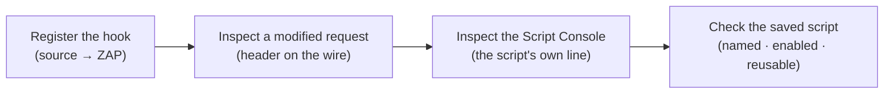

# Module 1 · Demo 2 — Extend ZAP with JavaScript

<div align="center">


<sub>Illustrative architecture · Generated using ChatGPT; only live requests and reports prove findings</sub>

</div>

<!-- demo-navigation:start -->
<p align="center"><b>Student exercise · Demo 2 of 6</b></p>
<p align="center">
  <a href="https://github.com/rupeshtiwari/pluralsight-script-development-with-zap/blob/m1-demo1-before/demos/module1-demos/m1-demo1-targeted-injection-xss-csrf/README.md"></a>
  <a href="https://github.com/rupeshtiwari/pluralsight-script-development-with-zap/blob/m1-demo3-before/demos/module1-demos/m1-demo3-python-scanning-authentication/README.md"></a>
</p>
<!-- demo-navigation:end -->

## Your scenario

Globomantics wants every request your security tests send to be identifiable — so that when traffic shows up in a log, the team can tell *authorized ZAP testing* apart from a real user and apart from an actual attacker. The obvious instinct is to write a script. But here is the trap I want you to feel in this demo: a JavaScript file sitting in the repository proves *nothing*. It has not run. It has not touched a single request. A saved file and a working extension are two completely different claims.

So you and I are going to earn the second claim. You will write a ZAP HTTP Sender script that stamps a marker header onto every outgoing message, and then we will refuse to believe it until we have seen three independent pieces of evidence: the header on a request ZAP actually sent, the script's own diagnostic line in ZAP's live Script Console, and the enabled registration that Module 2's automation will later call by name. The script's source is open in front of you the whole time, because the point is to understand *where in ZAP's message lifecycle your code runs* — not to copy a file.

## Your learning goals

You will extend ZAP at a real message hook and then verify it by observable effects:

1. Write and register an HTTP Sender JavaScript script in ZAP *(EO2a)*
2. Prove the outgoing header, live console output and enabled registration of that same script *(EO2a)*

No separate course outline is required — each step states what you are checking and why.

## Your evidence path



Each step is a *different* kind of proof. Registration is identity, the header is behavior, the console line is the script reporting its own work, and the saved registration is reuse. Together they close every gap between "a file exists" and "my code runs on real traffic."

## Start your lab

The Mac prerequisite installer, `setup/setup-macos.sh`, is a **one-time** preparation task explained in the [course README](../../../README.md). Each demo then starts its **own** local stack.

<details open>
<summary><b>Open the exact branch, folder and runtime for Module 1 Demo 2</b></summary>

**Where:** the VS Code integrated Terminal, starting in the root of your existing local repository.

```bash
cd "$HOME/pluralsight-script-development-with-zap"
git fetch origin
git switch m1-demo2-before
cd demos/module1-demos/m1-demo2-javascript-http-sender
./scripts/demo_up.sh
```

**Expected start:** the startup script brings up the Globomantics app and ZAP and reports readiness. Continue only after it does — a failed startup is not one of the four teaching steps.

**Interfaces:** [Globomantics app — localhost:8000](http://localhost:8000/) · [ZAP GUI — localhost:8080/zap/](http://localhost:8080/zap/) · [ZAP API/proxy — localhost:8090](http://localhost:8090/). You author the script in **VS Code** (`zap-scripts/globomantics-marker.js`) and inspect its effects in **ZAP's browser GUI** (History and Script Console). The `-before` branch deliberately ships without the finished JavaScript — create it from the example before expecting the verification steps to pass.

</details>

## Your four steps

<details open>
<summary><b>Step 1 — Load the JavaScript HTTP Sender script</b> · source → ZAP</summary>

### What you are learning

Register a JavaScript HTTP Sender hook, and understand why a file in the repo is not yet an extension that modifies traffic. *(EO2a)*

### What we examine, and why

Open `zap-scripts/globomantics-marker.js` in VS Code and read the parts that make it an HTTP Sender script, not just any JavaScript:

- **`sendingRequest(msg, initiator, helper)`** — this is the hook. ZAP calls it for *every message it is about to send*, which is exactly the moment to stamp a header. (There is a matching `responseReceived` for the other direction.) Understanding that the function name *is* the contract with ZAP is the whole lesson of the step.
- **`MARKER_HEADER` / `MARKER_VALUE`** — the constants `X-Globomantics-Marker` and `GLOBO-DEMO`, kept at the top so the marker is one obvious thing to change.
- **`msg.getRequestHeader().setHeader(...)`** — the line that actually mutates the outgoing request. Reading this is how you know the script *changes* traffic rather than just observing it.

Loading this file registers it with ZAP's **Graal.js** engine as an `httpsender` action. Registration means ZAP knows the script and will call `sendingRequest` — but it has not called it yet.

**Predict before you run:** you expect ZAP to list `globomantics-marker` as type `httpsender`, engine `Graal.js`, enabled `true`, loaded from `/zap-scripts/globomantics-marker.js`, and to report the header it *intends* to add. Note what you do **not** yet have: a request that carried it.

### Run command

**Where:** the VS Code integrated Terminal, in `demos/module1-demos/m1-demo2-javascript-http-sender`.

```bash
./steps/01-load-javascript-http-sender.sh
```

Then open [ZAP — localhost:8080/zap/](http://localhost:8080/zap/) → **Scripts → HTTP Sender → globomantics-marker** and read its name, engine and enabled state.

### Expected result (the script's output contract — not your run)

<table>
<thead><tr><th>Displayed field</th><th>Expected value or example</th><th>What to inspect</th></tr></thead>
<tbody>
<tr><td><b>Saved source file</b></td><td><code>zap-scripts/globomantics-marker.js</code></td><td>The file you authored</td></tr>
<tr><td><b>sendingRequest() adds</b></td><td><code>X-Globomantics-Marker: GLOBO-DEMO</code></td><td>The header the hook declares</td></tr>
<tr><td><b>Registered in ZAP</b></td><td><code>globomantics-marker · httpsender · Graal.js · enabled true</code></td><td>Identity, type, engine, state</td></tr>
<tr><td><b>Result</b></td><td><code>✔ PASS script is a valid HTTP Sender action and registered in ZAP</code></td><td>Registered — traffic not yet proven</td></tr>
</tbody></table>

### Investigate, then decide

Match the registered `httpsender` type to the `sendingRequest` hook you read in the source — that is why ZAP will call it on outgoing messages. The decision: *the script is loaded and enabled, so it is ready — but "ready" is a promise, not evidence.* You have earned exactly one claim so far: identity.

**On FAIL:** the diagnostic names the gap — a syntax error, the wrong hook name, or an unloaded file. Fix the source rather than asserting it registered.

**Next:** force ZAP to send a request and prove the hook actually fired.

</details>

<details>
<summary><b>Step 2 — Prove the marker on an outbound request</b> · header on the wire</summary>

### What you are learning

Confirm the hook ran by finding its header on a request ZAP actually sent — not by trusting that it loaded. *(EO2a)*

### What we examine, and why

This step sends a fresh request through ZAP and then reads the *outbound* message back. The thing to examine is the request line and its headers: a new `GET /greet?name=marker-<id>` carrying `X-Globomantics-Marker: GLOBO-DEMO`. The `marker-<id>` is unique per run on purpose — it guarantees you are looking at *this* request, not a stale one left in History, which is the single most common way people fool themselves here.

Why does this matter more than Step 1? Because registration and execution fail independently. A script can be enabled and still never fire (wrong initiator, disabled mid-session, an exception swallowed). The header on the wire is the first evidence that `sendingRequest` truly ran.

**Predict before you run:** you expect a brand-new `/greet?name=marker-<id>` request whose headers include `X-Globomantics-Marker: GLOBO-DEMO`. If the header is missing, the hook did not run on this message — a different problem from "it didn't load."

### Run command

**Where:** the VS Code integrated Terminal, in the same demo folder.

```bash
./steps/02-prove-outbound-marker-header.sh
```

Then open [ZAP — localhost:8080/zap/](http://localhost:8080/zap/) → **History**, select the newest `/greet?name=marker-…` request, and read its **Request** panel so you see the header on the message ZAP sent.

### Expected result (the script's output contract — not your run)

The `marker-<id>` is run-specific — read it from your output; the header name and value are fixed.

<table>
<thead><tr><th>Displayed field</th><th>Expected value or example</th><th>What to inspect</th></tr></thead>
<tbody>
<tr><td><b>Outbound request</b></td><td><code>GET /greet?name=marker-&lt;live ID&gt; HTTP/1.1</code></td><td>A fresh message, not a prior run</td></tr>
<tr><td><b>Header added by the script</b></td><td><code>X-Globomantics-Marker: GLOBO-DEMO</code></td><td>Request panel <b>and</b> terminal agree</td></tr>
<tr><td><b>Result</b></td><td><code>✔ PASS the script added X-Globomantics-Marker to the outbound request</code></td><td>Real outbound traffic carries the marker</td></tr>
</tbody></table>

### Investigate, then decide

Confirm the `marker-<id>` in ZAP's History matches the one the terminal reported — same request, not a lookalike. The decision: *the hook executes on live traffic.* You now hold a second, stronger claim: behavior, not just identity.

**On FAIL:** a missing header means the hook did not run on this request. Check it is enabled and that the request went through ZAP's proxy — do not claim a modification you cannot see.

**Next:** have the script tell you, in its own words, what it did — and read that in ZAP's Script Console.

</details>

<details>
<summary><b>Step 3 — Verify the live Script Console output</b> · the script's own line</summary>

### What you are learning

Read the diagnostic line the script prints, from ZAP's live Script Console — and understand why a predicted string in the terminal is not the same as console proof. *(EO2a)*

### What we examine, and why

A good automation script reports what it did. This one calls `print(...)` inside `sendingRequest`, so every marked request leaves a line like `[globo-marker] added X-Globomantics-Marker: GLOBO-DEMO to <url>` in ZAP's **Script Console**. The step reads that line *back from ZAP* for the request it just triggered.

Here is the discipline I want you to keep: the terminal can happily print the *expected* format — that proves nothing, it is just a string. The evidence is the line that appears in ZAP's own Script Console, carrying *this run's* request URL. Trusting the terminal's expected line instead of the console is exactly the kind of self-deception this course trains you out of.

**Predict before you run:** you expect a fresh `[globo-marker] … to …/greet?name=marker-<id>` line in the Script Console whose URL matches the request from this run. An empty console, or a line from an older request, is not a pass.

### Run command

**Where:** the VS Code integrated Terminal, in the same demo folder.

```bash
./steps/03-check-live-script-console.sh
```

Then switch to [ZAP — localhost:8080/zap/](http://localhost:8080/zap/) → **Scripts → Script Console** and find the fresh line whose request URL matches this run.

### Expected result (the script's output contract — not your run)

<table>
<thead><tr><th>Displayed field</th><th>Expected value or example</th><th>What to inspect</th></tr></thead>
<tbody>
<tr><td><b>Request that triggered the script</b></td><td><code>GET …/greet?name=marker-&lt;live ID&gt;</code></td><td>This run's request</td></tr>
<tr><td><b>Line the script printed (read back from ZAP)</b></td><td><code>[globo-marker] added X-Globomantics-Marker: GLOBO-DEMO to &lt;url&gt;</code></td><td>The named line, in the GUI console</td></tr>
<tr><td><b>Result</b></td><td><code>✔ PASS the script printed its named line for this request; the same line is in ZAP's Script Console</code></td><td>Console proof, not a terminal echo</td></tr>
</tbody></table>

### Investigate, then decide

Line the console URL up with the `marker-<id>` from Step 2 — same request, reported by the script itself. The decision: *the script observably executed and reported its own work*, which is what makes it trustworthy to reuse. Never let the terminal's expected-format line stand in for the live console.

**On FAIL:** no fresh console line means the print did not run or you are reading an old line. Re-trigger and read the console, rather than accepting the terminal's expected string.

**Next:** confirm the script is saved and enabled under a stable name, so Module 2's automation can call it.

</details>

<details>
<summary><b>Step 4 — Verify the script registration</b> · named · enabled · reusable</summary>

### What you are learning

Confirm the script's stable name, type, engine and enabled state — the identity the Automation Framework will reuse by name in Module 2. *(EO2a)*

### What we examine, and why

Reusable automation does not point at a file path and hope; it calls a *registered, named* script. This step reads back the registration ZAP holds — `globomantics-marker`, type `httpsender`, engine `Graal.js`, enabled `true`, sourced from `/zap-scripts/globomantics-marker.js` — and shows the exact script-job identity Module 2's Automation Framework plan will use. The reason to look now is forward-looking: in Module 2 Demo 1 a plan will say `name: globomantics-marker`, and it only works because that name resolves to this enabled script.

**Predict before you run:** you expect `globomantics-marker · httpsender · Graal.js · enabled true`, and the Module-2 reuse line naming the same script. This is a session-scoped registration, not a claim that it survives destroying the container.

### Run command

**Where:** the VS Code integrated Terminal, in the same demo folder.

```bash
./steps/04-verify-enabled-script-registration.sh
```

Then open [ZAP — localhost:8080/zap/](http://localhost:8080/zap/) → **Scripts → HTTP Sender → globomantics-marker** and read its name, type and engine from the same live session.

### Expected result (the script's output contract — not your run)

<table>
<thead><tr><th>Displayed field</th><th>Expected value or example</th><th>What to inspect</th></tr></thead>
<tbody>
<tr><td><b>Registered name</b></td><td><code>globomantics-marker</code></td><td>The stable name automation reuses</td></tr>
<tr><td><b>Type · engine · enabled</b></td><td><code>httpsender · Graal.js · true</code></td><td>Correct hook, engine, active state</td></tr>
<tr><td><b>Saved file</b></td><td><code>/zap-scripts/globomantics-marker.js</code> (= <code>zap-scripts/globomantics-marker.js</code>)</td><td>The current source behind the name</td></tr>
<tr><td><b>What Module 2 reuses</b></td><td><code>name: globomantics-marker · type: httpsender · engine: Graal.js</code></td><td>The Automation Framework script job</td></tr>
<tr><td><b>Result</b></td><td><code>✔ PASS script saved and registered as an enabled HTTP Sender, ready for the Automation Framework</code></td><td>Registration ready for reuse</td></tr>
</tbody></table>

### Investigate, then decide

Confirm the name and type match what the Module-2 reuse line expects. The decision: *the extension is reusable by name* — the final gap between "a working script in this session" and "a building block the pipeline calls" is closed.

**On FAIL:** a wrong name or disabled state breaks Module 2's plan. Fix the registration now rather than discovering it two demos later.

**Next:** you have source, a modified request, a live console line, and a reusable registration — four independent proofs that your code runs.

</details>

<!-- student-achievement:start -->
## What you achieved

You can now explain each learning objective with the evidence you captured:

1. **(EO2a) You extended ZAP at the HTTP Sender hook.** You authored `globomantics-marker.js` around `sendingRequest`, and ZAP registered it as type `httpsender` on the `Graal.js` engine, enabled.
2. **(EO2a) You proved the script changed real traffic — three independent ways.** The header `X-Globomantics-Marker: GLOBO-DEMO` appeared on a ZAP-sent `/greet?name=marker-…` request, the live Script Console printed the fresh `[globo-marker] …` line the script wrote for that request, and the enabled registration was confirmed by name for Module 2 to reuse.

**How to apply it:** this is the pattern for any custom ZAP behavior — hook the right lifecycle point, then prove execution on the wire and in the console before you trust it in a pipeline. "The file is saved" is never the finish line.

**Your final check:** explain each numbered outcome using *your own* captured evidence from this run. A README example, a missing result, or an earlier run does not satisfy this exercise.
<!-- student-achievement:end -->

## Finish your lab

After Step 4 you should be able to explain how the JavaScript hook changed a real proxied request — from the header, the console line and the registration, not from recalling a command.

Stop the demo's containers from the same demo directory:

```bash
./scripts/demo_down.sh
```

The `m1-demo2-after` branch holds the completed reference, including the finished `globomantics-marker.js`. Preserve your changes first, then compare without modifying files: `git diff m1-demo2-before..m1-demo2-after -- demos/module1-demos/m1-demo2-javascript-http-sender`.

<!-- demo-navigation:start -->
<p align="center"><b>Student exercise · Demo 2 of 6</b></p>
<p align="center">
  <a href="https://github.com/rupeshtiwari/pluralsight-script-development-with-zap/blob/m1-demo1-before/demos/module1-demos/m1-demo1-targeted-injection-xss-csrf/README.md"></a>
  <a href="https://github.com/rupeshtiwari/pluralsight-script-development-with-zap/blob/m1-demo3-before/demos/module1-demos/m1-demo3-python-scanning-authentication/README.md"></a>
</p>
<!-- demo-navigation:end -->

[← Module 1 demo catalog](../README.md) · [← Course home](../../../README.md)
