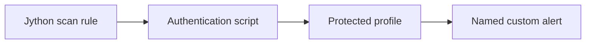

# Create Python Scan and Authentication Scripts

<div align="center">


<sub>Illustrative architecture · Generated using ChatGPT · Verify real results in your own lab</sub>

</div>

## What Problem Are You Solving?

The Globomantics profile page is accessible only after login, and a generic scan may never reach its unsafe reflection. Maya must automate authentication and register a custom Jython active rule so that ZAP tests the protected parameter as an authenticated user.

**Your outcome:** Complete four practical checks and be able to explain both the actual evidence and the engineering decision it supports. This page is self-contained; you do not need access to a separate course outline.

## Learning Objectives Covered

<table><thead><tr><th>Objective</th><th>What You Will Learn</th></tr></thead><tbody>
<tr><td><code>EO2b</code></td><td>Implement Python scripts for custom scanning rules</td></tr>
<tr><td><code>EO2c</code></td><td>Apply scripting for authentication sequence automation</td></tr>
</tbody></table>

## Your Four-Step Learning Path



<table>
<thead><tr><th>Step</th><th>Exact Command</th><th>What You Do</th><th>What To Verify</th><th>Why It Matters</th></tr></thead>
<tbody><tr><td><b>1</b></td><td><code>./steps/01-load-python-active-scan-rule.sh</code></td><td>Register a Jython custom Active Rules script</td><td>Python source and actual active-rule registration</td><td>A custom rule can target application-specific behavior</td></tr>
<tr><td><b>2</b></td><td><code>./steps/02-register-scripted-authentication.sh</code></td><td>Register the authentication script</td><td>Credential and login parameter declarations</td><td>ZAP uses a separate script type to create a session</td></tr>
<tr><td><b>3</b></td><td><code>./steps/03-confirm-authenticated-profile-access.sh</code></td><td>Reach the protected profile through the scripted user</td><td>HTTP 401 without login and HTTP 200 with ZAP login</td><td>Prove authentication succeeded before trusting the scan</td></tr>
<tr><td><b>4</b></td><td><code>./steps/04-confirm-custom-scan-alert.sh</code></td><td>Scan authenticated parameter note with the custom rule</td><td>Fresh Globomantics unsafe reflection custom alert</td><td>Named custom findings, not built-in substitutes, prove the rule ran</td></tr></tbody></table>

## Start This Exercise

From the repository root:

```bash
git fetch origin
git switch m1-demo3-before
./setup/setup-macos.sh
cd demos/module1-demos/m1-demo3-python-scanning-authentication
./scripts/demo_reset.sh
```

If you already prepared your Mac, the one-time setup script can be skipped. Run **Steps 1–4 above** from this demo directory, in order. Then validate and stop:

```bash
./scripts/preflight_check.sh
./scripts/demo_down.sh
```

The preflight writes a timestamped log to `logs/`; GUI-only evidence must also be verified in the real ZAP interface at <http://localhost:8080/zap/>. The app runs at <http://localhost:8000/> and ZAP's local API/proxy at <http://localhost:8090/>.

**Compare with the completed version:** `git diff m1-demo3-before..m1-demo3-after -- demos/module1-demos/m1-demo3-python-scanning-authentication`. This command does not overwrite your files. The `before` branch starts the exercise; the `after` branch provides its completed reference, where applicable.

**Technical evidence note:** The training login is intentionally simplified; it is not a production-ready credential-handling design. Jython code uses Python 2.7 syntax inside ZAP; Python 3 is used by the Mac-side helpers.

All testing must stay within the authorized Globomantics training application.

---

## Detailed Instructions And Expected Evidence

<details><summary><b>View The Four Executable Steps</b></summary>

```bash
./steps/01-load-python-active-scan-rule.sh
./steps/02-register-scripted-authentication.sh
./steps/03-confirm-authenticated-profile-access.sh
./steps/04-confirm-custom-scan-alert.sh
```

Run these commands in order from this demo's folder, then execute `./scripts/preflight_check.sh`. Inspect actual ZAP GUI or GitHub Actions evidence where indicated.
</details>


Extend ZAP with two Jython scripts — a custom active-scan rule and an
authentication script. You read each implementation in VS Code to understand the
mechanism, author both in ZAP's Script Console, then run the rule against a
login-only Globomantics page and confirm it raises your alert.

> **Authorization and scope.** These scripts run only against the local
> Globomantics application.

## Applications and locations used

| Application | Where | Used for |
|-------------|-------|----------|
| VS Code | `demos/module1-demos/m1-demo3-python-scanning-authentication/zap-scripts/globomantics-active-rule.py`, `…/globomantics-auth.py`, `runtime/app/main.py` | reading the scripts and the app sink they target |
| ZAP Script Console | **Scripts** tab (Active Rules, Authentication) | authoring both scripts |
| ZAP GUI | **Sites** (Context dialog), **Alerts** tab | configuring script-based authentication, viewing the alert |
| macOS Terminal | working directory `demos/module1-demos/m1-demo3-python-scanning-authentication` | running each `./scripts/demo_step.sh N` |
| Local Globomantics app | `http://localhost:8000/account/profile?note=seed` | the login-only target (401 before login, 200 after) |

You **author both scripts in ZAP's Script Console** (the outline's proof artifacts
are the Python active-rule source and the authentication script source). VS Code is
used to read and explain the source first; the Terminal commands then verify each
beat against the running ZAP instance (GUI on `:8080`, API on `:8090`).

## Setup

```bash
cd demos/module1-demos/m1-demo3-python-scanning-authentication
./scripts/demo_reset.sh          # prints "Up"; then open http://localhost:8080/zap/
```

The Python Scripting (jython) add-on installs in the ZAP container at startup.

## Step-by-step LO traceability

| Step | LO | Source / mechanism | Command | Observed result | Proof artifact |
|------|----|--------------------|---------|-----------------|----------------|
| 1 | EO2b | `globomantics-active-rule.py` — `_probe_request` 50–61, `_check` 82–94, `_raise` 64–79, `scan`/`scanNode` 97–103; app sink `main.py` `profile()` 375–377 | `steps/01-load-python-active-scan-rule.sh` | rule validates and loads as an active rule declaring `Globomantics unsafe reflection (custom rule)` | Python active-rule source |
| 2 | EO2c | `globomantics-auth.py` — `authenticate` 39–61, `getRequiredParamsNames` 64–65, `getCredentialsParamsNames` 72–73 | `steps/02-register-scripted-authentication.sh` | script registers as an authentication script submitting `username=alice` to `POST /login` | Authentication script source |
| 3 | EO2c | ZAP context: script-based auth + forced user | `steps/03-confirm-authenticated-profile-access.sh` | `/account/profile` 401 without login, 200 once ZAP runs the script; trace `authenticate: response=200` | Authenticated custom-scan result |
| 4 | EO2b | the custom rule on the authenticated scan | `steps/04-confirm-custom-scan-alert.sh` | named alert absent before, present after: Medium risk, parameter `note`, evidence `GLOBOxss7marker` | Custom alert record |

---

## Step 1: Write the Jython active-scan rule (EO2b)

**Goal:** Write a custom active-scan rule that probes a parameter and raises a named
alert when the Globomantics profile page returns the probe unencoded — a
house-specific reflection no built-in rule targets exactly.

**Application:** VS Code, then the ZAP Script Console, then macOS Terminal.

**Open / Navigate:**

- **VS Code — rule source:** open
  `demos/module1-demos/m1-demo3-python-scanning-authentication/zap-scripts/globomantics-active-rule.py` and read the functions that
  make the rule work:
  - **`_probe_request(msg, target)` (lines 50–61)** — clones the request (keeping the
    logged-in session cookie) and rewrites the query string to put the probe in the
    target parameter. It edits the URI directly rather than calling `sas.setParam()`,
    which needs per-parameter scanner state only set up inside `scan()` — so the rule
    works from `scanNode()` too.
  - **`_check(sas, msg, param)` (lines 82–94)** — sends the probe and tests whether it
    reflects verbatim in the response body.
  - **`_raise(sas, probe, param)` (lines 64–79)** — builds the alert with
    `sas.newAlert().setRisk(2)…setName(ALERT_NAME)…setMessage(probe)` and fires it via
    `getattr(alert, "raise")()` (because `raise` is a reserved word in Python).
  - **`scan` / `scanNode` (lines 97–103)** — ZAP's two active-scan entry points; both
    call `_check`, and ZAP de-duplicates identical alerts.
- **VS Code — app sink:** open `runtime/app/main.py` → `profile()` (lines 375–377). In the
  vulnerable build the `note` value is assigned straight into the page
  (`note_ctx = note`) with no encoding. That unencoded reflection is exactly what the
  rule detects.
- **ZAP Script Console:** ZAP GUI (`http://localhost:8080/zap/`) → **Scripts** tab →
  **Active Rules** → new script on the Python (jython) engine named
  `globomantics-active-rule`; paste the source, save, and enable it.

**Execute in Terminal:**

```bash
./steps/01-load-python-active-scan-rule.sh
```

**Expected output:** The rule validates and loads as an active rule on the
`python : jython` engine, declaring the alert `Globomantics unsafe reflection (custom
rule)`.

**What the learner should notice:** The rule is registered as an Active Rules script,
so ZAP invokes it during an active scan alongside the built-in rules — the
house-specific check is now part of the scan.

**Proof artifact:** Python active-rule source.

---

## Step 2: Write the authentication script (EO2c)

**Goal:** Teach ZAP to log in to the session-gated profile page (401 without a login
cookie) by writing an authentication script, so a scan can reach it.

**Application:** VS Code, then the ZAP Script Console, then macOS Terminal.

**Open / Navigate:**

- **VS Code — auth source:** open `demos/module1-demos/m1-demo3-python-scanning-authentication/zap-scripts/globomantics-auth.py`
  and read:
  - **`authenticate(helper, paramsValues, credentials)` (lines 39–61)** — builds the
    same form POST the login page sends (`username=…` to the `Login URL`), sends it
    with `helper.sendAndReceive(msg)`, and returns the message. ZAP captures the
    `Set-Cookie` session from that response and replays it on later requests.
  - **`getRequiredParamsNames()` (lines 64–65)** — declares the `Login URL` context
    parameter ZAP must supply.
  - **`getCredentialsParamsNames()` (lines 72–73)** — declares the per-user `username`
    credential field.
- **ZAP Script Console:** ZAP GUI → **Scripts** tab → **Authentication** → new script
  on the Python (jython) engine named `globomantics-auth`; paste the source and save.

**Execute in Terminal:**

```bash
./steps/02-register-scripted-authentication.sh
```

**Expected output:** The script validates and registers as an authentication script
on the `python : jython` engine, submitting `username=alice` to `POST /login`.

**What the learner should notice:** Authentication is a separate script type from the
active rule; ZAP uses it to obtain and reuse a session so scans run as a real user.

**Proof artifact:** Authentication script source.

---

## Step 3: Run scripted authentication against the login-only page (EO2c)

**Goal:** Show ZAP itself obtains a session by running the login script — with no
cookie supplied by hand — and reaches a page gated behind login.

**Application:** ZAP GUI, then macOS Terminal.

**Open / Navigate:** ZAP GUI → **Sites** tree → right-click `http://localhost:8000` →
**Include in Context → New Context**. In the Context dialog:

- **Authentication → Script-based Authentication** → select `globomantics-auth`; set
  **Login URL** `http://localhost:8000/login` and **Logged-in indicator (regex)**
  `Signed in as`.
- **Users → Add** user `alice` (username `alice`).
- Enable **Forced User Mode** (toolbar) and select `alice`.

**Execute in Terminal:**

```bash
./steps/03-confirm-authenticated-profile-access.sh
```

**Expected output:** `/account/profile` returns 401 without login and 200 once ZAP
authenticates via the script, and the authentication script's trace confirms it
logged in as `alice` (`authenticate: response=200`). No cookie was supplied by hand —
the session came from the script.

**What the learner should notice:** The same URL moves from 401 to 200 only because
ZAP ran the authentication script, demonstrating scripted authentication end to end.

**Proof artifact:** Authenticated custom-scan result.

---

## Step 4: Confirm the custom alert (EO2b)

**Goal:** Confirm the rule raises its named alert on the authenticated scan, and that
the alert is freshly produced by this run rather than left over from an earlier one.

**Application:** macOS Terminal, then ZAP GUI.

**Open / Navigate:** keep the ZAP GUI → **Alerts** tab in view to confirm the alert
the command reports also appears in the GUI.

**Execute in Terminal:**

```bash
./steps/04-confirm-custom-scan-alert.sh
```

**Expected output:** The step clears the alert store (named alert absent), scans
`/account/profile` as user `alice`, and reads the alert back: with the store cleared
first, the authenticated scan raises `Globomantics unsafe reflection (custom rule)` —
Medium risk, parameter `note`, evidence `GLOBOxss7marker`. The same alert appears in
the ZAP GUI **Alerts** tab.

**What the learner should notice:** Absent-before and present-after proves the alert is
from this scan, produced by Maya's rule on a session ZAP authenticated itself — the
alert a pipeline can later gate on.

**Proof artifact:** Custom alert record.

## Validate and reset

`./scripts/preflight_check.sh` runs all four steps, ending with
`5 checks passed, 0 failed`. Tear down with `./scripts/demo_down.sh`.

## The scripts

**Custom active-scan rule — `globomantics-active-rule.py`** (Jython 2.7.2). It
checks each query parameter by cloning the request (keeping the logged-in session),
putting a probe in the parameter, and raising the named alert if the probe reflects
unencoded. It runs from `scanNode()` so it does not depend on how ZAP enumerates
parameters:

```python
PROBE = "GLOBOxss7marker"
ALERT_NAME = "Globomantics unsafe reflection (custom rule)"

def _check(sas, msg, param):
    probe = msg.cloneRequest()                      # keeps the logged-in cookie
    pairs = ["%s=%s" % (p.getName(), PROBE if p.getName() == param else p.getValue())
             for p in msg.getUrlParams()]
    uri = probe.getRequestHeader().getURI()
    uri.setQuery("&".join(pairs))                   # put the probe in this parameter
    probe.getRequestHeader().setURI(uri)
    sas.sendAndReceive(probe, False, False)
    if PROBE in probe.getResponseBody().toString():
        alert = (sas.newAlert().setRisk(2).setConfidence(2).setName(ALERT_NAME)
                 .setDescription("Reflected without output encoding.")
                 .setParam(param).setAttack(PROBE).setEvidence(PROBE).setMessage(probe))
        getattr(alert, "raise")()                   # 'raise' is a keyword in Python

def scan(sas, msg, param, value):
    _check(sas, msg, param)

def scanNode(sas, msg):
    for p in msg.getUrlParams():
        _check(sas, msg, p.getName())
```

**Authentication script — `globomantics-auth.py`** (Jython 2.7.2):

```python
from org.apache.commons.httpclient import URI
from org.parosproxy.paros.network import HttpRequestHeader, HttpHeader
from java.net import URLEncoder
from java.lang import String
from jarray import array

def authenticate(helper, paramsValues, credentials):
    login_url = paramsValues.get("Login URL")
    username = credentials.getParam("username")
    body = "username=" + URLEncoder.encode(username, "UTF-8")
    msg = helper.prepareMessage()
    msg.setRequestHeader(
        HttpRequestHeader(HttpRequestHeader.POST, URI(login_url, False), HttpHeader.HTTP11))
    msg.getRequestHeader().setHeader(HttpHeader.CONTENT_TYPE, "application/x-www-form-urlencoded")
    msg.setRequestBody(body)
    msg.getRequestHeader().setContentLength(msg.getRequestBody().length())
    helper.sendAndReceive(msg)
    return msg

def getRequiredParamsNames():
    return array(["Login URL"], String)

def getOptionalParamsNames():
    return array([], String)

def getCredentialsParamsNames():
    return array(["username"], String)
```
