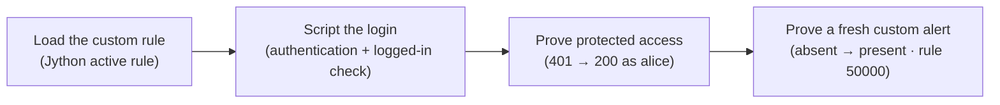

# Module 1 · Demo 3 — Script a scan rule and authentication

<div align="center">


<sub>Illustrative architecture · Generated using ChatGPT; only live requests and reports prove findings</sub>

</div>

<!-- demo-navigation:start -->
<p align="center"><b>Student exercise · Demo 3 of 6</b></p>
<p align="center">
  <a href="https://github.com/rupeshtiwari/pluralsight-script-development-with-zap/blob/m1-demo2-before/demos/module1-demos/m1-demo2-javascript-http-sender/README.md"></a>
  <a href="https://github.com/rupeshtiwari/pluralsight-script-development-with-zap/blob/m2-demo1-before/demos/module2-demos/m2-demo1-authenticated-zap-github-actions/README.md"></a>
</p>
<!-- demo-navigation:end -->

## Your scenario

The Globomantics Store has a flaw that only shows up *after you log in* — a profile field that reflects input unsafely. That one detail breaks the easy path. A built-in scanner does not know about your application-specific condition, and an unauthenticated scanner never even reaches the profile page, so it reports a reassuring nothing. Two different gaps, and you have to close both before you can honestly say the page was tested.

So in this demo you and I build two small scripts that work as a pair: a **custom Jython active-scan rule** that encodes the house-specific check ZAP does not ship, and a **scripted authentication** sequence that logs ZAP in so the rule can run where the vulnerability actually lives. Then — and this is the part that makes it real — we prove the login changed access (`401` without it, `200` with it) and we require a *fresh* alert from our named rule, because an alert left over from an earlier run would let an unrun scan masquerade as a passing one. The alert you capture here, rule `50000`, is the exact finding Module 2 Demo 2 will later pull straight from the ZAP API, so this is where that thread begins.

## Your learning goals

You will create two distinct script capabilities that work together:

1. Implement a focused custom Python (Jython) active-scan rule *(EO2b)*
2. Automate the ZAP authentication sequence and prove protected-endpoint access *(EO2c)*

No separate course outline is required — each step states what you are checking and why.

## Your evidence path



Read it as a dependency chain: the rule is useless until the login lets it reach the page, and the login is only proven once the rule fires a *new* finding inside the authenticated scope.

## Start your lab

The Mac prerequisite installer, `setup/setup-macos.sh`, is a **one-time** preparation task explained in the [course README](../../../README.md). Each demo then starts its **own** local stack.

<details open>
<summary><b>Open the exact branch, folder and runtime for Module 1 Demo 3</b></summary>

**Where:** the VS Code integrated Terminal, starting in the root of your existing local repository. This demo shows source code, so work in VS Code throughout.

```bash
cd "$HOME/pluralsight-script-development-with-zap"
git fetch origin
git switch m1-demo3-before
cd demos/module1-demos/m1-demo3-python-scanning-authentication
./scripts/demo_reset.sh
```

**Expected start:** the reset script prints a clean-slate message and brings up the vulnerable Globomantics build. Continue only after it reports readiness — a failed startup is not one of the four teaching steps.

**Interfaces:** <a href="http://localhost:8000/" target="_blank" rel="noopener">Globomantics app — localhost:8000</a> · <a href="http://localhost:8080/zap/" target="_blank" rel="noopener">ZAP GUI — localhost:8080/zap/</a> · <a href="http://localhost:8090/" target="_blank" rel="noopener">ZAP API/proxy — localhost:8090</a>. You author the two Python scripts in **VS Code** and inspect them in **ZAP's GUI** (Scripts → Active Rules, Scripts → Authentication, the Globomantics context, and Alerts). The `-before` branch omits the finished rule and auth script — create them before the later checks.

</details>

## Your four steps

<details open>
<summary><b>Step 1 — Register a custom Jython active-scan rule</b> · the house-specific check</summary>

### What you are learning

Implement and register a custom Python active-scan rule — the application-specific test a built-in scanner does not cover. *(EO2b)*

### ✍️ Author the rule (the `-before` branch ships without it)

On `m1-demo3-before`, `zap-scripts/globomantics-active-rule.py` **does not exist** — you write it. This is **Jython** (Python 2.7 syntax run inside ZAP's Java engine), so no f-strings. The shape ZAP expects from an active-scan script:

1. **`scan(sas, msg, param, value)`** — ZAP calls it once per parameter; and **`scanNode(sas, msg)`** — once per page. Run the same check from both so the rule does not depend on how ZAP enumerates parameters.
2. **Build the probe by cloning the request** and rewriting its query string (not `sas.setParam()`, which needs per-parameter state only set up inside `scan()`), send it, and check whether the probe comes back **unescaped** in the response body.
3. **Raise your own named alert** (`Globomantics unsafe reflection (custom rule)`) at Medium risk / Medium confidence when the reflection is found. `raise` is a reserved word in Python, so call the builder's `raise()` indirectly with `getattr`.

<details><summary>📄 <b>Write this to <code>zap-scripts/globomantics-active-rule.py</code></b></summary>

```python
# Globomantics custom active-scan rule (ZAP "Active Rules" script, Jython 2.7.2).
# During an active scan, for each query parameter it sends a distinctive probe
# and checks whether the response reflects it verbatim. Unencoded reflection is
# a strong indicator of reflected XSS; the rule flags it with a named alert.

import sys

PROBE = "GLOBOxss7marker"
ALERT_NAME = "Globomantics unsafe reflection (custom rule)"
DESCRIPTION = ("The parameter value is reflected in the HTML response without "
               "output encoding. Returning attacker-controlled input unescaped "
               "is a strong indicator of reflected XSS; whether injected script "
               "executes depends on the exact output context and should be "
               "confirmed with a context-specific payload.")


def _probe_request(msg, target):
    # Clone the request (keeps headers, including the session cookie) and put
    # our probe into the target parameter.
    probe = msg.cloneRequest()
    pairs = []
    for p in msg.getUrlParams():
        value = PROBE if p.getName() == target else p.getValue()
        pairs.append("%s=%s" % (p.getName(), value))
    uri = probe.getRequestHeader().getURI()
    uri.setQuery("&".join(pairs))
    probe.getRequestHeader().setURI(uri)
    return probe


def _raise(sas, probe, param):
    alert = (sas.newAlert()
             .setRisk(2)          # 0 info 1 low 2 medium 3 high
             .setConfidence(2)    # 0 fp 1 low 2 medium 3 high
             .setName(ALERT_NAME)
             .setDescription(DESCRIPTION)
             .setParam(param)
             .setAttack(PROBE)
             .setEvidence(PROBE)
             .setCweId(79)        # Cross-site Scripting
             .setWascId(20)
             .setMessage(probe))
    # 'raise' is a reserved word in Python, so call raise() indirectly.
    getattr(alert, "raise")()


def _check(sas, msg, param):
    try:
        probe = _probe_request(msg, param)
        sas.sendAndReceive(probe, False, False)
        if PROBE in probe.getResponseBody().toString():
            _raise(sas, probe, param)
    except:  # noqa: E722  (Jython: a Java Throwable is not a Python Exception)
        pass


def scan(sas, msg, param, value):
    _check(sas, msg, param)


def scanNode(sas, msg):
    for p in msg.getUrlParams():
        _check(sas, msg, p.getName())
```

<sub>The `m1-demo3-after` branch keeps a couple of extra `/tmp` trace lines used only by the author's preflight; they have no effect on screen or on the scan, so your version above omits them.</sub>
</details>

### What we examine, and why

With the file saved, read the two functions that make it an active rule:

- **`scan(sas, msg, param, value)`** — ZAP calls this per parameter during an active scan. Inside it, the rule injects its marker into the parameter and checks whether it comes back reflected — the exact Globomantics condition a generic rule would not look for.
- **`raiseAlert(...)` / the alert name** — when the reflection is found, the rule raises *its own named finding*, `Globomantics unsafe reflection (custom rule)`, rather than a built-in XSS alert. A named, owned alert is what lets a pipeline reason about *your* issue specifically.

This runs on ZAP's **Python Scripting (jython)** add-on, so the file is Python 2.7 syntax executed by Jython — that is why the engine shows as `jython`, not CPython. Registering it compiles the script; a clean `error flag false` is your first proof the Jython loaded without a syntax problem.

**Predict before you run:** you expect the jython add-on present, the rule registered as `globomantics-active-rule · type active · engine jython · enabled true`, the alert name read from the source, and the compile/run error flag `false`. Loading is not a finding — note that no alert has fired yet.

### Run command

**Where:** the VS Code integrated Terminal, in `demos/module1-demos/m1-demo3-python-scanning-authentication`.

```bash
./steps/01-load-python-active-scan-rule.sh
```

Then open <a href="http://localhost:8080/zap/" target="_blank" rel="noopener">ZAP — localhost:8080/zap/</a> → **Scripts → Active Rules** and confirm the loaded rule and its name.

### Expected result (the script's output contract — not your run)

<table>
<thead><tr><th>Displayed field</th><th>Expected value or example</th><th>What to inspect</th></tr></thead>
<tbody>
<tr><td><b>Python Scripting (jython) add-on</b></td><td><code>installed</code></td><td>The engine your rule needs</td></tr>
<tr><td><b>Saved rule source</b></td><td><code>zap-scripts/globomantics-active-rule.py</code></td><td>The file you authored</td></tr>
<tr><td><b>Alert name in the source</b></td><td><code>Globomantics unsafe reflection (custom rule)</code></td><td>A named finding, not built-in XSS</td></tr>
<tr><td><b>Registered in ZAP</b></td><td><code>globomantics-active-rule · active · jython · enabled true</code></td><td>Type and engine correct</td></tr>
<tr><td><b>Compile/run error flag</b></td><td><code>false</code></td><td>Jython loaded without errors</td></tr>
<tr><td><b>Result</b></td><td><code>✔ PASS the Jython active rule is registered, enabled and loaded without errors</code></td><td>Loaded ≠ a fired alert</td></tr>
</tbody></table>

### Investigate, then decide

Confirm the error flag is `false` and the registered type is `active` — a rule that compiled but registered as the wrong type will never run in a scan. The decision: *the house-specific check now exists inside ZAP's active scanner* — but it cannot reach the vulnerable page yet, because that page is behind a login.

**On FAIL:** a true error flag points at the Jython source (Python 2.7 syntax), not at ZAP. Fix the script and reload rather than claiming it registered.

**Next:** give ZAP a way to log in, so the rule can reach the protected profile.

</details>

<details>
<summary><b>Step 2 — Register the login script</b> · authentication + logged-in check</summary>

### What you are learning

Automate the login with a ZAP authentication script, and give ZAP a reliable way to tell a logged-in page from a logged-out one. *(EO2c)*

### ✍️ Author the login script (the `-before` branch ships without it)

On `m1-demo3-before`, `zap-scripts/globomantics-auth.py` **does not exist** — you write this second Jython script. ZAP's authentication contract needs four functions:

1. **`authenticate(helper, paramsValues, credentials)`** — builds and sends the same form `POST /login` the app's own login form sends, and returns the message. ZAP captures the `Set-Cookie` session and reuses it for every later request.
2. **`getRequiredParamsNames()` / `getOptionalParamsNames()`** — the context parameters ZAP must supply (here, the `Login URL`).
3. **`getCredentialsParamsNames()`** — the per-user credential fields (here, just `username` — a *training* simplification, not a production login).

<details><summary>📄 <b>Write this to <code>zap-scripts/globomantics-auth.py</code></b></summary>

```python
# Globomantics scripted authentication (ZAP "Authentication" script, Jython 2.7.2).
# Logs in by submitting the username to POST /login, exactly as the app's form
# does. ZAP then reuses the returned session cookie so scans run logged in. The
# context's logged-in indicator (e.g. "Signed in as") tells ZAP the session is valid.

from org.apache.commons.httpclient import URI
from org.parosproxy.paros.network import HttpRequestHeader, HttpHeader
from java.net import URLEncoder
from java.lang import String
from jarray import array


def authenticate(helper, paramsValues, credentials):
    login_url = paramsValues.get("Login URL")
    username = credentials.getParam("username")
    print("[globo-auth] logging in as '%s' via %s" % (username, login_url))

    # Build the same form POST the Globomantics login form sends.
    body = "username=" + URLEncoder.encode(username, "UTF-8")
    msg = helper.prepareMessage()
    msg.setRequestHeader(
        HttpRequestHeader(HttpRequestHeader.POST, URI(login_url, False), HttpHeader.HTTP11)
    )
    msg.getRequestHeader().setHeader(
        HttpHeader.CONTENT_TYPE, "application/x-www-form-urlencoded"
    )
    msg.setRequestBody(body)
    msg.getRequestHeader().setContentLength(msg.getRequestBody().length())

    # Send it; ZAP captures the Set-Cookie session for later requests.
    helper.sendAndReceive(msg)
    print("[globo-auth] login response: %s" % msg.getResponseHeader().getStatusCode())
    return msg


def getRequiredParamsNames():
    return array(["Login URL"], String)


def getOptionalParamsNames():
    return array([], String)


def getCredentialsParamsNames():
    return array(["username"], String)
```

<sub>As with the active rule, `m1-demo3-after` adds a couple of `/tmp` trace lines for the author's preflight only; omit them.</sub>
</details>

### What we examine, and why

With the file saved, read the two pieces ZAP's authentication contract requires:

- **`authenticate(helper, paramsValues, credentials)`** — submits the credentials, here a `POST /login` with the `username`. Scripting this is what makes the session *repeatable*: no operator pasting a cookie that expires an hour later.
- **`getCredentialsParamsNames()`** plus a **logged-in indicator** — ZAP needs a signal that the login actually worked. The script pairs with a logged-in regex (`Signed in as`) so ZAP can verify success instead of assuming it.

The reason the logged-in check matters as much as the login itself: without it, ZAP cannot tell that a session went stale mid-scan, and a "successful" scan could silently be running logged-out. The step proves the regex matches a logged-in page (`1`) and not a logged-out one (`0`).

**Predict before you run:** you expect `globomantics-auth` registered as type `authentication`, error flag `false`, a `/login POST username` submission, and the logged-in regex matching `1 / 0` (logged-in page / logged-out page). This simplified username-only login is a *training* model, not a production one.

### Run command

**Where:** the VS Code integrated Terminal, in the same demo folder.

```bash
./steps/02-register-scripted-authentication.sh
```

Then open <a href="http://localhost:8080/zap/" target="_blank" rel="noopener">ZAP — localhost:8080/zap/</a> → **Scripts → Authentication** to confirm the registered script.

### Expected result (the script's output contract — not your run)

<table>
<thead><tr><th>Displayed field</th><th>Expected value or example</th><th>What to inspect</th></tr></thead>
<tbody>
<tr><td><b>Saved auth source</b></td><td><code>zap-scripts/globomantics-auth.py</code></td><td>The file you authored</td></tr>
<tr><td><b>Credential submission in authenticate()</b></td><td><code>/login POST username</code></td><td>Training-only simplified login</td></tr>
<tr><td><b>Registered in ZAP</b></td><td><code>globomantics-auth · authentication · error flag false</code></td><td>Identity and clean load</td></tr>
<tr><td><b>Logged-in check (regex ZAP uses)</b></td><td><code>Signed in as</code> · matches <code>1 / 0</code></td><td>Distinguishes logged-in from logged-out</td></tr>
<tr><td><b>Result</b></td><td><code>✔ PASS authentication script registered and its logged-in check tells a logged-in page from a logged-out one</code></td><td>The protected endpoint is still to be tested</td></tr>
</tbody></table>

### Investigate, then decide

Confirm the logged-in regex matched `1` on the signed-in page and `0` on the signed-out one — that asymmetry is what makes the check trustworthy. The decision: *ZAP can now obtain and verify a session by running a script*, so access can be proven rather than assumed.

**On FAIL:** a regex that matches both pages (or neither) is a broken indicator — fix the logged-in check, because every later step trusts it.

**Next:** prove the login actually changes what ZAP can reach.

</details>

<details>
<summary><b>Step 3 — Compare unauthenticated and scripted access</b> · 401 → 200 as alice</summary>

### What you are learning

Prove the scripted login changes access to the protected page, and that ZAP runs your rule *as the authenticated user* — with no cookie supplied by hand. *(EO2b · EO2c)*

### What we examine, and why

This step makes the before/after explicit. It requests `/account/profile` with no session, then lets ZAP's forced-user mechanism run the authentication script and request it again. The two status codes are the proof: `401` without login, `200` with ZAP's scripted user. Then it runs the custom rule *inside that authenticated scope* and shows the rule saw the logged-in page (the `note` parameter reflected).

Why insist on the comparison? Because a clean scan report is meaningless if the scanner never passed the login wall. The `401`→`200` pair is how you rule out the most dangerous false negative in authenticated testing: a scan that looked fine only because it tested the login page over and over.

**Predict before you run:** you expect `/account/profile → 401` unauthenticated, `→ 200` as the forced user, an auth trace naming `user=alice`, and the custom-rule scan finishing against the logged-in page with `note` reflected. The session comes from ZAP running your script, not from a shell cookie.

### Run command

**Where:** the VS Code integrated Terminal, in the same demo folder.

```bash
./steps/03-confirm-authenticated-profile-access.sh
```

Keep the denied and authenticated profile requests and the authentication trace visible together. Open <a href="http://localhost:8080/zap/" target="_blank" rel="noopener">ZAP — localhost:8080/zap/</a> → the **Globomantics context → Users → Alice** when you want to see the context ZAP authenticated as.

### Expected result (the script's output contract — not your run)

<table>
<thead><tr><th>Displayed field</th><th>Expected value or example</th><th>What to inspect</th></tr></thead>
<tbody>
<tr><td><b>Without login</b></td><td><code>/account/profile → HTTP 401</code></td><td>The endpoint is truly protected</td></tr>
<tr><td><b>ZAP forced-user (script auth)</b></td><td><code>/account/profile → HTTP 200</code></td><td>ZAP obtained a valid session</td></tr>
<tr><td><b>Auth script ran</b></td><td><code>authenticate: user=alice login_url=&lt;login URL&gt;</code></td><td>The trace proves script invocation</td></tr>
<tr><td><b>Custom rule scan as alice</b></td><td><code>scan &lt;id&gt; · finished · &lt;n&gt; probe requests</code></td><td>The rule ran in authenticated scope</td></tr>
<tr><td><b>Rule saw the logged-in page</b></td><td><code>reflected: param=note</code></td><td>The vulnerable field was reached</td></tr>
<tr><td><b>Result</b></td><td><code>✔ PASS ZAP authenticated with the script and ran the custom rule against the logged-in page</code></td><td>Both status codes <b>and</b> the auth trace</td></tr>
</tbody></table>

### Investigate, then decide

Read the `401`/`200` pair together — the jump is the whole proof, and the auth trace confirms *why* it jumped. The decision: *the scanner can now reach and test the authenticated resource*, so a finding from this scope is meaningful. A `200` without the auth trace is not enough; you need both.

**On FAIL:** if the protected request is not `401` without login, the app state is wrong and the comparison is void — reset rather than trusting a `200`.

**Next:** require a *fresh* alert from the custom rule, so no stale finding can fake success.

</details>

<details>
<summary><b>Step 4 — Confirm a fresh custom scan alert</b> · absent → present · rule 50000</summary>

### What you are learning

Require the custom rule to raise its named alert on *this* authenticated scan — absent before, present after — and record it for Module 2 to reuse. *(EO2b)*

### What we examine, and why

The step clears the alert store, confirms the finding is **absent**, runs the authenticated scan, and then requires the named alert to be **present** — with its identity attached: `pluginId 50000`, alert `Globomantics unsafe reflection (custom rule)`, on `/account/profile` at parameter `note`, `Medium / Medium`. It saves that to `logs/custom-alert-record.json`.

The absent-before/present-after gate is the heart of the step. A leftover alert from an earlier run would let an unrun rule look successful — the single most common way scripted scans lie to you. Insisting the finding did not exist a moment ago is how you prove *this* scan produced it. And the `pluginId 50000` is not arbitrary: it is the stable identity Module 2 Demo 2 queries over the ZAP API, which is why the record is saved here.

**Predict before you run:** you expect `absent` before, then `pluginId 50000 · note · Medium / Medium` after, and a saved record at `logs/custom-alert-record.json`. A built-in XSS alert on the same page is *not* a substitute — it must be your named rule.

### Run command

**Where:** the VS Code integrated Terminal, in the same demo folder.

```bash
./steps/04-confirm-custom-scan-alert.sh
```

Then open <a href="http://localhost:8080/zap/" target="_blank" rel="noopener">ZAP — localhost:8080/zap/</a> → **Alerts** and select the newly raised custom alert on `/account/profile`.

### Expected result (the script's output contract — not your run)

The reflected marker value is run-specific; read it from your output. The identity fields are the demo's.

<table>
<thead><tr><th>Displayed field</th><th>Expected value or example</th><th>What to inspect</th></tr></thead>
<tbody>
<tr><td><b>Before the scan</b></td><td><code>absent</code></td><td>The alert store was cleared</td></tr>
<tr><td><b>Alert · pluginId</b></td><td><code>Globomantics unsafe reflection (custom rule) · 50000</code></td><td>Your named rule, not built-in XSS</td></tr>
<tr><td><b>URL · parameter</b></td><td><code>/account/profile?note=&lt;marker&gt; · note</code></td><td>The authenticated field</td></tr>
<tr><td><b>Risk · confidence</b></td><td><code>Medium · Medium</code></td><td>The disposition Module 2 will read</td></tr>
<tr><td><b>Alert record saved</b></td><td><code>logs/custom-alert-record.json</code></td><td>Handed forward to Module 2</td></tr>
<tr><td><b>Result</b></td><td><code>✔ PASS the custom rule raised its named alert on this authenticated scan (absent before, present after) and the record is saved</code></td><td>Absent before and present after</td></tr>
</tbody></table>

### Investigate, then decide

Confirm the finding was absent a moment ago and is now present as `pluginId 50000` on `note`. The decision this whole demo built to: *you have an application-specific finding, produced by your own rule, inside a scripted authenticated session, proven fresh* — and it is recorded under the identity Module 2 will query.

**On FAIL:** a finding present *before* the scan means the store was not cleared; a built-in XSS instead of `50000` means your rule did not fire. Neither is a pass — investigate rather than accept a lookalike.

**Next:** you have a reusable custom rule and a scripted login, and the alert record that Module 2 Demo 2 reads back over the API.

</details>

<!-- student-achievement:start -->
## What you achieved

You can now explain each learning objective with the evidence you captured:

1. **(EO2b) You implemented a custom Jython active-scan rule.** It loaded on the `jython` engine with the error flag `false` and raised its own named alert — `pluginId 50000`, `Globomantics unsafe reflection (custom rule)` — on `/account/profile` (parameter `note`) at `Medium / Medium`, absent before the scan and present after, distinct from any built-in rule.
2. **(EO2c) You automated the login and proved protected-page access.** The authentication script submitted `username` to `POST /login`, its logged-in check told a signed-in page from a signed-out one (`1 / 0`), `/account/profile` returned `401` unauthenticated and `200` as the scripted user `alice`, and the custom rule then ran inside that authenticated scope.

**How to apply it:** this is how you test anything behind a login with ZAP — script the authentication so it is repeatable and verifiable, encode your application's own checks as a named rule, and gate on a fresh finding so a stale alert can never fake a pass. The saved record (`pluginId 50000`) is the handoff into your Module 2 pipeline.

**Your final check:** explain each numbered outcome using *your own* captured evidence from this run. A README example, a missing result, or an earlier run does not satisfy this exercise.
<!-- student-achievement:end -->

## Finish your lab

After Step 4 you should be able to explain why the named custom rule fired on an authenticated profile — from the `401`/`200` pair, the auth trace and the fresh `50000` alert, not from recalling a command.

Stop the demo's containers from the same demo directory:

```bash
./scripts/demo_down.sh
```

The `m1-demo3-after` branch holds the completed reference, including the finished rule and auth script. Preserve your changes first, then compare without modifying files: `git diff m1-demo3-before..m1-demo3-after -- demos/module1-demos/m1-demo3-python-scanning-authentication`.

<!-- demo-navigation:start -->
<p align="center"><b>Student exercise · Demo 3 of 6</b></p>
<p align="center">
  <a href="https://github.com/rupeshtiwari/pluralsight-script-development-with-zap/blob/m1-demo2-before/demos/module1-demos/m1-demo2-javascript-http-sender/README.md"></a>
  <a href="https://github.com/rupeshtiwari/pluralsight-script-development-with-zap/blob/m2-demo1-before/demos/module2-demos/m2-demo1-authenticated-zap-github-actions/README.md"></a>
</p>
<!-- demo-navigation:end -->

[← Module 1 demo catalog](../README.md) · [← Course home](../../../README.md)
