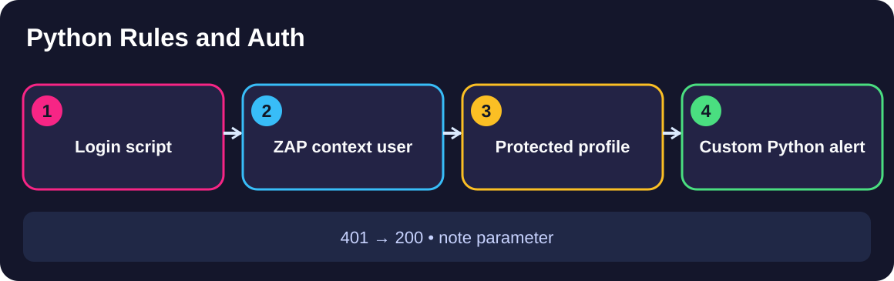
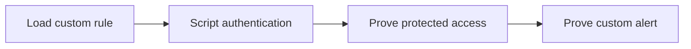

# Module 1 · Demo 3 — Script a scan rule and authentication

<div align="center">




<sub>Illustrative architecture · Generated using ChatGPT; only live requests and reports prove findings</sub>

</div>

<!-- demo-navigation:start -->
<p align="center"><b>Student exercise · Demo 3 of 6</b></p>
<p align="center">
  <a href="https://github.com/rupeshtiwari/pluralsight-script-development-with-zap/blob/m1-demo2-before/demos/module1-demos/m1-demo2-javascript-http-sender/README.md"></a>
  <a href="https://github.com/rupeshtiwari/pluralsight-script-development-with-zap/blob/m2-demo1-before/demos/module2-demos/m2-demo1-authenticated-zap-github-actions/README.md"></a>
</p>
<!-- demo-navigation:end -->

## The problem you are solving

The protected Globomantics profile is invisible to an unauthenticated security test. Maya needs an application-specific rule, a scripted login, proof that the scanner reached the protected page, and the exact named custom alert.

**What success looks like:** Script-driven authenticated coverage and a fresh custom Python active-scan alert. The four steps solve different parts of one problem. Read them in order: each adds evidence needed for the final decision.

## What you will learn in this demonstration

You will create two distinct script capabilities that work together:

- Implement a focused custom Python (Jython) active-scan rule *(EO2b)*
- Automate the ZAP authentication sequence and prove protected endpoint access *(EO2c)*

No separate course outline is required to complete this lab.

## Follow the evidence



## Start the local demo

This step starts the actual vulnerable Globomantics web application and ZAP container. The Mac prerequisite installer, `setup/setup-macos.sh`, is a **one-time preparation task** explained in the [course README](../../../README.md). You do not need to reinstall tools for every demo.

<details open>
<summary><b>Start Module 1 Demo 3 — exact branch, folder and runtime</b></summary>

**Where:** macOS Terminal or the VS Code integrated terminal, starting in the root of your existing local repository.

```bash
git fetch origin
git switch m1-demo3-before
cd demos/module1-demos/m1-demo3-python-scanning-authentication
./scripts/demo_reset.sh
```

**Expected startup:** the script waits for the local services. For a reset it prints a clean-slate message and brings up the vulnerable build. Continue only after it reports readiness; a failed startup is not part of the four teaching steps.

**Open these actual interfaces:** [Globomantics app — localhost:8000](http://localhost:8000/) · [ZAP GUI — localhost:8080/zap/](http://localhost:8080/zap/) · [ZAP API/proxy — localhost:8090](http://localhost:8090/). Open only the interface called for by the current step. The starter omits the completed Python rule and authentication script. Create them before attempting the later checks.

</details>

## The four teaching steps

<details open>
<summary><b>Step 1: Register a custom Jython active-scan rule</b> — Load custom rule</summary>

### The small problem to solve

A built-in scanner may not test the application's own unsafe reflection condition.

**Learning focus:** Implement a custom Python scanning rule *(EO2b)*

### Where to go

**Open VS Code.** Open `zap-scripts/globomantics-active-rule.py`. Inspect `scan` and `newAlert` / `raiseAlert`. Show **ZAP GUI → Scripts → Active Rules** if validating the loaded script.

### Run this exact command

**Where to type it:** the VS Code integrated Terminal, while your current directory is `demos/module1-demos/m1-demo3-python-scanning-authentication`.

```bash
./steps/01-load-python-active-scan-rule.sh
```

### What the script prints

The table shows the actual **field names and expected type of evidence** produced by the existing script. These are examples, **not results claimed from your computer**. Rule IDs and stable parameter names come from the demo; variable risk, request IDs and counters must be read from your live output.

<table>
<thead><tr><th>Displayed field</th><th>Example or expected value</th><th>What to check</th></tr></thead>
<tbody>
<tr><td><b>Script name</b></td><td><code>globomantics-active-rule (active · Jython)</code></td><td>Correct script type and engine</td></tr>
<tr><td><b>Alert it raises</b></td><td><code>Globomantics unsafe reflection (custom rule)</code></td><td>Named finding, not generic built-in XSS</td></tr>
<tr><td><b>Result</b></td><td><code>✔ PASS custom active rule loaded</code></td><td>Loading alone is not a fired alert</td></tr>
</tbody></table>

**Do not continue on FAIL.** Read the command's diagnostic text and verify the right branch, app state, and script source instead of claiming an alert appeared.

### What you should understand

The custom rule is now registered with ZAP's active scanning mechanism, where it can inspect application-specific parameters.

**How this connects:** Provide the authentication sequence so the rule can reach the protected profile.

</details>

<details>
<summary><b>Step 2: Register the login script</b> — Script authentication</summary>

### The small problem to solve

Manual cookie copying is unreliable in repeatable automated scanning.

**Learning focus:** Apply scripting to authentication sequence automation *(EO2c)*

### Where to go

**In VS Code**, inspect `zap-scripts/globomantics-auth.py`, focusing on `authenticate` and `getCredentialsParamsNames`. Use ZAP GUI → Scripts → Authentication for confirmation.

### Run this exact command

**Where to type it:** the VS Code integrated Terminal, while your current directory is `demos/module1-demos/m1-demo3-python-scanning-authentication`.

```bash
./steps/02-register-scripted-authentication.sh
```

### What the script prints

The table shows the actual **field names and expected type of evidence** produced by the existing script. These are examples, **not results claimed from your computer**. Rule IDs and stable parameter names come from the demo; variable risk, request IDs and counters must be read from your live output.

<table>
<thead><tr><th>Displayed field</th><th>Example or expected value</th><th>What to check</th></tr></thead>
<tbody>
<tr><td><b>Script name</b></td><td><code>globomantics-auth (authentication · Jython)</code></td><td>Authentication script identity</td></tr>
<tr><td><b>It submits</b></td><td><code>username=alice to POST /login</code></td><td>Training-only simplified login</td></tr>
<tr><td><b>Result</b></td><td><code>✔ PASS authentication script registered</code></td><td>The protected endpoint remains to be tested</td></tr>
</tbody></table>

**Do not continue on FAIL.** Read the command's diagnostic text and verify the right branch, app state, and script source instead of claiming an alert appeared.

### What you should understand

ZAP can now obtain a session by running a script rather than accepting an operator's copied cookie. The course's simplified username-only login is not a production security model.

**How this connects:** Prove the script really changes access to the protected page.

</details>

<details>
<summary><b>Step 3: Compare unauthenticated and scripted access</b> — Prove protected access</summary>

### The small problem to solve

A scan can incorrectly look clean if it never passes the login wall.

**Learning focus:** Verify scripted authentication effectiveness *(EO2c)*

### Where to go

**In ZAP GUI**, inspect Globomantics context and user Alice. Then return to **VS Code Terminal** to run the comparison. No cookie is manually supplied by the shell probe.

### Run this exact command

**Where to type it:** the VS Code integrated Terminal, while your current directory is `demos/module1-demos/m1-demo3-python-scanning-authentication`.

```bash
./steps/03-confirm-authenticated-profile-access.sh
```

### What the script prints

The table shows the actual **field names and expected type of evidence** produced by the existing script. These are examples, **not results claimed from your computer**. Rule IDs and stable parameter names come from the demo; variable risk, request IDs and counters must be read from your live output.

<table>
<thead><tr><th>Displayed field</th><th>Example or expected value</th><th>What to check</th></tr></thead>
<tbody>
<tr><td><b>Without login</b></td><td><code>/account/profile → HTTP 401</code></td><td>Endpoint truly protected</td></tr>
<tr><td><b>ZAP forced-user script auth</b></td><td><code>/account/profile → HTTP 200</code></td><td>ZAP obtains valid session</td></tr>
<tr><td><b>Auth script ran</b></td><td><code>authenticate: &lt;actual trace&gt;</code></td><td>Trace must prove script invocation</td></tr>
<tr><td><b>Result</b></td><td><code>✔ PASS ZAP executed authentication script</code></td><td>Both HTTP status and auth trace required</td></tr>
</tbody></table>

**Do not continue on FAIL.** Read the command's diagnostic text and verify the right branch, app state, and script source instead of claiming an alert appeared.

### What you should understand

HTTP 401 without login and HTTP 200 with ZAP's scripted user establish that the scanner can access the authenticated resource.

**How this connects:** Run the custom rule against the authenticated page, and reject stale findings.

</details>

<details>
<summary><b>Step 4: Confirm a fresh custom scan alert</b> — Prove custom alert</summary>

### The small problem to solve

A previous alert can make a new scan seem successful when the custom rule never ran.

**Learning focus:** Demonstrate application-specific scanning proof *(EO2b)*

### Where to go

**Open ZAP GUI → Alerts** for the targeted profile. Run the command in **VS Code Terminal**, then return to the Alerts pane and inspect the newly produced named finding.

### Run this exact command

**Where to type it:** the VS Code integrated Terminal, while your current directory is `demos/module1-demos/m1-demo3-python-scanning-authentication`.

```bash
./steps/04-confirm-custom-scan-alert.sh
```

### What the script prints

The table shows the actual **field names and expected type of evidence** produced by the existing script. These are examples, **not results claimed from your computer**. Rule IDs and stable parameter names come from the demo; variable risk, request IDs and counters must be read from your live output.

<table>
<thead><tr><th>Displayed field</th><th>Example or expected value</th><th>What to check</th></tr></thead>
<tbody>
<tr><td><b>Before scan</b></td><td><code>absent</code></td><td>Cleared alert store</td></tr>
<tr><td><b>Scan target</b></td><td><code>/account/profile?note=seed (as alice)</code></td><td>Authorized authenticated parameter</td></tr>
<tr><td><b>Alert</b></td><td><code>Globomantics unsafe reflection (custom rule)</code></td><td>Exact custom finding</td></tr>
<tr><td><b>Risk / Parameter</b></td><td><code>&lt;actual risk&gt; / note</code></td><td>Current result, not placeholder</td></tr>
<tr><td><b>Evidence</b></td><td><code>&lt;actual reflected marker&gt;</code></td><td>Evidence from real request</td></tr>
<tr><td><b>Result</b></td><td><code>✔ PASS named alert raised on current scan</code></td><td>Absent before and present after</td></tr>
</tbody></table>

**Do not continue on FAIL.** Read the command's diagnostic text and verify the right branch, app state, and script source instead of claiming an alert appeared.

### What you should understand

A new authenticated scan now produces the required custom alert tied to `note`. Built-in XSS alerts are not substitutes.

**How this connects:** The demo closes with repeatable authentication and an application-specific finding supported by a fresh scan.

</details>

## Finish and clean up

After Step 4, you should be able to explain why the named custom rule fired on an authenticated profile from real evidence rather than only recalling a command.

**Stop the demo's containers** from the same demo directory:

```bash
./scripts/demo_down.sh
```

To inspect the finished example, switch to `m1-demo3-after` **after preserving any exercise changes**. Compare without modifying files using `git diff m1-demo3-before..m1-demo3-after -- demos/module1-demos/m1-demo3-python-scanning-authentication`. For operational-only demos, the important difference may be live scan evidence rather than source code.

**Course-wide validation:** The Developer can run `./setup/run-all-demo-preflights.sh` **once from the repository root** to validate all six completed demo branches and produce real evidence bundles. It is not another script to run after each step.

<!-- demo-navigation:start -->
<p align="center"><b>Student exercise · Demo 3 of 6</b></p>
<p align="center">
  <a href="https://github.com/rupeshtiwari/pluralsight-script-development-with-zap/blob/m1-demo2-before/demos/module1-demos/m1-demo2-javascript-http-sender/README.md"></a>
  <a href="https://github.com/rupeshtiwari/pluralsight-script-development-with-zap/blob/m2-demo1-before/demos/module2-demos/m2-demo1-authenticated-zap-github-actions/README.md"></a>
</p>
<!-- demo-navigation:end -->

[← Module 1 demo catalog](../README.md) · [← Course home](../../../README.md)

