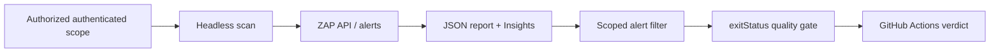

# Module 2 · Automate ZAP Security Decisions

### Convert an authenticated scan into traceable API evidence and a meaningful CI gate

Illustrative architecture · Generated using ChatGPT

## Why Does This Matter?

An interactive scan does not scale across pull requests, and a red CI job does not necessarily mean a vulnerability has been proven. The release team needs an authenticated scan that runs consistently, a report that agrees with the API, and an explicit policy for when a finding blocks delivery.

## Learning Objectives You Can Practice

| Objective | What You Will Learn | Demo |
|---|---|---|
| **EO3a** | Configure ZAP for headless execution in CI/CD environments | [Authenticated CI Scan](m2-demo1-authenticated-zap-github-actions/README.md) |
| **EO3b** | Implement ZAP API for programmatic security testing | [ZAP API & Insights](m2-demo2-zap-api-scan-evidence/README.md) |
| **EO3c** | Apply threshold-based quality gates for security findings in build pipelines | [Security Quality Gate](m2-demo3-security-quality-gates/README.md) |

## Choose One Independent Exercise

<table>
<tr><th>Demo</th><th>Real Question</th><th>Evidence You Will Inspect</th><th>Guide</th></tr>
<tr><td><b>1 · Authenticated GitHub Actions</b></td><td>Did ZAP actually run our scripts under the correct logged-in user?</td><td>Automation Framework plan, job log, authenticated custom alert</td><td><a href="m2-demo1-authenticated-zap-github-actions/README.md">Open Demo 1 →</a></td></tr>
<tr><td><b>2 · ZAP API and Insights</b></td><td>Do machine-readable findings match the archived report, and was the scan effective?</td><td>Scan status, script-generated alert, official JSON report, real Insights</td><td><a href="m2-demo2-zap-api-scan-evidence/README.md">Open Demo 2 →</a></td></tr>
<tr><td><b>3 · Security quality gate</b></td><td>Can the build ignore a scoped benign finding while still blocking real High risk?</td><td><code>alertFilter</code>, job order, final alert risks and process exit code</td><td><a href="m2-demo3-security-quality-gates/README.md">Open Demo 3 →</a></td></tr>
</table>

## How The Decision Travels

## How To Start

Run `./setup/setup-macos.sh` from the repository root, choose the appropriate `m2-demoN-before` branch, and follow the demo-specific README. The Module 2 starter branches include their required earlier script assets, so you do **not** need to execute Module 1 first.

For a hosted demo, open the GitHub Actions link from its README and verify that the run belongs to the branch you selected. For a quality gate, an intentionally failing job is valid only when its actual report and exit code establish the expected security decision.

Test only the supplied authorized Globomantics training application.

[← Return To Course Home](../../README.md)
