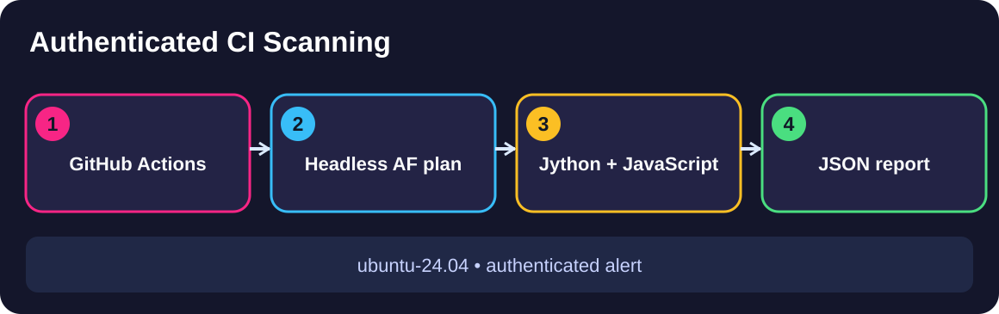

# Module 2, Automate authenticated security decisions

Illustrative diagram · Generated using ChatGPT

The Globomantics release team needs repeatable security checks in CI. Its pipeline must authenticate, retrieve the right custom finding, and enforce a risk policy that ignores only reviewed benign noise.

> 🧪 **Self-test off camera first:** `./preflight-check --module2` runs every Module 2 demo's steps and writes `course-evidence.txt` (and a `FAIL-<module>-<demo>.log` for anything broken). Use `./preflight-check` for the whole course, or `--m2d1 … --m2d3` for one demo. It is not an on-camera step.

## What you will learn

**Demo 1, Run authenticated ZAP in GitHub Actions.** Define an Automation Framework plan, authenticate as the right user, reuse JavaScript and Jython scripts, and prove the custom finding in a hosted report *(EO3a)*.

[Open Module 2 Demo 1 →](m2-demo1-authenticated-zap-github-actions/README.md)

**Demo 2, Query the ZAP API and inspect evidence.** Confirm the scan finished, retrieve a named alert, reconcile its risk against the official JSON report, and interpret operational Insights *(EO3b)*.

[Open Module 2 Demo 2 →](m2-demo2-zap-api-scan-evidence/README.md)

**Demo 3, Enforce a security quality gate.** Scope a False Positive filter, verify job order, then prove a remaining High finding caused the intended build-blocking process exit *(EO3c)*.

[Open Module 2 Demo 3 →](m2-demo3-security-quality-gates/README.md)

## Start an exercise

Use the one-time Mac prerequisites described on the [course landing page](../../README.md). Each demo has independent prerequisites in its starter branch; no prior exercise needs to be executed. Start its local training stack from the specified demo folder, run the four named commands, inspect actual API/CI proof, then stop the lab.

[← Course home](../../README.md)
