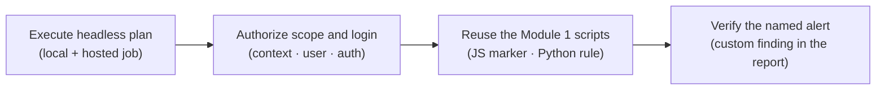

# Module 2 · Demo 1, Run authenticated ZAP in GitHub Actions

<div align="center">


<sub>Illustrative workflow · Generated using ChatGPT · Verify actual evidence in your own lab</sub>

</div>

<!-- demo-navigation:start -->
<p align="center"><b>Student exercise · Demo 4 of 6</b></p>
<p align="center">
  <a href="https://github.com/rupeshtiwari/pluralsight-script-development-with-zap/blob/m1-demo3-before/demos/module1-demos/m1-demo3-python-scanning-authentication/README.md"></a>
  <a href="https://github.com/rupeshtiwari/pluralsight-script-development-with-zap/blob/m2-demo2-before/demos/module2-demos/m2-demo2-zap-api-scan-evidence/README.md"></a>
</p>
<!-- demo-navigation:end -->

## Your scenario

Everything you built in Module 1, the marker script, the custom rule, the scripted login, ran on your machine, with you watching. That does not survive contact with a real team. The next pull request against the Globomantics Store needs those same checks to run *without you*, on a hosted build runner, and produce a report someone can trust without having been there.

And here is the subtle part you and I are going to insist on: a green workflow badge does not prove your security test ran. A job can go green having scanned nothing but the login page, or having quietly skipped your custom rule, or having produced a report from a commit two weeks old. So in this demo we move the whole scan into a versioned **Automation Framework plan** (`ci/af-plan.yaml`), run it headless, and then verify, against the **hosted GitHub Actions run for this exact code**, that the authenticated context loaded, that both Module 1 scripts actually ran, and that your named finding (`Globomantics unsafe reflection`, rule `50000`) reached the report. The green badge is where most people stop; it is where we start checking.

## Your learning goals

You will turn interactive ZAP checks into an unattended security run:

1. Configure ZAP's Automation Framework plan for authenticated headless execution in CI/CD *(EO3a)*
2. Verify that the original custom scripts, authorized scope and expected finding actually reached the CI report *(EO3a)*

You do not need the separate course outline, each step states what you are checking and why.

## Your evidence path



Each step checks a different way the badge could be lying: that the plan ran at all, that it ran *authenticated*, that it ran *your* scripts, and that it produced *your* finding, all tied back to the hosted run for this commit.

## Start your lab

Mac dependencies are prepared **once for the course** with `setup/setup-macos.sh` (see the [course README](../../../README.md)). Each demo then starts its **own** local stack.

<details open>
<summary><b>Open the exact branch and start Module 2 Demo 1</b></summary>

**Where:** the VS Code integrated Terminal, from the root of your existing Git checkout. This demo shows plan and workflow source, so work in VS Code.

```bash
cd "$HOME/pluralsight-script-development-with-zap"
git fetch origin
git switch m2-demo1-before
cd demos/module2-demos/m2-demo1-authenticated-zap-github-actions
./scripts/demo_up.sh
```

**Expected start:** the startup script reports healthy Globomantics, Postgres, MongoDB and ZAP services. If anything is not ready, stop and read the actual output before continuing.

**Interfaces:** <a href="http://localhost:8000/" target="_blank" rel="noopener">Training application</a> · <a href="http://localhost:8080/zap/" target="_blank" rel="noopener">ZAP GUI</a> · <a href="http://localhost:8090/" target="_blank" rel="noopener">ZAP API and proxy</a>, plus **GitHub → Actions → authenticated-scan** for the hosted proof. The `-before` branch ships the Module 1 scripting assets but deliberately omits the finished `ci/af-plan.yaml`, author it from the approved example before expecting the plan check to pass. Hosted GitHub Actions proof is separate from the local check.

</details>

## Your four steps

<details open>
<summary><b>Step 1, Run ZAP from the Automation Framework plan</b> · local + hosted job</summary>

### What you are learning

Move the scan into a versioned plan ZAP can run headless, and confirm the hosted `ubuntu-24.04` job ran it for this exact code. *(EO3a)*

### What we examine, and why

Open `ci/af-plan.yaml` and `.github/workflows/zap-authenticated-scan.yml` in VS Code. The plan is the scan written as *configuration*, an ordered list of jobs (load scripts, define context, spider, active-scan, report) that ZAP executes with `zap.sh -cmd -autorun`. No clicks, so it is repeatable; in version control, so it is reviewable. The workflow is what runs that plan on a hosted runner on every change.

The step does two things, and the distinction is the lesson: it runs the plan **locally** to prove it executes cleanly, and it reads the **hosted GitHub Actions API** to confirm a real `ubuntu-24.04` run of this plan succeeded *for your code*. "For your code" is doing real work, the helper checks the hosted run's commit, and if the watched files (the plan, the workflow, the scripts) have not changed since that run, the run still covers your current checkout. That is how a local green and a hosted green become one claim instead of two hopes.

**Predict before you run:** you expect the local plan to finish with `0 errors`, and the hosted run to show `ubuntu-24.04`, a successful headless ZAP step, and `covers this code`. A local pass alone is only half the proof.

### Run command

**Where:** the VS Code integrated Terminal, in `demos/module2-demos/m2-demo1-authenticated-zap-github-actions`.

```bash
cd "$HOME/pluralsight-script-development-with-zap/demos/module2-demos/m2-demo1-authenticated-zap-github-actions"
./steps/01-run-headless-automation-plan.sh
```

For the hosted proof, open the <a href="https://github.com/rupeshtiwari/pluralsight-script-development-with-zap/actions/workflows/zap-authenticated-scan.yml" target="_blank" rel="noopener">authenticated-scan workflow</a>, select the run for your branch/SHA, and read the headless-execution step.

### Expected result (the script's output contract, not your run)

The hosted run ID and commit are specific to your run, read them from your output. The named values are what a healthy run shows.

<table><thead><tr><th>Output field</th><th>Expected value or example</th><th>What to inspect</th></tr></thead>
<tbody><tr><td><b>Local plan run</b></td><td><code>plan &lt;id&gt; · finished · 0 errors · 0 warnings</code></td><td>The plan executes cleanly, headless</td></tr>
<tr><td><b>Hosted workflow run</b></td><td><code>&lt;run id&gt; · success · commit &lt;sha&gt;</code></td><td>A real GitHub Actions run, from the API</td></tr>
<tr><td><b>Runner</b></td><td><code>ubuntu-24.04</code></td><td>The hosted platform the course targets</td></tr>
<tr><td><b>Headless ZAP step · covers this code</b></td><td><code>success · branch</code></td><td>The run applies to your current checkout</td></tr>
<tr><td><b>Result</b></td><td><code>✔ PASS the plan ran headless with no errors, and the hosted ubuntu-24.04 job for this code succeeded</code></td><td>Local <b>and</b> hosted, same plan</td></tr></tbody></table>

### Investigate, then decide

Read the local `0 errors` next to the hosted `success · covers this code`. The decision: *the scan is now an unattended, versioned control*, not a thing you have to be present to run. If the hosted run does not cover your code, your latest change has not been proven in CI yet; push and let it run rather than claiming the old run speaks for it.

**On FAIL:** a local plan error points at `ci/af-plan.yaml`; a missing or non-covering hosted run means CI has not validated this commit. Treat them as the different problems they are.

**Next:** prove the plan did not just run, that it ran *authenticated*.

</details>

<details>
<summary><b>Step 2, Inspect the authenticated scan context</b> · context · user · auth</summary>

### What you are learning

Read how the plan binds scope, scripted login and user *before* scanning, and why the hosted run proves that binding actually loaded. *(EO3a)*

### What we examine, and why

In `ci/af-plan.yaml`, read the `env.contexts` block: the `Globomantics` context, the `script`-based authentication pointing at `globomantics-auth` on the `jython` engine, the user `alice`, and the `includePaths` that keep the scan bounded to `http://app:8000/account/profile.*`. This is the same scripted login you proved in Module 1 Demo 3, now expressed as plan config so CI logs in the same way every time.

Configuration on its own, though, is just text, it does not prove ZAP logged in. The honest proof is indirect and strong: the hosted run raises the custom alert **on a login-only page**, and that can only happen if ZAP loaded the context, assumed user `alice`, and ran the scripted auth. A finding on a page you cannot reach without logging in *is* the login working.

**Predict before you run:** you expect `Globomantics · script · jython`, user `alice`, scope limited to the profile path, a local authenticated request reaching `/account/profile?note=seed`, and the hosted run confirming the context loaded. Config plus a login-only finding, not config alone.

### Run command

**Where:** the VS Code integrated Terminal, in the same demo folder.

```bash
cd "$HOME/pluralsight-script-development-with-zap/demos/module2-demos/m2-demo1-authenticated-zap-github-actions"
./steps/02-inspect-authenticated-scan-context.sh
```

Keep `ci/af-plan.yaml` open at `env.contexts`, the script, user `alice` and included paths, while you read the result.

### Expected result (the script's output contract, not your run)

<table><thead><tr><th>Output field</th><th>Expected value or example</th><th>What to inspect</th></tr></thead>
<tbody><tr><td><b>Context · authentication · engine</b></td><td><code>Globomantics · script · python : jython</code></td><td>The scripted login from Module 1</td></tr>
<tr><td><b>User · scope</b></td><td><code>alice · http://app:8000/account/profile.*</code></td><td>Bounded, authorized target</td></tr>
<tr><td><b>Local authenticated request</b></td><td><code>GET /account/profile?note=seed</code></td><td>The login-only page was reached</td></tr>
<tr><td><b>Hosted run proved it loaded</b></td><td><code>custom alert on login-only page · covers this code</code></td><td>The context loaded in CI, not just on disk</td></tr>
<tr><td><b>Result</b></td><td><code>✔ PASS the plan declares the authenticated context and the hosted run proves ZAP loaded it</code></td><td>A finding on a login-only page</td></tr></tbody></table>

### Investigate, then decide

Tie the config (`alice`, scripted auth, profile scope) to the login-only finding the hosted run produced. The decision: *CI scans as a real authenticated user, inside an authorized scope*, so coverage of the protected area is real, not a scan of the front door. Configuration you cannot tie to a login-only effect is not yet proof.

**On FAIL:** a context that did not load shows as no authenticated request and no login-only finding. Fix the plan's context block, not the assertion.

**Next:** confirm it was *your* Module 1 scripts doing the work, not CI reinventing them.

</details>

<details>
<summary><b>Step 3, Verify the scripts run in the authenticated scope</b> · JS marker · Python rule</summary>

### What you are learning

Prove the plan reuses the exact Module 1 scripts, the JavaScript marker and the Python rule, rather than rewriting them in CI. *(EO3a)*

### What we examine, and why

Read the plan's script-loading jobs: they load `globomantics-marker` (the JS HTTP Sender from Demo 2) and `globomantics-active-rule` plus `globomantics-auth` (the Python scripts from Demo 3) by name. Reuse-by-name matters because the alternative, reimplementing the check inside the pipeline, creates drift: the CI version and the one you tested diverge, and your report starts describing a rule you never reviewed.

The step shows both scripts executing in the authenticated run: the JS marker stamping its header on an authenticated request, and the Python rule raising its `50000` alert at `Medium/Medium` on the login-only page. Same scripts, same identities as Module 1, now inside the plan.

**Predict before you run:** you expect the marker header on an authenticated `/account/profile?note=seed` request, and the Python rule's `50000 · Medium/Medium` alert. The marker header is proof the JS hook fired; the `50000` is proof the rule fired, two scripts, one authenticated run.

### Run command

**Where:** the VS Code integrated Terminal, in the same demo folder.

```bash
cd "$HOME/pluralsight-script-development-with-zap/demos/module2-demos/m2-demo1-authenticated-zap-github-actions"
./steps/03-verify-reused-security-scripts.sh
```

Keep the plan's script jobs and requestor configuration visible in VS Code; the hosted run's protected-profile request corroborates the same coverage.

### Expected result (the script's output contract, not your run)

<table><thead><tr><th>Output field</th><th>Expected value or example</th><th>What to inspect</th></tr></thead>
<tbody><tr><td><b>JavaScript check (globomantics-marker)</b></td><td><code>marker header on an authenticated request: GET /account/profile?note=seed</code></td><td>The JS hook fired in the plan</td></tr>
<tr><td><b>Python check (globomantics-active-rule)</b></td><td><code>custom alert 50000 · Medium/Medium</code></td><td>The Module 1 rule fired, by identity</td></tr>
<tr><td><b>Ran authenticated against</b></td><td><code>/account/profile (note parameter)</code></td><td>Protected page, authorized scope</td></tr>
<tr><td><b>Result</b></td><td><code>✔ PASS both Module 1 scripts ran during the authenticated plan</code></td><td>Reuse by name, not a rewrite</td></tr></tbody></table>

### Investigate, then decide

Confirm the `50000` identity matches the rule you wrote in Module 1 Demo 3, same plugin, now in CI. The decision: *the pipeline runs the scripts you reviewed, unchanged*, so the report describes your checks, not a CI-local reimplementation that could drift.

**On FAIL:** a missing marker header or a built-in alert instead of `50000` means a script did not load, fix the plan's script job rather than inferring the side effect.

**Next:** confirm the one finding this whole pipeline exists to prove actually reached the report.

</details>

<details>
<summary><b>Step 4, Confirm the custom Python alert in the report</b> · custom finding in the report</summary>

### What you are learning

Require the named custom finding in the CI report, tied to this commit, because a green job can still omit the very thing it was meant to prove. *(EO3a)*

### What we examine, and why

The step clears the alert store, runs the authenticated plan, and requires `Globomantics unsafe reflection (custom rule)` on `/account/profile` at parameter `note`, `Medium`, and confirms the **hosted job's report check** passed for this code. That hosted check is *fail-closed*: if the named finding is missing from the report, the job fails. This is the opposite of trusting a green badge, the badge is green *because* the finding was verified present, not in spite of it being absent.

The reason this is the last step, not the first: it is the payoff of every prior check. The plan ran (Step 1), authenticated (Step 2), with your scripts (Step 3), and now the application-specific finding they produce is in the report that a release decision would read. A historical green run does not prove a newer commit; the `covers this code` check is what keeps you honest.

**Predict before you run:** you expect the named alert on `note` at `Medium`, and the hosted report check `success · covers this code`. A built-in XSS alert in its place is a fail, not a near-miss.

### Run command

**Where:** the VS Code integrated Terminal, in the same demo folder.

```bash
cd "$HOME/pluralsight-script-development-with-zap/demos/module2-demos/m2-demo1-authenticated-zap-github-actions"
./steps/04-confirm-authenticated-custom-alert.sh
```

Then open the same hosted run → **Artifacts → globo-ci-report**, download the JSON, and read the named finding for your run's SHA, not a historical report.

### Expected result (the script's output contract, not your run)

<table><thead><tr><th>Output field</th><th>Expected value or example</th><th>What to inspect</th></tr></thead>
<tbody><tr><td><b>Alert (this plan run; store cleared first)</b></td><td><code>Globomantics unsafe reflection (custom rule)</code></td><td>The exact named Python finding</td></tr>
<tr><td><b>Risk · parameter</b></td><td><code>Medium · note</code></td><td>The protected-page input</td></tr>
<tr><td><b>Hosted report check</b></td><td><code>success · covers this code: branch</code></td><td>Fail-closed check for this commit</td></tr>
<tr><td><b>Result</b></td><td><code>✔ PASS the custom alert was raised by this authenticated run, and the hosted job's report check passed for this code</code></td><td>Named finding, not built-in XSS</td></tr></tbody></table>

### Investigate, then decide

Confirm the report's finding is your named rule on `note`, and that the hosted check covers this commit. The decision this whole demo built to: *an unattended CI run now produces a report you can trust as a release signal*, authenticated, running your scripts, carrying your finding, tied to this code. That report is exactly what Module 2 Demo 2 queries over the API next.

**On FAIL:** a job that is green but whose report check failed (or covers an older commit) is the trap this step exists to catch, push and re-run rather than trusting the badge.

**Next:** a repeatable authenticated CI report is now a trusted source for the API-driven decisions you make in Demo 2.

</details>

<!-- student-achievement:start -->
## What you achieved

You can now explain each learning objective with the evidence you captured:

1. **(EO3a) You ran the Automation Framework plan headless in CI.** The local plan finished with `0 errors`, and the hosted `ubuntu-24.04` job for this exact commit launched ZAP with `-autorun`, succeeded, and `covers this code`, the same checks, unattended and versioned.
2. **(EO3a) You verified the pipeline reached the intended finding.** The authenticated context (`Globomantics`, scripted `jython` auth, user `alice`, bounded scope) loaded, proven by a custom alert on a login-only page; both Module 1 scripts ran (the JS marker header on an authenticated request and the Python rule's `50000 · Medium/Medium`); and the hosted, fail-closed report check passed for the named finding on `/account/profile (note)`, a stale report or a built-in substitute would have failed it.

**How to apply it:** this is how you make security testing a real gate, put the scan in a versioned plan, run it headless in CI, and verify authentication, script reuse and the specific finding against the hosted run for *this* commit. The green badge is the beginning of the check, not the end of it.

**Your final check:** explain each numbered outcome using *your own* captured evidence from this run. A README example, a missing result, or an earlier run does not satisfy this exercise.
<!-- student-achievement:end -->

## Finish your lab

A headless scan is useful only when its reported target, authentication and custom finding are real and tied to this code, which is exactly what you just proved, local and hosted.

From the same demo directory, stop the local services:

```bash
cd "$HOME/pluralsight-script-development-with-zap/demos/module2-demos/m2-demo1-authenticated-zap-github-actions"
./scripts/demo_down.sh
```

The `m2-demo1-after` branch holds the completed reference, including the finished `ci/af-plan.yaml`. Preserve your changes first, then compare without modifying files: `git diff m2-demo1-before..m2-demo1-after -- demos/module2-demos/m2-demo1-authenticated-zap-github-actions` from the repository root.

<!-- demo-navigation:start -->
<p align="center"><b>Student exercise · Demo 4 of 6</b></p>
<p align="center">
  <a href="https://github.com/rupeshtiwari/pluralsight-script-development-with-zap/blob/m1-demo3-before/demos/module1-demos/m1-demo3-python-scanning-authentication/README.md"></a>
  <a href="https://github.com/rupeshtiwari/pluralsight-script-development-with-zap/blob/m2-demo2-before/demos/module2-demos/m2-demo2-zap-api-scan-evidence/README.md"></a>
</p>
<!-- demo-navigation:end -->

[← Module 2 catalog](../README.md) · [← Course home](../../../README.md)
