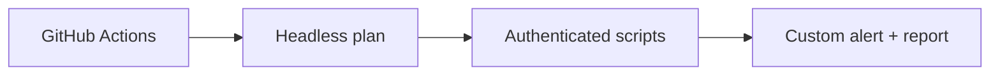

# Run Authenticated ZAP in GitHub Actions

<details><summary><b>Branch: m2-demo1-after — Completed CI Reference</b></summary>

This branch contains the authenticated Automation Framework plan and all its scripting prerequisites. You can study the completed plan or switch to `m2-demo1-before` to author it.

</details>


<div align="center">


<sub>Illustrative architecture · Generated using ChatGPT · Verify the actual API, report or CI results</sub>

</div>

## What Problem Are You Solving?

A local scan can look convincing but fail on a hosted runner because scripts, scope, and login state are missing. Maya needs an Automation Framework plan that can authenticate as a Globomantics user, reuse the JavaScript and Jython scripts, and archive a named custom finding on GitHub Actions.

**Your outcome:** Understand how the system behaves, run four meaningful commands, inspect the real output and explain the engineering decision. No external course outline is required.

## Learning Objective Covered

<table><thead><tr><th>Objective</th><th>What You Will Learn</th></tr></thead><tbody>
<tr><td><code>EO3a</code></td><td>Configure ZAP for headless execution in CI/CD environments</td></tr>
</tbody></table>

## Your Four-Step Learning Path



<table>
<thead><tr><th>Step</th><th>Exact Command</th><th>What You Do</th><th>What To Verify</th><th>Why It Matters</th></tr></thead>
<tbody><tr><td><b>1</b></td><td><code>./steps/01-run-headless-automation-plan.sh</code></td><td>Execute the Automation Framework plan without a GUI</td><td>Successful plan execution and GitHub Actions job log</td><td>CI cannot depend on manual desktop actions</td></tr>
<tr><td><b>2</b></td><td><code>./steps/02-inspect-authenticated-scan-context.sh</code></td><td>Inspect context, login script, user and target scope</td><td>Context Globomantics, user alice and scoped profile</td><td>An authenticated scan requires explicit identity and boundaries</td></tr>
<tr><td><b>3</b></td><td><code>./steps/03-verify-reused-security-scripts.sh</code></td><td>Run the original custom scripts against the protected page</td><td>Script job results plus authenticated request evidence</td><td>Reuse tested scripts instead of rewriting them in CI</td></tr>
<tr><td><b>4</b></td><td><code>./steps/04-confirm-authenticated-custom-alert.sh</code></td><td>Inspect the custom finding in the headless result</td><td>Named alert on /account/profile, parameter note</td><td>A pipeline needs a fail-closed assertion on the intended finding</td></tr></tbody></table>

## Start This Exercise

From the repository root:

```bash
git fetch origin
git switch m2-demo1-before
./setup/setup-macos.sh
cd demos/module2-demos/m2-demo1-authenticated-zap-github-actions
./scripts/demo_up.sh
```

If the one-time Mac setup has already completed, you can skip that setup command. Execute Steps 1–4 above from this demo directory. Then run:

```bash
./scripts/preflight_check.sh
./scripts/demo_down.sh
```

The preflight saves a timestamped log in `logs/`. For hosted evidence, use the GitHub Actions link in the detailed steps and inspect the actual workflow's **run SHA**, status, job log and report. Never assume a successful report from an earlier session satisfies this exercise.

**Compare with the completed version:** `git diff m2-demo1-before..m2-demo1-after -- demos/module2-demos/m2-demo1-authenticated-zap-github-actions`. This comparison does not overwrite your work. Both the starter and completed branches include their required prerequisites; authored solution files or plans are added by the exercise when applicable.

**Technical evidence note:** The hosted job's source SHA matters: an older successful workflow cannot prove a newer plan. A built-in XSS alert does not substitute for the named custom Python alert. On the starter branch the finished Automation Framework plan must be created before its execution succeeds.

All scanning stays within the supplied, authorized Globomantics training environment.

---

## Detailed Instructions And Expected Evidence

<details><summary><b>View The Four Executable Steps</b></summary>

```bash
./steps/01-run-headless-automation-plan.sh
./steps/02-inspect-authenticated-scan-context.sh
./steps/03-verify-reused-security-scripts.sh
./steps/04-confirm-authenticated-custom-alert.sh
```

Run these commands in order from this demo's folder, then execute `./scripts/preflight_check.sh`. Inspect actual ZAP GUI or GitHub Actions evidence where indicated.
</details>


Run the ZAP scripts you built in Module 1 automatically and headless inside a
GitHub Actions pipeline — logged in as a real user, driven entirely by one ZAP
Automation Framework plan. You read the plan in VS Code to understand how it binds
authentication and scope, then prove the same plan runs headless and authenticated.

> **Authorization and scope.** The scan runs only against the local Globomantics
> app started inside the workflow. Never point it at any system you are not
> authorized to test.

## Applications and locations used

| Application | Where | Used for |
|-------------|-------|----------|
| VS Code | `demos/module2-demos/m2-demo1-authenticated-zap-github-actions/ci/af-plan.yaml` + the integrated terminal | reading the plan config, then running `./scripts/demo_step.sh N` |
| GitHub Actions | `https://github.com/rupeshtiwari/pluralsight-script-development-with-zap/actions/workflows/zap-authenticated-scan.yml` → latest run → job **authenticated-scan** | the same plan run headless on the hosted runner |
| CI artifact | run page → **Artifacts** → `globo-ci-report` | the archived report from the hosted run |

The local run and the GitHub Actions run execute the **same** plan: use VS Code for
the config and mechanics, and the Actions run for the hosted-runner proof.

## Setup

```bash
cd demos/module2-demos/m2-demo1-authenticated-zap-github-actions
./scripts/demo_up.sh             # prints "Up" when healthy
```

To show the hosted run, trigger the workflow from the Actions tab (**Run workflow**,
it is `workflow_dispatch`) or push to the repository, then open the most recent run
of *Globomantics authenticated ZAP scan*.

## Step-by-step LO traceability

| Step | LO | Config / mechanism (`ci/af-plan.yaml`) | Command | Observed result | Proof artifact |
|------|----|----------------------------------------|---------|-----------------|----------------|
| 1 | EO3a | whole plan, run via `zap.sh -cmd -autorun` | `steps/01-run-headless-automation-plan.sh` | plan runs headless to completion, no errors | GitHub Actions job log |
| 2 | EO3a | `authentication` 29–40 · `users` 44–47 · `includePaths` 26–28 | `steps/02-inspect-authenticated-scan-context.sh` | plan binds context `Globomantics`, scripted auth, user `alice`, scope `http://app:8000` | Authenticated context configuration |
| 3 | EO3a | `passiveScan-config` 60–62 · script `add`/`enable` 67–91 · `spider` 93–99 · `requestor` 109–119 · `activeScan` + rule `50000` 121–134 | `steps/03-verify-reused-security-scripts.sh` | Module 1 scripts load and run against `/account/profile` while logged in | Authenticated script job result |
| 4 | EO3a | `report` 141–146 | `steps/04-confirm-authenticated-custom-alert.sh` | custom alert `Globomantics unsafe reflection (custom rule)` on `/account/profile`, param `note` | Authenticated custom alert record |

---

## Step 1: Run ZAP headless from the plan (EO3a)

**The problem.** A pipeline has no GUI to click. ZAP must run the entire
authenticated scan from one config file, unattended — exactly as the hosted runner
does.

**Execute.**

```bash
./steps/01-run-headless-automation-plan.sh
```

**Inspect the actual evidence.** ZAP runs `ghcr.io/zaproxy/zaproxy` (pinned by
digest = tag `20260807-stable`, ZAP 2.17.0) via `zap.sh -cmd -autorun …` and the
plan runs headless to completion with no errors, following the canonical job order
`passiveScan-config → script → spider → passiveScan-wait → activeScan →
passiveScan-wait → report` (the gate jobs `alertFilter`/`exitStatus` are M2 C5).
In CI, the same beat is the **authenticated-scan** job's **Run ZAP headless with the
Automation Framework plan** step on `ubuntu-24.04`.

**The engineer's decision.** One plan file drives the whole authenticated scan with
no window — which is what makes it runnable unattended in CI.

Proof artifact: GitHub Actions job log.

---

## Step 2: Show the authenticated context configuration (EO3a)

**The problem.** A headless run cannot fill in a login form, so the plan must declare
*how to log in* and *what to scan* as data, once, before any scanning.

**Inspect the plan in VS Code.** Open `demos/module2-demos/m2-demo1-authenticated-zap-github-actions/ci/af-plan.yaml` →
`env.contexts`:

- **`authentication` (lines 29–40)** — `method: script` loads
  `globomantics-auth.py` by path, with `scriptEngine: "python : jython"` and the
  `Login URL` it needs. Verification is response-based: `loggedInRegex: "Signed in
  as"` and `loggedOutRegex: "Please log in first"` tell ZAP when the session is valid.
- **`users` (lines 44–47)** — the user the scan runs as: `alice`, with the
  `username` credential the auth script consumes.
- **`includePaths` (lines 26–28)** — the scope: the profile and greet paths on
  `http://app:8000`.

The mechanism: authentication and scope are declared as config, so the same login
and target apply identically on every run.

**Execute.**

```bash
./steps/02-inspect-authenticated-scan-context.sh
```

**Inspect the actual evidence.** The plan binds Context `Globomantics`, script-based
authentication via `globomantics-auth` (Login URL `/login`), user `alice`, and scope
`http://app:8000` before scanning.

**The engineer's decision.** Because the login and scope live in the plan, the
authenticated scan is reproducible on every unattended run.

Proof artifact: Authenticated context configuration.

---

## Step 3: See the Module 1 scripts run authenticated (EO3a)

**The problem.** The plan has to load the exact scripts from Module 1 and run them
as `alice` against the login-only page — not re-implement them.

**Inspect the jobs in VS Code.** In the same file, the `jobs` list follows the
canonical Automation Framework order (non-gate portion):

- **`passiveScan-config` (lines 60–62)** — enables scope-limited passive scanning
  before any traffic.
- **script `add` / `enable` (lines 67–91)** — loads `globomantics-active-rule` (Py)
  and `globomantics-marker` (JS) by path; the auth script is loaded by the context.
- **`spider` (lines 93–99)** — crawls the scope *as alice* so the sites tree is
  populated from inside the session.
- **`passiveScan-wait` (lines 101–103)** — drains the passive-scan queue.
- **`requestor` (lines 109–119)** — seeds `/account/profile?note=seed` into the sites
  tree *as alice*, guaranteeing the authenticated node (with the `note` param) the
  active scan and custom rule attack.
- **`activeScan` + rule `50000` (lines 121–134)** — runs the scan as the context user;
  the Script Active Scan Rules plugin (`50000`, inline policy at LOW threshold) is what
  runs the custom Python rule. A second `passiveScan-wait` then `report` follow.

**Execute.**

```bash
./steps/03-verify-reused-security-scripts.sh
```

**Inspect the actual evidence.** The plan loads `globomantics-marker` (JS),
`globomantics-active-rule` (Py), and `globomantics-auth` (Py) and runs authenticated
against `/account/profile` — the scan reaches the logged-in page.

**The engineer's decision.** The custom JavaScript and Python checks from Module 1
run unchanged inside the pipeline, now against an authenticated scope.

Proof artifact: Authenticated script job result.

---

## Step 4: Confirm the authenticated custom alert (EO3a)

**The problem.** The run must record the unsafe-reflection finding on the login-only
page — the exact condition the Module 1 custom rule targets, reachable only because
the scripted login worked (the page is HTTP 401 without it).

**Execute.**

```bash
./steps/04-confirm-authenticated-custom-alert.sh
```

**Inspect the actual evidence.** The custom rule's named alert `Globomantics unsafe
reflection (custom rule)` is recorded on `/account/profile`, parameter `note`, under
the authenticated headless run — alongside ZAP's built-in `Cross Site Scripting
(Reflected)` on the same parameter. In CI it is written to the downloadable
`globo-ci-report` artifact.

**The engineer's decision.** The finding exists only under authentication, and it is
*your* Module 1 rule's named alert serialized by the headless pipeline run — exactly
what a quality gate can later pass or fail the build on.

Proof artifact: Authenticated custom alert record.

## Validate and reset

Run the same Automation Framework plan locally through the checker — it runs the plan
via the ZAP API, logs in, runs the scripts authenticated, and confirms the finding,
writing a reviewable log to `logs/`:

```bash
./scripts/preflight_check.sh
```

It ends with `5 checks passed, 0 failed`. Tear down with `./scripts/demo_down.sh`.
