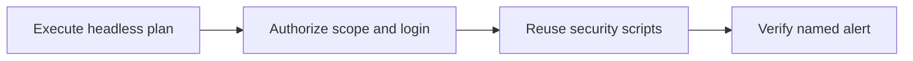

# Module 2 · Demo 1 — Run authenticated ZAP in GitHub Actions

<div align="center">


<sub>Illustrative workflow · Generated using ChatGPT · Verify actual evidence in your own lab</sub>

</div>

<!-- demo-navigation:start -->
<p align="center"><b>Student exercise · Demo 4 of 6</b></p>
<p align="center">
  <a href="https://github.com/rupeshtiwari/pluralsight-script-development-with-zap/blob/m1-demo3-before/demos/module1-demos/m1-demo3-python-scanning-authentication/README.md"></a>
  <a href="https://github.com/rupeshtiwari/pluralsight-script-development-with-zap/blob/m2-demo2-before/demos/module2-demos/m2-demo2-zap-api-scan-evidence/README.md"></a>
</p>
<!-- demo-navigation:end -->

## Your Scenario

Your team needs the Store security checks on a hosted build runner. A successful local scan or a green workflow badge alone does not establish that the intended authenticated custom check ran.

**Your practical goal:** I will guide you through headless ZAP execution, the authenticated context, reuse of the existing scripts and the named custom alert. You will link the hosted job and report to the exact source commit.

## Your Learning Goals

You will turn interactive ZAP checks into an unattended security run:

- Configure ZAP's Automation Framework plan for authenticated headless execution in CI/CD *(EO3a)*
- Verify that the original custom scripts, authorized scope and expected finding actually reached the CI report *(EO3a)*

You do not need the separate course outline to understand the objective or follow the exercises.

## Your Evidence Path



## Start Your Lab

Mac dependencies are prepared **once for the course** using `setup/setup-macos.sh`, as shown in the [course README](../../../README.md). Each demo must then start its **own local training stack**:

<details open>
<summary><b>Open the exact branch and start Module 2 Demo 1</b></summary>

**Where:** macOS Terminal or VS Code integrated Terminal, from the root of your existing Git checkout.

```bash
cd "$HOME/pluralsight-script-development-with-zap"
git fetch origin
git switch m2-demo1-before
cd demos/module2-demos/m2-demo1-authenticated-zap-github-actions
./scripts/demo_up.sh
```

**Expected start:** healthy Globomantics, Postgres, MongoDB, and ZAP services, reported by the startup script. If they are not ready, stop and inspect the actual output before proceeding.

**URLs:** [Training application](http://localhost:8000/) · [ZAP GUI](http://localhost:8080/zap/) · [ZAP API and proxy](http://localhost:8090/). The starter branch has required original scripting assets but intentionally lacks the completed `ci/af-plan.yaml`. Author the plan using the approved example before expecting the headless plan check to pass. Hosted GitHub Actions proof is separate from local preflight.

</details>

## Your Four Steps

<details open>
<summary><b>Step 1 — Run ZAP from the Automation Framework plan</b> · Execute headless plan</summary>

### Learning Goal

A security test needing manual clicks is not a repeatable CI control.

**What you are learning:** Configure headless ZAP in CI/CD *(EO3a)*

### Demo Workspace

**Open VS Code.** Inspect `ci/af-plan.yaml` and the `.github/workflows/zap-authenticated-scan.yml` workflow. Open **GitHub → Actions → authenticated-scan** for hosted proof of the exact current commit.

<!-- student-location:start -->
**Run in:** VS Code integrated Terminal.

```bash
cd "$HOME/pluralsight-script-development-with-zap/demos/module2-demos/m2-demo1-authenticated-zap-github-actions"
```
<!-- student-location:end -->

### Run Command

**Where:** VS Code integrated Terminal for the local check; GitHub Actions page for CI evidence. **Current folder:** `demos/module2-demos/m2-demo1-authenticated-zap-github-actions`.

```bash
./steps/01-run-headless-automation-plan.sh
```

<!-- student-proof:start -->
**Where your result appears:** The local result stays in Terminal. For required hosted proof, open https://github.com/rupeshtiwari/pluralsight-script-development-with-zap/actions/workflows/zap-authenticated-scan.yml, select the matching branch/SHA run, authenticated-scan job, and headless execution step.

**Inspect this evidence:** Actual hosted runner log, launch command and exact commit; a printed local Runner (CI) label is only configuration.
<!-- student-proof:end -->

### Expected Results

This is the existing script's **output field contract**, not a manufactured scan result. The field values containing angle brackets vary and must be taken from the real output.

<table><thead><tr><th>Output field</th><th>Expected value or example</th><th>What to inspect</th></tr></thead>
<tbody><tr><td><b>Runner (CI)</b></td><td><code>ubuntu-24.04 · ZAP pinned container</code></td><td>Confirm correct hosted platform</td></tr>
<tr><td><b>Command</b></td><td><code>zap.sh -cmd -autorun /zap/wrk/af-plan.yaml</code></td><td>No desktop UI required</td></tr>
<tr><td><b>Result</b></td><td><code>✔ PASS plan ran headlessly to completion</code></td><td>Compare to hosted job for this SHA</td></tr></tbody></table>

**Failure handling:** If the script reports FAIL, the required result is not established. Review the diagnostic and do not advance or substitute a prior run.

### Interpret Results

The Automation Framework plan moves the scan configuration into versioned code. The local step proves that plan can execute headlessly; a hosted run must be verified separately against the same plan revision.

**How the investigation advances:** Inspect the user and scope declared by that plan.

</details>

<details>
<summary><b>Step 2 — Inspect the authenticated scan context</b> · Authorize scope and login</summary>

### Learning Goal

A headless job can silently scan only the login page without valid context or identity.

**What you are learning:** Specify an authenticated context and bounded targets *(EO3a)*

### Demo Workspace

**In VS Code**, scroll through `ci/af-plan.yaml` to `env.contexts`, authentication script, `alice` user, and `includePaths`. Keep the relevant YAML keys visible.

<!-- student-location:start -->
**Run in:** VS Code integrated Terminal.

```bash
cd "$HOME/pluralsight-script-development-with-zap/demos/module2-demos/m2-demo1-authenticated-zap-github-actions"
```
<!-- student-location:end -->

### Run Command

**Where:** the VS Code integrated Terminal. **Current folder:** `demos/module2-demos/m2-demo1-authenticated-zap-github-actions`.

```bash
./steps/02-inspect-authenticated-scan-context.sh
```

<!-- student-proof:start -->
**Where your result appears:** Stay in VS Code with ci/af-plan.yaml and the integrated terminal. Show env.contexts, script authentication, user alice and included paths.

**Inspect this evidence:** Context, authentication method, user and target scope; configuration alone is not a login success.
<!-- student-proof:end -->

### Expected Results

This is the existing script's **output field contract**, not a manufactured scan result. The field values containing angle brackets vary and must be taken from the real output.

<table><thead><tr><th>Output field</th><th>Expected value or example</th><th>What to inspect</th></tr></thead>
<tbody><tr><td><b>Context</b></td><td><code>Globomantics</code></td><td>Correct test context</td></tr>
<tr><td><b>Authentication</b></td><td><code>script-based → globomantics-auth (/login)</code></td><td>Script supplies session</td></tr>
<tr><td><b>User</b></td><td><code>alice</code></td><td>Identity for protected scan</td></tr>
<tr><td><b>Target scope</b></td><td><code>http://app:8000 (profile and greet paths)</code></td><td>Target stays authorized</td></tr>
<tr><td><b>Result</b></td><td><code>✔ PASS context and authentication configured</code></td><td>Configuration established</td></tr></tbody></table>

**Failure handling:** If the script reports FAIL, the required result is not established. Review the diagnostic and do not advance or substitute a prior run.

### Interpret Results

The context specifies how ZAP logs in and where it is allowed to scan. This is the foundation for meaningful authenticated coverage.

**How the investigation advances:** Confirm the original JavaScript and Python scripts are reused rather than replaced.

</details>

<details>
<summary><b>Step 3 — Verify the scripts run in the authenticated scope</b> · Reuse security scripts</summary>

### Learning Goal

Rewriting the same script in CI introduces drift and makes the reported result harder to trust.

**What you are learning:** Reuse configured custom security scripts in automation *(EO3a)*

### Demo Workspace

**In VS Code**, inspect the plan's script-loading jobs, requestor, and active scan. Then inspect the protected profile request or report in the same hosted GitHub Actions run.

<!-- student-location:start -->
**Run in:** VS Code integrated Terminal.

```bash
cd "$HOME/pluralsight-script-development-with-zap/demos/module2-demos/m2-demo1-authenticated-zap-github-actions"
```
<!-- student-location:end -->

### Run Command

**Where:** the VS Code integrated Terminal. **Current folder:** `demos/module2-demos/m2-demo1-authenticated-zap-github-actions`.

```bash
./steps/03-verify-reused-security-scripts.sh
```

<!-- student-proof:start -->
**Where your result appears:** Show local fields, then the same hosted authenticated-scan run and protected-profile request/report. Keep the script jobs and requestor configuration accessible in VS Code.

**Inspect this evidence:** Reused script names and authenticated coverage; a loaded sender needs separate header evidence to prove its mutation.
<!-- student-proof:end -->

### Expected Results

This is the existing script's **output field contract**, not a manufactured scan result. The field values containing angle brackets vary and must be taken from the real output.

<table><thead><tr><th>Output field</th><th>Expected value or example</th><th>What to inspect</th></tr></thead>
<tbody><tr><td><b>Loaded by the plan</b></td><td><code>globomantics-marker (JS), active-rule (Py), auth (Py)</code></td><td>Original scripts reused</td></tr>
<tr><td><b>Ran authenticated against</b></td><td><code>/account/profile (note parameter)</code></td><td>Protected page reached</td></tr>
<tr><td><b>Result</b></td><td><code>✔ PASS scripts executed against authenticated scope</code></td><td>Do not infer an unshown marker side effect</td></tr></tbody></table>

**Failure handling:** If the script reports FAIL, the required result is not established. Review the diagnostic and do not advance or substitute a prior run.

### Interpret Results

The plan loads the original extensions and targets the authenticated profile. This confirms script reuse and coverage, not every possible side effect of the HTTP Sender script.

**How the investigation advances:** Locate the exact named custom finding in the current CI evidence.

</details>

<details>
<summary><b>Step 4 — Confirm the custom Python alert in the report</b> · Verify named alert</summary>

### Learning Goal

A successful job could still omit the application-specific finding it was supposed to prove.

**What you are learning:** Validate authenticated security results in a CI report *(EO3a)*

### Demo Workspace

**Open GitHub → Actions → latest matching authenticated scan run → Artifacts / scan report**. Keep the run's branch and SHA visible. Run the terminal step in VS Code.

<!-- student-location:start -->
**Run in:** VS Code integrated Terminal.

```bash
cd "$HOME/pluralsight-script-development-with-zap/demos/module2-demos/m2-demo1-authenticated-zap-github-actions"
```
<!-- student-location:end -->

### Run Command

**Where:** the VS Code integrated Terminal; inspect the actual GitHub Actions artifact separately. **Current folder:** `demos/module2-demos/m2-demo1-authenticated-zap-github-actions`.

```bash
./steps/04-confirm-authenticated-custom-alert.sh
```

<!-- student-proof:start -->
**Where your result appears:** After the local check, open the same hosted run, Artifacts, globo-ci-report; download and open the JSON in VS Code. Keep the run SHA available, not a historical report.

**Inspect this evidence:** Named custom finding, protected URL, note parameter and actual rating in that hosted report.
<!-- student-proof:end -->

### Expected Results

This is the existing script's **output field contract**, not a manufactured scan result. The field values containing angle brackets vary and must be taken from the real output.

<table><thead><tr><th>Output field</th><th>Expected value or example</th><th>What to inspect</th></tr></thead>
<tbody><tr><td><b>Alert</b></td><td><code>Globomantics unsafe reflection (custom rule)</code></td><td>Exact named Python finding</td></tr>
<tr><td><b>Risk</b></td><td><code>Medium</code></td><td>Current report rating</td></tr>
<tr><td><b>Parameter</b></td><td><code>note</code></td><td>Affected protected-page input</td></tr>
<tr><td><b>Result</b></td><td><code>✔ PASS named custom alert recorded</code></td><td>Must be the script's alert, not built-in XSS</td></tr></tbody></table>

**Failure handling:** If the script reports FAIL, the required result is not established. Review the diagnostic and do not advance or substitute a prior run.

### Interpret Results

The report's named custom finding, risk and affected parameter connect the headless job to the original application-specific security check. A historical successful job does not prove a newer commit.

**How the investigation advances:** A repeatable authenticated CI report can now become a trusted source for API-driven decisions.

</details>

<!-- student-achievement:start -->
## What You Achieved

After the local checks and matching hosted run, you can explain how the Automation Framework binds user, authentication and scope, then prove the pipeline produced the intended custom finding. You can reject a stale report or a built-in alert offered as a substitute.

**Your final check:** Explain the result using your own captured evidence. A README example, missing result or earlier run does not satisfy this exercise.
<!-- student-achievement:end -->

## Finish Your Lab

A headless scan is useful only when its reported target, authentication and custom finding are real.

From the same demo directory, stop the local services:

```bash
./scripts/demo_down.sh
```

The `m2-demo1-after` branch contains the completed example or reference behavior. Preserve student changes before switching branches. For a safe comparison run `git diff m2-demo1-before..m2-demo1-after -- demos/module2-demos/m2-demo1-authenticated-zap-github-actions` from the repository root; operational-only exercises may have no source diff.

<!-- demo-navigation:start -->
<p align="center"><b>Student exercise · Demo 4 of 6</b></p>
<p align="center">
  <a href="https://github.com/rupeshtiwari/pluralsight-script-development-with-zap/blob/m1-demo3-before/demos/module1-demos/m1-demo3-python-scanning-authentication/README.md"></a>
  <a href="https://github.com/rupeshtiwari/pluralsight-script-development-with-zap/blob/m2-demo2-before/demos/module2-demos/m2-demo2-zap-api-scan-evidence/README.md"></a>
</p>
<!-- demo-navigation:end -->

[← Module 2 catalog](../README.md) · [← Course home](../../../README.md)
