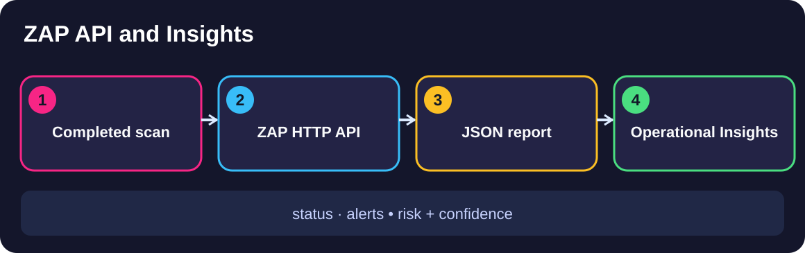

# Query the ZAP API and inspect scan evidence

<div align="center">



<sub>Illustrative architecture, not live scan output · Generated using ChatGPT</sub>

</div>

<details><summary><b>View The Four Executable Steps</b></summary>

```bash
./steps/01-check-zap-scan-status.sh
./steps/02-query-custom-rule-alert.sh
./steps/03-reconcile-json-report.sh
./steps/04-read-zap-insights.sh
```

Run these commands in order from this demo's folder, then execute `./scripts/preflight_check.sh`. Inspect actual ZAP GUI or GitHub Actions evidence where indicated.
</details>


Inspect a finished authenticated scan entirely through ZAP's HTTP API — no GUI.
Ask the engine for its status, pull the finding with its rule identity and rating,
generate ZAP's official JSON report, and read ZAP 2.17.0 Insights to judge how well
the scan ran.

> **Authorization and scope.** Every request targets only the local Globomantics
> training app on the compose network. Never point these queries at any system you
> are not authorized to test.

## Applications and locations used

| Application | Where | Used for |
|-------------|-------|----------|
| macOS Terminal | working directory `demos/module2-demos/m2-demo2-zap-api-scan-evidence` | running each `./scripts/demo_step.sh N` |
| ZAP HTTP API | `http://localhost:8090` (local only) | status, alerts, report generation, statistics |
| Generated JSON report | produced by `reports/action/generate` (template `traditional-json`); the step prints its relevant fields | the archivable record reconciled against the API |

This demo is API/Terminal only — no ZAP window is required. The numeric values
(request counts, Insight statistics) are live and vary per run; the rule identity,
ratings, and report structure are stable.

## Setup

```bash
cd demos/module2-demos/m2-demo2-zap-api-scan-evidence
./scripts/demo_up.sh             # prints "Up" when healthy
```

The first step inspects a finished authenticated scan; if none exists in the ZAP
session yet, the step runs the authenticated plan once to create it, then inspects
it.

## Learning-objective coverage

| Step | Objective | Proof artifact |
|------|-----------|----------------|
| 1 | EO3b | ZAP API status response |
| 2 | EO3b | ZAP API alert response |
| 3 | EO3b | ZAP JSON report |
| 4 | EO3b | ZAP Insights evidence |

## Step 1: Ask the API for runtime and scan status (EO3b)

Goal: Establish, over HTTP, that the engine is up and the scan has finished — a
pipeline's first question.

Application: macOS Terminal querying the ZAP API.
Open / Navigate: Terminal in `demos/module2-demos/m2-demo2-zap-api-scan-evidence`; API at `http://localhost:8090`
(`GET core/view/version`, `GET ascan/view/scans`).
Execute: `./steps/01-check-zap-scan-status.sh`.

Expected output: the ZAP runtime version `2.17.0`, an active scan reporting
`progress=100%` / `state=FINISHED`, and the number of requests the scan sent (a live
value, e.g. several hundred).

What the learner should notice: scan state and progress are machine-readable over
HTTP, so a pipeline can wait for completion without a screen.

Proof artifact: ZAP API status response.

## Step 2: Ask the API for the finding's rule identity and disposition (EO3b)

Goal: Read the two things a gate cares about for the script-generated finding —
which rule found the issue, and how it is rated.

Application: macOS Terminal querying the ZAP API.
Open / Navigate: Terminal in `demos/module2-demos/m2-demo2-zap-api-scan-evidence`; API `GET core/view/alerts`.
Execute: `./steps/02-query-custom-rule-alert.sh`.

Expected output: the script-generated alert `Globomantics unsafe reflection (custom
rule)` (raised by the Script Active Scan Rules plugin, id `50000`), disposition
`Medium · Medium` (risk · confidence), on parameter `note`.

What the learner should notice: your Module 1 Python rule's finding carries a rule
identity and a risk/confidence rating — the fields a quality gate later thresholds on.

Proof artifact: ZAP API alert response.

## Step 3: Generate the official JSON report and reconcile it (EO3b)

Goal: Produce ZAP's archivable JSON report and confirm it carries the same finding
as the live API, so what you archive matches what you queried.

Application: macOS Terminal querying the ZAP API.
Open / Navigate: Terminal in `demos/module2-demos/m2-demo2-zap-api-scan-evidence`; API `POST reports/action/generate`
with template `traditional-json`. (In CI, the equivalent report is the downloadable
`globo-ci-report` artifact from the authenticated-scan run.)
Execute: `./steps/03-reconcile-json-report.sh`.

Expected output: the `traditional-json` report containing the script-generated alert
`Globomantics unsafe reflection (custom rule)`, `riskdesc` `Medium (Medium)` — the
same script-generated alert and rating as the Step 2 API response.

What the learner should notice: the report is a point-in-time record that reconciles
with the live API, so the archived evidence is trustworthy.

Proof artifact: ZAP JSON report.

## Step 4: Read ZAP 2.17.0 Insights (EO3b)

Goal: Judge how well the scan ran, not just what it found — Insights are operational
signals that ZAP 2.17.0 includes in its report.

Application: macOS Terminal querying the ZAP API.
Open / Navigate: Terminal in `demos/module2-demos/m2-demo2-zap-api-scan-evidence`; the report's `insights[]` section.
Execute: `./steps/04-read-zap-insights.sh`.

Expected output: the report's Insights section reporting scan-effectiveness signals —
for example logged ZAP errors (`insight.log.error`), logged warnings
(`insight.log.warn`), and an authentication-failure percentage (`insight.auth.failure`);
the counts are live values and the exact Insight keys vary per run. If the report carries no Insights section, the step fails
(generic statistics are not accepted as a substitute).

What the learner should notice: Insights are operational signals, not
vulnerabilities — they tell you whether to trust the scan's coverage before acting
on its findings.

Proof artifact: ZAP Insights evidence.

## Validate and reset

`./scripts/preflight_check.sh` runs all four steps and writes a reviewable log to
`logs/`, ending with `5 checks passed, 0 failed`. Tear down with
`./scripts/demo_down.sh`.
