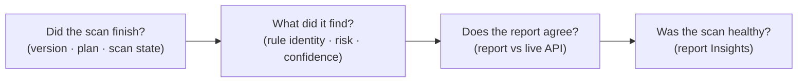

# Module 2 · Demo 2 — Query the ZAP API and evidence reports

<div align="center">


<sub>Illustrative workflow · Generated using ChatGPT · Verify actual evidence in your own lab</sub>

</div>

<!-- demo-navigation:start -->
<p align="center"><b>Student exercise · Demo 5 of 6</b></p>
<p align="center">
  <a href="https://github.com/rupeshtiwari/pluralsight-script-development-with-zap/blob/m2-demo1-before/demos/module2-demos/m2-demo1-authenticated-zap-github-actions/README.md"></a>
  <a href="https://github.com/rupeshtiwari/pluralsight-script-development-with-zap/blob/m2-demo3-before/demos/module2-demos/m2-demo3-security-quality-gates/README.md"></a>
</p>
<!-- demo-navigation:end -->

## Your scenario

Picture the Globomantics release pipeline at two in the morning. No one is watching a ZAP window — a build step has to decide, on its own, whether the authenticated scan of the Store actually finished, whether it found the issue you care about, and whether the report it is about to attach to the release really describes *this* code. A screenshot or an alert count cannot answer any of that. A machine needs machine-readable answers.

That is the problem you and I solve in this demo. ZAP exposes a REST API on `http://localhost:8090/`, and everything the GUI shows you is also available as JSON over that API. We are going to ask ZAP four questions the way a pipeline would — *did the scan finish, what exactly did it find, does the saved report agree with the live engine, and was the scan even healthy* — and we are going to treat every answer as evidence to be checked, not taken on faith.

One honest framing before we start: this demo lives in the terminal on purpose, because the API *is* the lesson. We are not avoiding the GUI to save time; we are learning the contract a pipeline depends on. Every command below is one HTTP question, and the teaching is in reading the JSON it returns.

## Your learning goals

You will retrieve and reconcile machine-readable security evidence from a completed authenticated scan:

1. Query scan status and a specific finding using the official ZAP API *(EO3b)*
2. Reconcile the API's named custom rule against a generated JSON report and the report's own scan-effectiveness Insights *(EO3b)*

You do not need the separate course outline to follow along — each step states what you are checking and why.

## Your evidence path



Read it as one investigation: each step only makes sense because of the one before it. You cannot trust a finding from a scan you have not confirmed finished, and you cannot trust a report you have not reconciled against the live engine.

## Start your lab

Mac dependencies are prepared **once for the course** with `setup/setup-macos.sh` (see the [course README](../../../README.md)). Each demo then starts its **own** local stack:

<details open>
<summary><b>Open the exact branch and start Module 2 Demo 2</b></summary>

**Where:** macOS Terminal or the VS Code integrated Terminal, from the root of your existing Git checkout.

```bash
cd "$HOME/pluralsight-script-development-with-zap"
git fetch origin
git switch m2-demo2-before
cd demos/module2-demos/m2-demo2-zap-api-scan-evidence
./scripts/demo_up.sh
```

**Expected start:** the startup script reports healthy Globomantics, Postgres, MongoDB and ZAP services, and provisions this demo's authenticated scan so there is real evidence to query. If anything is not ready, stop and read the actual output before continuing.

**URLs:** [Training application](http://localhost:8000/) · [ZAP GUI](http://localhost:8080/zap/) · [ZAP API and proxy](http://localhost:8090/). You will work from the terminal; the GUI is there only if you want to see the same data rendered.

</details>

## Your four steps

<details open>
<summary><b>Step 1 — Ask the API whether the scan actually finished</b> · version · plan · scan state</summary>

### What you are learning

Query machine-readable scan status, and understand why "the API answered" is not the same as "the scan is done." *(EO3b)*

### What we examine, and why

The script asks ZAP three questions over HTTP, and each one exists for a reason:

- **`GET core/view/version`** — which engine produced these findings. This matters more than it looks: detection logic changes between ZAP releases, so a report is only meaningful next to the version that generated it. You should see `2.17.0`, the version this course is built on.
- **`automation/view/planProgress?planId=…`** — did the Automation Framework plan that ran the authenticated scan actually complete, how many errors did it hit, and which user was it scanning as. A plan that errored out can still leave a half-populated session that looks fine from the outside.
- **`GET ascan/view/scans`** — the active scan's `id`, `progress`, and `state`. This is the one that keeps you honest: a pipeline that reads findings at `progress=50%` is reading half a scan.

**Predict before you run:** you expect version `2.17.0`, the plan `finished` with `0` errors scanning as the authenticated user, and a scan at `progress=100% · state=FINISHED`. Hold that prediction — the point of the step is to confirm it from the engine, not assume it.

### Run command

**Where:** macOS Terminal, in `demos/module2-demos/m2-demo2-zap-api-scan-evidence`.

```bash
./steps/01-check-zap-scan-status.sh
```

### Expected result (the script's output contract — not your run)

Values in `<…>` are run-specific and must be read from your own output. The named values are what the API returns on a healthy run.

<table><thead><tr><th>Output field</th><th>Expected value or example</th><th>What to inspect</th></tr></thead>
<tbody><tr><td><b>ZAP runtime (GET core/view/version)</b></td><td><code>2.17.0</code></td><td>The engine that produced the findings</td></tr>
<tr><td><b>Authenticated plan (automation/view/planProgress)</b></td><td><code>plan &lt;id&gt; · finished · 0 errors · scanning as alice</code></td><td>The plan completed, and as the real user</td></tr>
<tr><td><b>Active scan (GET ascan/view/scans)</b></td><td><code>id=&lt;live scan ID&gt; · progress=100% · state=FINISHED</code></td><td>A finished scan, not merely a reachable API</td></tr>
<tr><td><b>Result</b></td><td><code>✔ PASS API reports a finished authenticated scan</code></td><td>Machine-readable readiness</td></tr></tbody></table>

### Investigate, then decide

Read your own output against the prediction. If `state` is not `FINISHED` or `progress` is below `100`, you must **stop** — any finding you read now is from an incomplete scan. The engineering decision this step authorizes is simple and strict: *only consume findings once the engine itself says the scan is finished.* That is the rule a pipeline encodes so it never ships on a half-run scan.

**On FAIL:** the script tells you which of the three signals failed (version, plan, or scan). Fix that first; do not advance or reuse an earlier run.

**Next:** now that the scan is trustworthy, retrieve the one finding that matters instead of a count.

</details>

<details>
<summary><b>Step 2 — Pull the custom finding and read its disposition</b> · rule identity · risk · confidence</summary>

### What you are learning

Retrieve a specific scanner finding through the API and read the fields a pipeline reasons about. *(EO3b)*

### What we examine, and why

The script calls **`GET core/view/alerts?baseurl=<authenticated profile URL>`** and pulls the entry for our custom rule. Each alert in the JSON carries, among other fields: `pluginId`, `alertRef`, `alert` (the name), `risk`, `confidence`, `param`, and `evidence`. We read the ones that make a finding actionable:

- **`pluginId` and `alertRef`** — the rule's identity. You should see `50000` — that is *the Jython active-scan rule you wrote in Module 1, Demo 3*, not a built-in rule. This is the whole reason the custom rule existed: so your application-specific issue shows up as your own named finding here.
- **`param`** — `note`, the Store profile field the rule probes. Identity plus parameter is what tells a developer exactly where to look.
- **`risk` and `confidence`** — two *different* axes, and keeping them apart is the lesson. `risk` is how bad it is if real; `confidence` is how sure ZAP is that it is real. You should see `Medium · Medium`. Teams that collapse these into one number either panic over a low-confidence note or wave through a high-risk one.

**Predict before you run:** you expect `pluginId 50000`, name "Globomantics unsafe reflection (custom rule)", `param note`, and `Medium · Medium`. If a built-in XSS rule also fired on this page, that is *not* the finding we are proving — ours is the named custom one.

### Run command

**Where:** macOS Terminal, in `demos/module2-demos/m2-demo2-zap-api-scan-evidence`.

```bash
./steps/02-query-custom-rule-alert.sh
```

### Expected result (the script's output contract — not your run)

<table><thead><tr><th>Output field</th><th>Expected value or example</th><th>What to inspect</th></tr></thead>
<tbody><tr><td><b>Rule identity (pluginId · alertRef)</b></td><td><code>50000 · 50000</code></td><td>Your Jython rule, not a built-in</td></tr>
<tr><td><b>Alert name</b></td><td><code>Globomantics unsafe reflection (custom rule)</code></td><td>The name your rule set</td></tr>
<tr><td><b>Disposition (risk · confidence)</b></td><td><code>Medium · Medium</code></td><td>Two separate axes, read both</td></tr>
<tr><td><b>Parameter</b></td><td><code>note</code></td><td>The profile input the rule probes</td></tr>
<tr><td><b>Result</b></td><td><code>✔ PASS API returns the named custom alert</code></td><td>Identity, not a count</td></tr></tbody></table>

### Investigate, then decide

Confirm the identity is `50000`, not a built-in reflected-XSS rule that happens to be on the same page. That connection — *this API alert is the rule I wrote* — is what makes the finding yours to own. The decision this authorizes: a pipeline routes and gates on **rule identity and disposition**, never on a raw alert count, because only identity tells you *what* broke and only risk-with-confidence tells you *how much to care*.

**On FAIL:** the API returned no `50000` on the profile URL. That usually means the authenticated scan did not reach the protected page (go back to Step 1) — not that the rule is wrong.

**Next:** prove the report you would hand to a release owner says the same thing the live engine just said.

</details>

<details>
<summary><b>Step 3 — Reconcile the official JSON report with the live API</b> · report vs engine</summary>

### What you are learning

Generate an official report and reconcile it, field by field, against the live API. *(EO3b)*

### What we examine, and why

The script calls **`reports/action/generate` with the `traditional-json` template** — ZAP's official machine-readable report, the artifact a pipeline stores and attaches to a release. Then it reads back the same finding from that report (`pluginid`, `riskdesc`, and the instance `param`) and compares them to the values you captured from the live API in Step 2.

Why go to this trouble? Because **a report is a file, and files go stale.** The most dangerous mistake in this whole workflow is attaching last week's report to this week's release — the vulnerability you believe is fixed may simply have been scanned before the fix existed. Reconciliation is how you prove the archived evidence and the live engine are describing the same scan.

**Predict before you run:** the report's `pluginid` should be `50000` and its `riskdesc` should read `Medium (Medium)` — the same identity and the same rating the API gave you a moment ago. You are checking for *agreement*, and you should be a little suspicious until you see it.

### Run command

**Where:** macOS Terminal, in `demos/module2-demos/m2-demo2-zap-api-scan-evidence`.

```bash
./steps/03-reconcile-json-report.sh
```

### Expected result (the script's output contract — not your run)

<table><thead><tr><th>Output field</th><th>Expected value or example</th><th>What to inspect</th></tr></thead>
<tbody><tr><td><b>Report template</b></td><td><code>traditional-json</code></td><td>ZAP's official report type</td></tr>
<tr><td><b>Report alert (pluginid · name)</b></td><td><code>50000 · Globomantics unsafe reflection (custom rule)</code></td><td>Same rule as the live API</td></tr>
<tr><td><b>Report rating (riskdesc)</b></td><td><code>Medium (Medium)</code></td><td>Must equal Step 2's risk · confidence</td></tr>
<tr><td><b>Reconciliation</b></td><td><code>report pluginid/riskdesc/param == API</code></td><td>Field-by-field agreement</td></tr>
<tr><td><b>Result</b></td><td><code>✔ PASS JSON report reconciled with the API</code></td><td>Archived and live evidence agree</td></tr></tbody></table>

### Investigate, then decide

Look at the three fields side by side with your Step 2 values. If any of identity, scope, or rating disagrees, you do **not** have evidence — you have a question to chase (a stale file, a different scan, a scope mismatch). The decision: *a report is only release-grade when it reconciles with the current engine.* That sentence is the entire reason this step exists.

**On FAIL:** either the report failed to generate (check the reports add-on and Docker access to the ZAP container) or it disagreed with the API. A disagreement is a real finding about your process, not something to edit away.

**Next:** the finding checks out — but was the scan that produced it any good? Read its health.

</details>

<details>
<summary><b>Step 4 — Read the report's scan-effectiveness Insights</b> · was the scan healthy?</summary>

### What you are learning

Interpret the operational findings ZAP reports about the scan itself, not the application. *(EO3b)*

### What we examine, and why

The script reads the report's **`insights[]`** section and prints a real entry's level, key, statistic and meaning. Insights are a different kind of information from alerts: they describe *the scan*, not the app — how much was covered, how many requests went out, whether anything went wrong during the run.

Here is why this is the step people skip and shouldn't. **A scan can come back with zero findings for two opposite reasons: the application is clean, or the scan barely touched it.** An authentication failure, a scope that missed the real pages, or a run that died early all produce a reassuring, empty, and completely misleading result. Insights is how you tell a thorough scan from a shallow one.

**Predict before you run:** you expect a non-empty insight — a real level and key with a statistic and a plain-English meaning. You should be ready to treat an *empty* Insights section as a problem, not a pass.

### Run command

**Where:** macOS Terminal, in `demos/module2-demos/m2-demo2-zap-api-scan-evidence`.

```bash
./steps/04-read-zap-insights.sh
```

### Expected result (the script's output contract — not your run)

Insight values are genuinely run-specific; read yours from the output. The contract is that a real, non-empty insight must be present.

<table><thead><tr><th>Output field</th><th>Expected value or example</th><th>What to inspect</th></tr></thead>
<tbody><tr><td><b>Insight (level · key)</b></td><td><code>&lt;actual level&gt; · &lt;actual insight key&gt;</code></td><td>Must come from a non-empty insights[]</td></tr>
<tr><td><b>Statistic · meaning</b></td><td><code>&lt;actual value&gt; · &lt;real description&gt;</code></td><td>Evidence about scan coverage/health</td></tr>
<tr><td><b>Result</b></td><td><code>✔ PASS report Insights returned</code></td><td>Never substitute an unrelated counter</td></tr></tbody></table>

### Investigate, then decide

Read the real insight and say what it tells you about the scan's reach. The decision this authorizes is the one that protects you from false confidence: *a clean result is only trustworthy next to evidence the scan actually did its job.* If Insights is empty, the correct move is to investigate the run — never to invent a number so the step looks complete.

**On FAIL:** empty or missing Insights is a HOLD by design. Investigate why the report has none rather than papering over it.

**Next:** you now have all four pieces — finished, found, reconciled, healthy — the complete programmatic evidence a pipeline needs.

</details>

<!-- student-achievement:start -->
## What you achieved

You can now defend a scan's evidence the way a release pipeline has to — with the API, not a screenshot:

1. **(EO3b) You confirmed the scan was real before trusting it.** You asked the engine its version (`2.17.0`), confirmed the authenticated plan `finished` with no errors as `alice`, and read `progress=100% · state=FINISHED` — so you know the findings came from a complete scan, not a half-run one.
2. **(EO3b) You identified the finding by rule, not by count.** You pulled `pluginId 50000` — your own Jython rule from Module 1 — on parameter `note`, and read `risk` and `confidence` as the two separate `Medium` axes a pipeline reasons about.
3. **(EO3b) You proved the report is release-grade.** You generated the official `traditional-json` report and reconciled its `pluginid` and `riskdesc` ("Medium (Medium)") field-by-field with the live API, so you can reject a stale or mismatched report instead of trusting it blindly.
4. **(EO3b) You checked the scan's health, not just its result.** You read a real `insights[]` entry and know that an empty Insights section is a reason to investigate, never a clean bill of health.

**How to apply it:** this is exactly the sequence you wire into CI — confirm completion, pull findings by identity, reconcile the stored report, and check coverage — so a build can make a defensible security decision with no human watching.

**Your final check:** explain each outcome using *your* captured values from this run. A README example, a missing result, or an earlier run does not satisfy this exercise.
<!-- student-achievement:end -->

## Finish your lab

A report is trustworthy only when its custom finding, its rating, and its scan-quality context all match the current API evidence — which is exactly what you just proved, in order.

From the same demo directory, stop the local services:

```bash
./scripts/demo_down.sh
```

The `m2-demo2-after` branch holds the completed reference. Preserve your changes before switching branches. For a safe comparison, run `git diff m2-demo2-before..m2-demo2-after -- demos/module2-demos/m2-demo2-zap-api-scan-evidence` from the repository root; this is an operational demo, so the difference is in the captured evidence, not in source files.

<!-- demo-navigation:start -->
<p align="center"><b>Student exercise · Demo 5 of 6</b></p>
<p align="center">
  <a href="https://github.com/rupeshtiwari/pluralsight-script-development-with-zap/blob/m2-demo1-before/demos/module2-demos/m2-demo1-authenticated-zap-github-actions/README.md"></a>
  <a href="https://github.com/rupeshtiwari/pluralsight-script-development-with-zap/blob/m2-demo3-before/demos/module2-demos/m2-demo3-security-quality-gates/README.md"></a>
</p>
<!-- demo-navigation:end -->

[← Module 2 catalog](../README.md) · [← Course home](../../../README.md)
