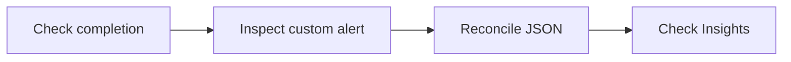

# Module 2 · Demo 2 — Query the ZAP API and evidence reports

<div align="center">


<sub>Illustrative workflow · Generated using ChatGPT · Verify actual evidence in your own lab</sub>

</div>

<!-- demo-navigation:start -->
<p align="center"><b>Student exercise · Demo 5 of 6</b></p>
<p align="center">
  <a href="https://github.com/rupeshtiwari/pluralsight-script-development-with-zap/blob/m2-demo1-before/demos/module2-demos/m2-demo1-authenticated-zap-github-actions/README.md"></a>
  <a href="https://github.com/rupeshtiwari/pluralsight-script-development-with-zap/blob/m2-demo3-before/demos/module2-demos/m2-demo3-security-quality-gates/README.md"></a>
</p>
<!-- demo-navigation:end -->

## The problem you are solving

Maya has a completed security scan but needs a machine-readable status, precise custom alert, archived report, and scan-quality evidence. A screenshot or arbitrary alert total is insufficient for a release pipeline.

**What success looks like:** API status, named alert, official JSON report, and actual Insights reconciled to one scan. All four steps address parts of this same engineering problem.

## What you will learn in this demonstration

You will retrieve four kinds of evidence from ZAP programmatically:

- Query scan status and findings using the official ZAP API *(EO3b)*
- Reconcile the API's named custom rule with a generated JSON report and actual Insights about scan effectiveness *(EO3b)*

You do not need the separate course outline to understand the objective or follow the exercises.

## From setup to a defensible decision



## Start the demo's application

Mac dependencies are prepared **once for the course** using `setup/setup-macos.sh`, as shown in the [course README](../../../README.md). Each demo must then start its **own local training stack**:

<details open>
<summary><b>Open the exact branch and start Module 2 Demo 2</b></summary>

**Where:** macOS Terminal or VS Code integrated Terminal, from the root of your existing Git checkout.

```bash
git fetch origin
git switch m2-demo2-before
cd demos/module2-demos/m2-demo2-zap-api-scan-evidence
./scripts/demo_up.sh
```

**Expected start:** healthy Globomantics, Postgres, MongoDB, and ZAP services, reported by the startup script. If they are not ready, stop and inspect the actual output before proceeding.

**URLs:** [Training application](http://localhost:8000/) · [ZAP GUI](http://localhost:8080/zap/) · [ZAP API and proxy](http://localhost:8090/). This independent exercise provisions its own authenticated scanning prerequisites, so you do not need to run another demonstration first.

</details>

## Complete the four demo steps

<details open>
<summary><b>Step 1 — Ask the API whether the scan finished</b> · Check completion</summary>

### The specific problem

The API can be available while the active scan is incomplete.

**What you are learning:** Query machine-readable scan status *(EO3b)*

### Which application and screen?

**Open macOS Terminal**, enter the demo folder, and inspect ZAP API endpoints used by `scripts/_steps.sh` when needed. No GUI is required for this step.

### Run this exact command

**Where:** macOS Terminal. **Current folder:** `demos/module2-demos/m2-demo2-zap-api-scan-evidence`.

```bash
./steps/01-check-zap-scan-status.sh
```

### Expected output and what it means

This is the existing script's **output field contract**, not a manufactured scan result. The field values containing angle brackets vary and must be taken from the real output.

<table><thead><tr><th>Output field</th><th>Expected value or example</th><th>What to inspect</th></tr></thead>
<tbody><tr><td><b>ZAP runtime (GET core/view/version)</b></td><td><code>2.17.0</code></td><td>Scanner version</td></tr>
<tr><td><b>Active scan (GET ascan/view/scans)</b></td><td><code>id=&lt;live scan ID&gt; · progress=100% · state=FINISHED</code></td><td>Complete scan, not merely open API</td></tr>
<tr><td><b>Requests the scan sent</b></td><td><code>&lt;live count&gt;</code></td><td>Actual telemetry may differ</td></tr>
<tr><td><b>Result</b></td><td><code>✔ PASS API reports finished scan</code></td><td>Machine-readable readiness</td></tr></tbody></table>

**Failure handling:** If the script reports FAIL, the required result is not established. Review the diagnostic and do not advance or substitute a prior run.

### How to interpret this result

The version confirms which engine generated the findings. Progress and finished status tell an automated consumer when scan results are ready.

**How the investigation advances:** Retrieve the one custom alert rather than treating every scanner finding as equivalent.

</details>

<details>
<summary><b>Step 2 — Query the custom rule's risk and confidence</b> · Inspect custom alert</summary>

### The specific problem

A count of twenty alerts is not actionable without rule identity and affected parameter.

**What you are learning:** Retrieve a specific scanner finding through the API *(EO3b)*

### Which application and screen?

**Remain in macOS Terminal**. The command queries `core/view/alerts` using the authenticated profile URL. Inspect the response fields printed by the step.

### Run this exact command

**Where:** macOS Terminal. **Current folder:** `demos/module2-demos/m2-demo2-zap-api-scan-evidence`.

```bash
./steps/02-query-custom-rule-alert.sh
```

### Expected output and what it means

This is the existing script's **output field contract**, not a manufactured scan result. The field values containing angle brackets vary and must be taken from the real output.

<table><thead><tr><th>Output field</th><th>Expected value or example</th><th>What to inspect</th></tr></thead>
<tbody><tr><td><b>Rule identity (pluginId · alert)</b></td><td><code>50000 · Globomantics unsafe reflection (custom rule)</code></td><td>Script-generated finding</td></tr>
<tr><td><b>Disposition (risk · confidence)</b></td><td><code>Medium · Medium</code></td><td>Risk versus evidence strength</td></tr>
<tr><td><b>Parameter</b></td><td><code>note</code></td><td>Profile input</td></tr>
<tr><td><b>Result</b></td><td><code>✔ PASS API returns custom alert</code></td><td>Named rule must be present</td></tr></tbody></table>

**Failure handling:** If the script reports FAIL, the required result is not established. Review the diagnostic and do not advance or substitute a prior run.

### How to interpret this result

Rule ID and name distinguish the application-specific Jython finding from built-in XSS. Risk and confidence are separate fields that a pipeline can reason about.

**How the investigation advances:** Verify the officially generated report contains that same finding.

</details>

<details>
<summary><b>Step 3 — Compare the JSON report with the API result</b> · Reconcile JSON</summary>

### The specific problem

If the stored JSON disagrees with the current API, it cannot support a reliable release decision.

**What you are learning:** Generate and reconcile an official security report *(EO3b)*

### Which application and screen?

**Remain in macOS Terminal**. Inspect the official `reports/action/generate` request and `traditional-json` report type used by the script.

### Run this exact command

**Where:** macOS Terminal. **Current folder:** `demos/module2-demos/m2-demo2-zap-api-scan-evidence`.

```bash
./steps/03-reconcile-json-report.sh
```

### Expected output and what it means

This is the existing script's **output field contract**, not a manufactured scan result. The field values containing angle brackets vary and must be taken from the real output.

<table><thead><tr><th>Output field</th><th>Expected value or example</th><th>What to inspect</th></tr></thead>
<tbody><tr><td><b>Report template</b></td><td><code>traditional-json</code></td><td>Official ZAP report type</td></tr>
<tr><td><b>Report alert (pluginid · name)</b></td><td><code>50000 · Globomantics unsafe reflection (custom rule)</code></td><td>Same rule as live API</td></tr>
<tr><td><b>Report rating (riskdesc)</b></td><td><code>Medium (Medium)</code></td><td>Risk and confidence same as Step 2</td></tr>
<tr><td><b>Result</b></td><td><code>✔ PASS JSON report reconciled with API</code></td><td>Archived and live evidence agree</td></tr></tbody></table>

**Failure handling:** If the script reports FAIL, the required result is not established. Review the diagnostic and do not advance or substitute a prior run.

### How to interpret this result

The generated report preserves the named custom finding in a shareable format. Matching its identity and rating against the API prevents stale-report assumptions.

**How the investigation advances:** Inspect the scan's operational quality in addition to the vulnerability result.

</details>

<details>
<summary><b>Step 4 — Read the report's scan-effectiveness Insights</b> · Check Insights</summary>

### The specific problem

A scan might appear clean because it encountered an authentication, scope or execution problem.

**What you are learning:** Interpret operational findings exposed with the scan report *(EO3b)*

### Which application and screen?

**Remain in macOS Terminal**. Locate the actual `insights[]` entries returned by the report extraction, with the key and explanation readable.

### Run this exact command

**Where:** macOS Terminal. **Current folder:** `demos/module2-demos/m2-demo2-zap-api-scan-evidence`.

```bash
./steps/04-read-zap-insights.sh
```

### Expected output and what it means

This is the existing script's **output field contract**, not a manufactured scan result. The field values containing angle brackets vary and must be taken from the real output.

<table><thead><tr><th>Output field</th><th>Expected value or example</th><th>What to inspect</th></tr></thead>
<tbody><tr><td><b>Insight (level · key)</b></td><td><code>&lt;actual level&gt; · &lt;actual insight key&gt;</code></td><td>Must be from nonempty insights[]</td></tr>
<tr><td><b>Statistic · meaning</b></td><td><code>&lt;actual value&gt; · &lt;real description&gt;</code></td><td>Scan-effectiveness evidence</td></tr>
<tr><td><b>Result</b></td><td><code>✔ PASS report Insights returned</code></td><td>Do not substitute unrelated counters</td></tr></tbody></table>

**Failure handling:** If the script reports FAIL, the required result is not established. Review the diagnostic and do not advance or substitute a prior run.

### How to interpret this result

Insights describe scan behavior and confidence in coverage, not only vulnerability risk. A missing Insights section is a reason to investigate, not something to invent or ignore.

**How the investigation advances:** The four fields now support a programmatic, evidence-backed scan assessment.

</details>

## Complete the exercise

A report is trustworthy only when its custom finding, rating and scan-quality context match the current API evidence.

From the same demo directory, stop the local services:

```bash
./scripts/demo_down.sh
```

The `m2-demo2-after` branch contains the completed example or reference behavior. Preserve student changes before switching branches. For a safe comparison run `git diff m2-demo2-before..m2-demo2-after -- demos/module2-demos/m2-demo2-zap-api-scan-evidence` from the repository root; operational-only exercises may have no source diff.

**One batch validation command for the course:** `./setup/run-all-demo-preflights.sh` from the repository root. This checks all six finished branches and creates real evidence bundles for the production team. There are no separate per-demo preflight commands.

<!-- demo-navigation:start -->
<p align="center"><b>Student exercise · Demo 5 of 6</b></p>
<p align="center">
  <a href="https://github.com/rupeshtiwari/pluralsight-script-development-with-zap/blob/m2-demo1-before/demos/module2-demos/m2-demo1-authenticated-zap-github-actions/README.md"></a>
  <a href="https://github.com/rupeshtiwari/pluralsight-script-development-with-zap/blob/m2-demo3-before/demos/module2-demos/m2-demo3-security-quality-gates/README.md"></a>
</p>
<!-- demo-navigation:end -->

[← Module 2 catalog](../README.md) · [← Course home](../../../README.md)
