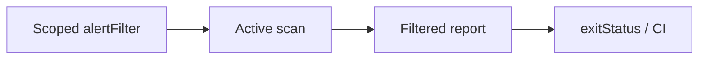

# Enforce Security Quality Gates in GitHub Actions

<details><summary><b>Branch: m2-demo3-after — Completed Gate Reference</b></summary>

The completed gate plan is available here. To build it yourself, follow the exercise on `m2-demo3-before`. A failed GitHub Actions job only counts as valid proof when its report and exit code show the intended security threshold.

</details>


<div align="center">


<sub>Illustrative architecture · Generated using ChatGPT · Verify the actual API, report or CI results</sub>

</div>

## What Problem Are You Solving?

An organization wants to ignore a reviewed benign header finding on one path while still blocking release if reflected XSS remains High risk. Maya must show the exact filter, job order, final report and process exit—not simply interpret every red build as a valid security block.

**Your outcome:** Understand how the system behaves, run four meaningful commands, inspect the real output and explain the engineering decision. No external course outline is required.

## Learning Objective Covered

<table><thead><tr><th>Objective</th><th>What You Will Learn</th></tr></thead><tbody>
<tr><td><code>EO3c</code></td><td>Apply threshold-based quality gates for security findings in build pipelines</td></tr>
</tbody></table>

## Your Four-Step Learning Path



<table>
<thead><tr><th>Step</th><th>Exact Command</th><th>What You Do</th><th>What To Verify</th><th>Why It Matters</th></tr></thead>
<tbody><tr><td><b>1</b></td><td><code>./steps/01-inspect-false-positive-filter.sh</code></td><td>Scope the known benign rule 10021 on /greet</td><td>Actual alertFilter rule ID, URL and False Positive setting</td><td>Narrow filtering avoids suppressing unrelated risk</td></tr>
<tr><td><b>2</b></td><td><code>./steps/02-check-automation-job-order.sh</code></td><td>Verify filter, scan, report and gate ordering</td><td>alertFilter before activeScan; exitStatus last</td><td>Order determines when the disposition is applied</td></tr>
<tr><td><b>3</b></td><td><code>./steps/03-run-security-quality-gate.sh</code></td><td>Run the plan and capture the real exit code</td><td>Actual remaining High finding and exit code 1</td><td>A deliberate security block differs from failed infrastructure</td></tr>
<tr><td><b>4</b></td><td><code>./steps/04-verify-filtered-alert-report.sh</code></td><td>Inspect both expected report findings</td><td>Rule 10021 disposed False Positive; rule 40012 remains High</td><td>Prove the filter suppressed noise without hiding real risk</td></tr></tbody></table>

## Start This Exercise

From the repository root:

```bash
git fetch origin
git switch m2-demo3-before
./setup/setup-macos.sh
cd demos/module2-demos/m2-demo3-security-quality-gates
./scripts/demo_up.sh
```

If the one-time Mac setup has already completed, you can skip that setup command. Execute Steps 1–4 above from this demo directory. Then run:

```bash
./scripts/preflight_check.sh
./scripts/demo_down.sh
```

The preflight saves a timestamped log in `logs/`. For hosted evidence, use the GitHub Actions link in the detailed steps and inspect the actual workflow's **run SHA**, status, job log and report. Never assume a successful report from an earlier session satisfies this exercise.

**Compare with the completed version:** `git diff m2-demo3-before..m2-demo3-after -- demos/module2-demos/m2-demo3-security-quality-gates`. This comparison does not overwrite your work. Both the starter and completed branches include their required prerequisites; authored solution files or plans are added by the exercise when applicable.

**Technical evidence note:** In a verified historical run the official report showed rule 10021 as Low (False Positive), rule 40012 as High (Medium), and exit code 1. Treat those as an example—not proof for a different run. A generic nonzero exit or a missing filtered finding is insufficient proof.

All scanning stays within the supplied, authorized Globomantics training environment.

---

## Detailed Instructions And Expected Evidence

<details><summary><b>View The Four Executable Steps</b></summary>

```bash
./steps/01-inspect-false-positive-filter.sh
./steps/02-check-automation-job-order.sh
./steps/03-run-security-quality-gate.sh
./steps/04-verify-filtered-alert-report.sh
```

Run these commands in order from this demo's folder, then execute `./scripts/preflight_check.sh`. Inspect actual ZAP GUI or GitHub Actions evidence where indicated.
</details>


Turn a ZAP scan into a build decision. Mark a known benign finding as a False
Positive, prove the plan applies that decision before scanning, then let ZAP's
`exitStatus` job convert the remaining alert risk into a process exit code — the
signal a pipeline uses to pass or block the build. You read the gate plan in VS
Code to see how each decision is encoded, then run it headless and read the verdict.

> **Authorization and scope.** The gate scans only the local Globomantics training
> app on the compose network. Never point it at any system you are not authorized
> to test.

## Applications and locations used

| Application | Where | Used for |
|-------------|-------|----------|
| VS Code | `demos/module2-demos/m2-demo3-security-quality-gates/ci/gate-plan.yaml` + the integrated terminal | reading the filter, job order, and thresholds, then running `./scripts/demo_step.sh N` |
| GitHub Actions | `https://github.com/rupeshtiwari/pluralsight-script-development-with-zap/actions/workflows/zap-quality-gate.yml` → latest run → job **quality-gate** | the gate pass/fail on the hosted build |
| CI artifact | run page → **Artifacts** → `globo-gate-report` | the archived gate report |

The gate workflow is `workflow_dispatch` (run it from the Actions tab). The exit
code is the build decision: `0` ok · `1` error · `2` warning.

## Setup

```bash
cd demos/module2-demos/m2-demo3-security-quality-gates
./scripts/demo_up.sh             # prints "Up" when healthy
```

## Step-by-step LO traceability

| Step | LO | Config / mechanism (`ci/gate-plan.yaml`) | Command | Observed result | Proof artifact |
|------|----|------------------------------------------|---------|-----------------|----------------|
| 1 | EO3c | `alertFilter` 27–32 (ruleId `10021` → False Positive, url-scoped) | `steps/01-inspect-false-positive-filter.sh` | rule `10021` marked `newRisk: False Positive`, scoped to `/greet.*` | False Positive alert filter |
| 2 | EO3c | `jobs` order 24–64 | `steps/02-check-automation-job-order.sh` | `alertFilter → requestor → activeScan → report → exitStatus`; filter before scan, gate last | Automation Framework job order |
| 3 | EO3c | `exitStatus` 61–64 (`errorLevel HIGH`, `warnLevel MEDIUM`) | `steps/03-run-security-quality-gate.sh` | High-risk alert remains after filtering; process exit code `1`; build blocked | Gate JSON report and exit code |
| 4 | EO3c | `report` 51–56 output | `steps/04-verify-filtered-alert-report.sh` | `10021` disposed False Positive; `40012` kept High | Filtered alert report |

---

## Step 1: Mark a benign finding as a False Positive (EO3c)

**The problem.** A quality gate must ignore noise it has already judged benign, and
that decision has to live in config — not in a person's memory — so every run
applies it the same way.

**Inspect the plan in VS Code.** Open `demos/module2-demos/m2-demo3-security-quality-gates/ci/gate-plan.yaml` →
`alertFilter` job (lines 27–32):

- **`ruleId: 10021`** — X-Content-Type-Options Header Missing, the known-benign
  finding for this app.
- **`newRisk: "False Positive"`** — the disposition the filter assigns.
- **`url` / `urlRegex`** — scoped to `http://app:8000/greet.*`, so only this finding
  on this path is reclassified.

**Execute.**

```bash
./steps/01-inspect-false-positive-filter.sh
```

**Inspect the actual evidence.** The plan marks rule `10021` as
`newRisk: False Positive`, scoped to `http://app:8000/greet.*`.

**The engineer's decision.** The disposition lives in config, so the gate ignores
this noise identically on every run.

Proof artifact: False Positive alert filter.

---

## Step 2: Confirm the job order applies the filter before scanning (EO3c)

**The problem.** A filter applied *after* the scan would be too late to change the
alerts the gate sees. Order is the mechanism.

**Inspect the plan in VS Code.** In the same file, the `jobs` list (lines 24–64) runs
in order: `alertFilter` → `requestor` → `activeScan` → `report` → `exitStatus`. The
filter precedes the scan, so every alert the scan raises inherits the intended
disposition; `exitStatus` is last, so the gate evaluates the final alert set.

**Execute.**

```bash
./steps/02-check-automation-job-order.sh
```

**Inspect the actual evidence.** The step reports the job order
`alertFilter -> requestor -> activeScan -> report -> exitStatus`, confirming
`alertFilter` runs before `activeScan` and `exitStatus` runs last.

**The engineer's decision.** Because the filter is applied before scanning and the
gate runs last, the disposition is already in effect when the gate makes its call.

Proof artifact: Automation Framework job order.

---

## Step 3: Run the gate and read the report plus exit code (EO3c)

**The problem.** The remaining alerts must be compared against thresholds and turned
into the one signal a pipeline blocks on — a process exit code.

**Inspect the plan in VS Code.** The `exitStatus` job (lines 61–64) sets
`errorLevel: "HIGH"` and `warnLevel: "MEDIUM"`: a High alert is at or above
`errorLevel`, so the run must exit non-zero (process result: `0` ok, `1` error,
`2` warning).

**Execute.**

```bash
./steps/03-run-security-quality-gate.sh
```

**Inspect the actual evidence.** With thresholds `errorLevel HIGH` · `warnLevel
MEDIUM`, at least one High-risk alert (the reflected-XSS finding) remains after
filtering, the process exits `1`, and the gate blocks the build. In CI, the
**quality-gate** job's gate step shows the same exit code decide the run.

**The engineer's decision.** A remaining High-risk alert maps, through `errorLevel`,
to a non-zero exit code — the scan result has become an automatic build verdict.

Proof artifact: Gate JSON report and exit code.

---

## Step 4: Confirm the filtered report disposition (EO3c)

**The problem.** Maya must prove the filter held — that the benign finding now
carries the False Positive disposition while the real High finding remains, which is
exactly why the gate blocked.

**Execute.**

```bash
./steps/04-verify-filtered-alert-report.sh
```

**Inspect the actual evidence.** In the gate report, rule `10021`
(X-Content-Type-Options Header Missing) is disposed as False Positive, while rule
`40012` (Cross Site Scripting (Reflected)) is kept at High risk — benign filtered
out, High kept → build blocked. In CI this is the downloadable `globo-gate-report`
artifact on the quality-gate run page.

**The engineer's decision.** Filtering changed disposition, not the gate logic; the
gate still blocked on real risk, so noise suppression did not weaken the check.

Proof artifact: Filtered alert report.

## Validate and reset

`./scripts/preflight_check.sh` runs all four steps and writes a reviewable log to
`logs/`, ending with `5 checks passed, 0 failed`. Tear down with
`./scripts/demo_down.sh`.
