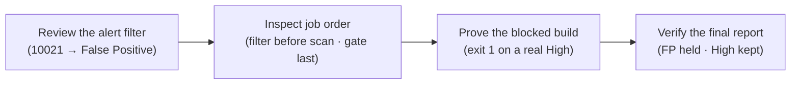

# Module 2 · Demo 3, Enforce a security quality gate

> ⚡ **Run from anywhere (shortcut).** You keep landing at the repo root, which is fine: the `./lab` helper there picks THIS demo from your branch, so you never fight directories.
>
> ```bash
> cd "$HOME/pluralsight-script-development-with-zap"   # the repo root (where ./lab lives)
> ./lab up      # start the lab (first time; waits until ready)
> ./lab run inspect-false-positive-filter   # run the first check (use the matching script name below)
> ./lab down    # stop the lab when you are done
> ```
>
> The walk-through below shows each command as `./steps/0N-...sh` (run inside the demo folder); `./lab run <name>` runs that same step from the repo root (it cd’s into the demo folder for you).
>
> 🧪 **Self-test before you start.** `preflight-check` runs every step and confirms each one works and prints the expected output, so you can fix any setup issue before you begin.
> ```bash
> (cd "$(git rev-parse --show-toplevel)" && ./preflight-check --m2d3)   # just this demo — runs from anywhere
> (cd "$(git rev-parse --show-toplevel)" && ./preflight-check)          # or the whole course, every demo in order
> ```


<div align="center">


<sub>Illustrative workflow · Generated using ChatGPT · Verify actual evidence in your own lab</sub>

</div>

<!-- demo-navigation:start -->
<p align="center"><b>Student exercise · Demo 6 of 6</b></p>
<p align="center">
  <a href="https://github.com/rupeshtiwari/pluralsight-script-development-with-zap/blob/m2-demo2-before/demos/module2-demos/m2-demo2-zap-api-scan-evidence/README.md"></a>
  <a href="../../../README.md"></a>
</p>
<!-- demo-navigation:end -->

## Your scenario

This is the last mile: the Globomantics pipeline has to *decide*. A scan that produces a report but never blocks anything is a smoke detector with no battery. Your job in this demo is to turn ZAP's findings into a build outcome the team can defend, one that fails the release for a genuine High-risk vulnerability, but does **not** fail it over a benign finding the team already reviewed and accepted.

That tension is the whole lesson, and it is where teams get it wrong in two opposite directions. Disable the noisy rule outright and you blind the gate to that same issue everywhere, even where it would be dangerous. Leave the noise in and the gate cries wolf until someone switches it off entirely, and then a real High sails through. So you and I are going to do the disciplined thing: a reviewed **False Positive** disposition for the one benign finding the team has already accepted, so it stays visible in the report but stops inflating the gate, while the rule stays live and the genuine Highs still block. The jobs are ordered so the filter applies *before* scanning, the gate exit blocks on a real High, and the report *explains* the decision. A red build is not the deliverable. A red build you can justify from evidence is.

## Your learning goals

You will make a release decision from the final alert set instead of simply reacting to a red build:

1. Record a reviewed False-Positive disposition as code, rather than disabling an entire security rule *(EO3c)*
2. Order the automation jobs, verify final High-risk evidence, and confirm the CI exit status *(EO3c)*

You do not need the separate course outline, each step states what you are checking and why.

## Your evidence path



Read it as building a defensible decision: record the exception, order the plan so it takes effect, run the real gate, then prove from the report that both the benign and the genuine findings were handled exactly as intended.

## Start your lab

Mac dependencies are prepared **once for the course** with `setup/setup-macos.sh` (see the [course README](../../../README.md)). Each demo then starts its **own** local stack.

<details open>
<summary><b>Open the exact branch and start Module 2 Demo 3</b></summary>

**Where:** the VS Code integrated Terminal, from the root of your existing Git checkout. This demo shows plan source, so work in VS Code.

```bash
cd "$HOME/pluralsight-script-development-with-zap"
git fetch origin
git switch m2-demo3-before
(cd demos/module2-demos/m2-demo3-security-quality-gates && ./scripts/lab-up.sh)
```

**Expected start:** the startup script reports healthy Globomantics, Postgres, MongoDB and ZAP services. If anything is not ready, stop and read the actual output before continuing.

**Interfaces:** <a href="http://localhost:8000/" target="_blank" rel="noopener">Training application</a> · <a href="http://localhost:8080/zap/" target="_blank" rel="noopener">ZAP GUI</a> · <a href="http://localhost:8090/" target="_blank" rel="noopener">ZAP API and proxy</a>, plus **GitHub → Actions → quality-gate** for the hosted proof. The `-before` branch deliberately omits the finished `ci/gate-plan.yaml`; you bring it in with one command in Step 3, then open and read it, before running the gate.

</details>

## Your steps

<!-- learner-command-steps:start -->

Follow one numbered action set at a time. Opening the terminal, pasting a command and pressing Enter belong to the same step. Reading its source and interpreting its result stay with that step. Script filenames retain their stable 01–04 identifiers. Check numbers printed by the scripts identify those underlying lab checks, not the parent step numbers below. The numbered walkthrough steps also include entering the folder, reference copies and reruns where needed.

| Step | Action |
|---|---|
| [Step 1](#step-1) | directory change command |
| [Step 2](#step-2) | false positive filter script |
| [Step 3](#step-3) | reference copy command |
| [Step 4](#step-4) | false positive filter script |
| [Step 5](#step-5) | automation job order script |
| [Step 6](#step-6) | security quality gate script |
| [Step 7](#step-7) | filtered alert report script |

<a id="step-1"></a>

## Step 1: directory change command

[All steps](#your-steps) · [Next step 2 →](#step-2)

1. Open the VS Code integrated Terminal at the repository root after the lab setup above.
2. Paste this command and press Enter.

```bash
cd demos/module2-demos/m2-demo3-security-quality-gates
```

Confirm the returned prompt is inside `demos/module2-demos/m2-demo3-security-quality-gates` before running the first check. Stop if the directory change fails. This folder entry is Step 1; pasting and executing each later command is one new step, with its teaching and results kept together.

[All steps](#your-steps) · [Next step 2 →](#step-2)

<a id="step-2"></a>

## Step 2: false positive filter script

[← Previous step 1](#step-1) · [All steps](#your-steps) · [Next step 3 →](#step-3)

<details>
<summary><b>Teaching, command and result</b></summary>

### What you are learning

Why the gate check cannot pass before `ci/gate-plan.yaml` exists, and what the non-alarming author gate looks like. *(EO3c)*

### Run it. The first run stops on purpose.

Do this in the **VS Code integrated Terminal**:

```bash
./steps/01-inspect-false-positive-filter.sh
```

It stops with a **yellow `✍️ AUTHOR THIS FIRST`** message (not red, not an error): on `m2-demo3-before` the finished `ci/gate-plan.yaml` does not exist yet. That yellow gate is the cue to author the plan, which is the whole point of this exercise.

**Next:** bring the finished plan in with one command.

</details>

[← Previous step 1](#step-1) · [All steps](#your-steps) · [Next step 3 →](#step-3)

<a id="step-3"></a>

## Step 3: reference copy command

[← Previous step 2](#step-2) · [All steps](#your-steps) · [Next step 4 →](#step-4)

<details>
<summary><b>Teaching, command and result</b></summary>

### What you are learning

The exercise is to understand the gate plan, not to type it from memory, so you bring the finished file in with one command and read it. *(EO3c)*

### Bring the plan in with one command

Copy-paste this exactly. It copies the finished plan into your working folder from the completed branch; you **stay on the `-before` branch**, there is no branch switch:

```bash
(cd "$(git rev-parse --show-toplevel)" && git show origin/m2-demo3-after:demos/module2-demos/m2-demo3-security-quality-gates/ci/gate-plan.yaml > demos/module2-demos/m2-demo3-security-quality-gates/ci/gate-plan.yaml)
```

The file now exists in the demo folder, and the filter check in Step 4 reads it.

**Next:** open the plan and read the False Positive filter.

### What you are learning

Record a reviewed disposition for one benign finding without disabling that rule, read straight from the source. *(EO3c)*

Open `ci/gate-plan.yaml` in VS Code at the `alertFilter` job and read the fields together, because they are the difference between a reviewed exception and a blind spot:

- **`ruleId: 10021`**, *X-Content-Type-Options Header Missing*. A real finding the Globomantics team has reviewed and accepted: the store is served only to trusted internal traffic here, so the missing header is noise, not a risk.
- **`newRisk: False Positive`**, the disposition. It does not delete the finding or disable the rule; it re-labels the alert as reviewed-and-accepted, so the gate stops *counting* it while the report still *shows* it.

Notice what is *not* here: a `url`. This is a **rule-level** disposition, and that is a deliberate choice. A missing security header is an app-wide configuration fact, so the team has accepted it everywhere and records the exception for the rule. You would reach for a URL-scoped filter (`url` plus `urlRegex: true`) only for a finding that is benign on *one specific path* yet still dangerous elsewhere, and even then a ZAP alert-filter URL regex must be escaped and full-matched, so you would always confirm in the report that it landed where you meant (Step 7 is exactly that habit). A scope you cannot verify is worse than none: it reads as safety while quietly hiding real findings.

This is a disposition-as-code: the judgment is written once, in the plan, reviewed in a pull request, and applied on every run, not clicked away in a GUI where no one can audit it.

**Next:** run the step again, and this time the filter validates.

</details>

[← Previous step 2](#step-2) · [All steps](#your-steps) · [Next step 4 →](#step-4)

<a id="step-4"></a>

## Step 4: false positive filter script

[← Previous step 3](#step-3) · [All steps](#your-steps) · [Next step 5 →](#step-5)

<details>
<summary><b>Teaching, command and result</b></summary>

### What you are learning

Confirm the reviewed False Positive is configured correctly before anything is scanned or judged. *(EO3c)*

**Predict before you run:** you expect `ruleId 10021` and `newRisk False Positive`, a rule-level disposition with no `url` scope. The YAML proves the exception is *configured*; whether it actually took effect is something only the report (Step 7) can prove.

### Run the SAME command again. Now it validates.

**Where:** the VS Code integrated Terminal, in `demos/module2-demos/m2-demo3-security-quality-gates`.

```bash
./steps/01-inspect-false-positive-filter.sh
```

Keep `ci/gate-plan.yaml` open at `alertFilter`, rule ID and `newRisk`, while you read the result.

### Expected result (the script's output contract, not your run)

| OBSERVED FIELD | ACTUAL VALUE |
|---|---|
| Filtered rule  (ruleId) | `10021  (X-Content-Type-Options Header Missing)` |
| New disposition  (newRisk) | `False Positive` |
| Applies to | `all in-scope pages (rule-level: the header is missing app-wide, benign everywhere the team reviewed)` |

**`✔ PASS`** the plan marks rule 10021 as a reviewed False Positive

### Investigate, then decide

Confirm the rule ID and disposition are exactly what you reviewed. The decision: *this is a reviewed exception for one finding the team has accepted app-wide*, re-labelled so it stays visible but is not counted, with the rule still live for anything new. Configured is not yet applied; hold that distinction for Step 7, where the report proves where the disposition actually landed.

**On FAIL:** a wrong rule ID, or a `newRisk` that is not `False Positive`, is a filter you should not ship. Fix the `alertFilter` block rather than accepting it.

**Next:** make sure the filter actually runs *before* ZAP creates alerts.

</details>

[← Previous step 3](#step-3) · [All steps](#your-steps) · [Next step 5 →](#step-5)

<a id="step-5"></a>

## Step 5: automation job order script

[← Previous step 4](#step-4) · [All steps](#your-steps) · [Next step 6 →](#step-6)

<details>
<summary><b>Teaching, command and result</b></summary>

### What you are learning

Confirm the plan's jobs run in an order where the filter is in place before scanning and the gate reads the final alert set. *(EO3c)*

### What we examine, and why

Scroll through the `jobs` list in `ci/gate-plan.yaml`. Order is not cosmetic here, it changes the result:

- **`alertFilter` before `activeScan`**, the disposition must exist *when ZAP discovers alerts*, so every matching alert inherits it as it is raised. A filter applied after scanning would leave the already-raised alerts untouched, and your "False Positive" would quietly do nothing.
- **`report` then `exitStatus` last**, the gate must judge the *final* alert set, after scanning and filtering have both finished. If `exitStatus` ran earlier, it would decide the build on incomplete evidence.

The step checks the plan against the Module 2 architecture's job order (`passiveScan-config → alertFilter → script → spider → passiveScan-wait → activeScan-policy → activeScan → passiveScan-wait → report → exitStatus`) and confirms the two ordering invariants hold.

**Predict before you run:** you expect the architecture job order, `alertFilter before activeScan: yes`, and `exitStatus last: yes`. This is still configuration proof, it earns an exit code only when you actually run the gate.

### Run command

**Where:** the VS Code integrated Terminal, in the same demo folder.

```bash
./steps/02-check-automation-job-order.sh
```

Keep the ordered `jobs` list in `ci/gate-plan.yaml` visible while you read the result.

### Expected result (the script's output contract, not your run)

| OBSERVED FIELD | ACTUAL VALUE |
|---|---|
| Job order (ci/gate-plan.yaml) | `passiveScan-config → alertFilter → script → script → spider → passiveScan-wait → activeScan-policy → activeScan → passiveScan-wait → report → exitStatus` |
| Architecture order (Module 2) | `passiveScan-config → alertFilter → script → spider → passiveScan-wait → activeScan-policy → activeScan → passiveScan-wait → report → exitStatus` |
| alertFilter before activeScan · exitStatus last | `yes · yes` |

**`✔ PASS`** the plan follows the architecture job order: filter before scanning, gate last.

### Investigate, then decide

Confirm both invariants, filter early, gate last. The decision: *the plan is sequenced so the disposition applies to every alert and the gate judges the complete picture.* Order is correctness here, not style; a right filter in the wrong place is a wrong filter.

**On FAIL:** a filter after the scan, or a gate that is not last, means the plan would mis-decide. Reorder the jobs rather than trusting the outcome.

**Next:** run the real gate and read the exit code it actually produces.

</details>

[← Previous step 4](#step-4) · [All steps](#your-steps) · [Next step 6 →](#step-6)

<a id="step-6"></a>

## Step 6: security quality gate script

[← Previous step 5](#step-5) · [All steps](#your-steps) · [Next step 7 →](#step-7)

<details>
<summary><b>Teaching, command and result</b></summary>

### What you are learning

Enforce the High-risk threshold and prove the build blocked *because of a security finding*, not because something in the runner broke. *(EO3c)*

### What we examine, and why

Read the `exitStatus` job's thresholds in the plan: `errorLevel: HIGH`, `warnLevel: MEDIUM`. The gate compares the remaining alerts (after filtering) against those levels and sets the process exit code, `1` when a genuine High survives, which is the signal a pipeline blocks on.

The discipline this step enforces is *attribution*: an arbitrary nonzero exit could mean the runner crashed, the container died, or ZAP never started, none of which is a security decision. So the step reads the actual High-risk count from the report *and* the exit code together, and confirms the hosted `quality-gate` job failed at its gate step for this commit. Exit `1` plus a positive High count plus a blocked hosted gate, that is a release block you can attribute to a real vulnerability.

**Predict before you run:** you expect thresholds `HIGH · MEDIUM`, a High-risk count of at least one after filtering (the genuine reflected XSS, rule `40012`), process exit `1 → BLOCKED`, and the hosted gate job failing at its gate step for this code. A green gate here would mean the High was missed, a failure of the gate, not a pass.

### Run command

**Where:** the VS Code integrated Terminal, in the same demo folder.

```bash
./steps/03-run-security-quality-gate.sh
```

For the hosted proof, open the <a href="https://github.com/rupeshtiwari/pluralsight-script-development-with-zap/actions/workflows/zap-quality-gate.yml" target="_blank" rel="noopener">quality-gate workflow</a>, select the run for your branch/SHA, and read the gate step in the quality-gate job.

### Expected result (the script's output contract, not your run)

The High-risk count and hosted run ID/commit are run-specific, read them from your output.

| OBSERVED FIELD | ACTUAL VALUE |
|---|---|
| Gate thresholds from the plan  (errorLevel · warnLevel) | `HIGH · MEDIUM` |
| High-risk alerts after filtering (report) | `3` |
| Process exit code  (echo $?) | `1` |
| Hosted gate run (GitHub Actions) | `<run id> · gate step failure · commit <sha> · covers this code: yes` |

**`✔ PASS`** the gate exited 1 for a real High-risk alert, and the hosted gate job blocked the build for this code.

### Investigate, then decide

Read the exit `1` next to a positive High count and the hosted gate failure, the three together attribute the block to a vulnerability, not an outage. The decision: *the gate blocks the release for a genuine High, in CI, for this commit.* An exit `1` you cannot tie to a High finding is an infrastructure problem to diagnose, not a security pass.

**On FAIL:** a `0` exit with a real High means the gate missed it (check thresholds and ordering); a nonzero with *no* High means something broke, fix the right one.

**Next:** prove from the report that the block was correct, benign filtered, High kept.

</details>

[← Previous step 5](#step-5) · [All steps](#your-steps) · [Next step 7 →](#step-7)

<a id="step-7"></a>

## Step 7: filtered alert report script

[← Previous step 6](#step-6) · [All steps](#your-steps)

<details>
<summary><b>Teaching, command and result</b></summary>

### What you are learning

Confirm from the official report that the reviewed False Positive held *and* the genuine High remained, the evidence that makes the blocked build defensible. *(EO3c)*

### What we examine, and why

A failed job, on its own, cannot tell you *why* it failed. This step reads the two findings that explain the decision, from the same report the gate judged:

- **rule `10021`**, *X-Content-Type-Options Header Missing*, now `Low (False Positive)`. The filter held: the finding is still in the report (not hidden), but carries the reviewed disposition, so the gate did not count it. This is where you *verify the disposition landed where you intended*, the report shows it re-labelled on the pages where the header was flagged.
- **rule `40012`**, *Cross Site Scripting (Reflected)*, `High (Medium)`. One of the genuine Highs the team must not ship (the scan also raises DOM-based XSS `40026` and SQL injection `40018`), untouched by the filter, which is exactly why the gate blocked.

Seeing both in one report is the point. The filter did not weaken the gate against real risk; it only re-labelled reviewed noise. That is the sentence you could put in a release-block ticket and have another engineer agree with.

**Predict before you run:** you expect `10021, Low (False Positive)` and `40012, High (Medium)` in the same report, reconciling with the exit `1` from Step 6. If `10021` still reads `Low (Medium)`, the disposition did not apply; if `40012` is gone, the gate had no business passing.

### Run command

**Where:** the VS Code integrated Terminal, in the same demo folder.

```bash
./steps/04-verify-filtered-alert-report.sh
```

For the hosted proof, open the same Actions run → **Artifacts → globo-gate-report**, download the JSON, and read rules `10021` and `40012` for your run's SHA, not an old report.

### Expected result (the script's output contract, not your run)

| OBSERVED FIELD | ACTUAL VALUE |
|---|---|
| Benign finding  (rule 10021) | `X-Content-Type-Options Header Missing, Low (False Positive)` |
| Real finding  (rule 40012) | `Cross Site Scripting (Reflected), High (Medium)` |
| Gate outcome (from this run) | `exit 1 → build blocked` |

**`✔ PASS`** the filtered report shows the benign finding as False Positive and the High kept, the reason the gate blocked.

### Investigate, then decide

Read the two findings side by side and tie them to the exit code: benign re-labelled, High retained, build blocked. The decision this whole course built to: *you can block a release and justify it from the report*, the gate is evidence-backed, not a tripwire. That is an auditable security decision another engineer can stand behind.

**On FAIL:** a missing `10021` means the filter was too broad; a missing `40012` means the gate would wrongly pass. Either is a real finding about your plan, fix it rather than accept the build outcome.

**Next:** you have a complete, defensible quality gate, reviewed exception, correct order, real block, report that explains it.

</details>

[← Previous step 6](#step-6) · [All steps](#your-steps)

<!-- learner-command-steps:end -->

<!-- student-achievement:start -->
## What you achieved

You can now explain each learning objective with the evidence you captured:

1. **(EO3c) You recorded a reviewed disposition, not a blanket suppression.** The alert filter set rule `10021` to `False Positive` as a rule-level reviewed exception, and the report still shows that finding as `Low (False Positive)`, the rule stays live for anything new.
2. **(EO3c) You made the release decision from final evidence.** With the jobs ordered so the filter applied before scanning and the gate ran last, the gate exited `1` on a genuine High (reflected XSS `40012, High (Medium)`) while `10021` stayed `False Positive` in the same report, and the hosted `quality-gate` job blocked the build for this commit, a security decision, not an infrastructure failure.

**How to apply it:** this is how you make ZAP a real release gate, encode reviewed exceptions as filters in version control, order the plan so they take effect, and block on genuine risk with a report that explains the call. A red build is only useful when you can defend it from evidence.

**Your final check:** explain each numbered outcome using *your own* captured evidence from this run. A README example, a missing result, or an earlier run does not satisfy this exercise.
<!-- student-achievement:end -->

## Finish your lab

The gate blocks because genuine High risks remain after the benign alert was reviewed and re-labelled, which is exactly what the report proves.

From the same demo directory, stop the local services:

```bash
cd "$HOME/pluralsight-script-development-with-zap/demos/module2-demos/m2-demo3-security-quality-gates"
./scripts/lab-down.sh
```

The `m2-demo3-after` branch holds the completed reference, including the finished `ci/gate-plan.yaml`. Preserve your changes first, then compare without modifying files: `git diff m2-demo3-before..m2-demo3-after -- demos/module2-demos/m2-demo3-security-quality-gates` from the repository root.

<!-- demo-navigation:start -->
<p align="center"><b>Student exercise · Demo 6 of 6</b></p>
<p align="center">
  <a href="https://github.com/rupeshtiwari/pluralsight-script-development-with-zap/blob/m2-demo2-before/demos/module2-demos/m2-demo2-zap-api-scan-evidence/README.md"></a>
  <a href="../../../README.md"></a>
</p>
<!-- demo-navigation:end -->

[← Module 2 catalog](../README.md) · [← Course home](../../../README.md)
