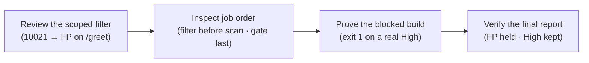

# Module 2 · Demo 3 — Enforce a security quality gate

<div align="center">


<sub>Illustrative workflow · Generated using ChatGPT · Verify actual evidence in your own lab</sub>

</div>

<!-- demo-navigation:start -->
<p align="center"><b>Student exercise · Demo 6 of 6</b></p>
<p align="center">
  <a href="https://github.com/rupeshtiwari/pluralsight-script-development-with-zap/blob/m2-demo2-before/demos/module2-demos/m2-demo2-zap-api-scan-evidence/README.md"></a>
  <a href="../../../README.md"></a>
</p>
<!-- demo-navigation:end -->

## Your scenario

This is the last mile: the Globomantics pipeline has to *decide*. A scan that produces a report but never blocks anything is a smoke detector with no battery. Your job in this demo is to turn ZAP's findings into a build outcome the team can defend — one that fails the release for a genuine High-risk vulnerability, but does **not** fail it over a benign finding the team already reviewed and accepted.

That tension is the whole lesson, and it is where teams get it wrong in two opposite directions. Silence the noisy finding globally and you blind the gate to that same issue everywhere else in the app. Leave it in and the gate cries wolf until someone disables it entirely — and then a real High sails through. So you and I are going to do the disciplined thing: a **scoped** False Positive filter for the one benign finding on the one path it is benign, jobs ordered so the filter applies *before* scanning, a real gate exit that blocks on a genuine High, and a report that *explains* the decision. A red build is not the deliverable. A red build you can justify from evidence is.

## Your learning goals

You will make a release decision from the final alert set instead of simply reacting to a red build:

1. Apply a scoped alert filter rather than ignoring an entire security rule *(EO3c)*
2. Order the automation jobs, verify final High-risk evidence, and confirm the CI exit status *(EO3c)*

You do not need the separate course outline — each step states what you are checking and why.

## Your evidence path



Read it as building a defensible decision: scope the exception, order the plan so it takes effect, run the real gate, then prove from the report that both the benign and the genuine finding were handled exactly as intended.

## Start your lab

Mac dependencies are prepared **once for the course** with `setup/setup-macos.sh` (see the [course README](../../../README.md)). Each demo then starts its **own** local stack.

<details open>
<summary><b>Open the exact branch and start Module 2 Demo 3</b></summary>

**Where:** the VS Code integrated Terminal, from the root of your existing Git checkout. This demo shows plan source, so work in VS Code.

```bash
cd "$HOME/pluralsight-script-development-with-zap"
git fetch origin
git switch m2-demo3-before
cd demos/module2-demos/m2-demo3-security-quality-gates
./scripts/demo_up.sh
```

**Expected start:** the startup script reports healthy Globomantics, Postgres, MongoDB and ZAP services. If anything is not ready, stop and read the actual output before continuing.

**Interfaces:** <a href="http://localhost:8000/" target="_blank" rel="noopener">Training application</a> · <a href="http://localhost:8080/zap/" target="_blank" rel="noopener">ZAP GUI</a> · <a href="http://localhost:8090/" target="_blank" rel="noopener">ZAP API and proxy</a>, plus **GitHub → Actions → quality-gate** for the hosted proof. The `-before` branch deliberately omits the finished `ci/gate-plan.yaml` — author it from the exercise before running the gate.

</details>

## Your four steps

<details open>
<summary><b>Step 1 — Inspect the False Positive filter</b> · scoped exception</summary>

### What you are learning

Record a reviewed disposition for one benign finding, scoped to one path — without suppressing that rule anywhere else. *(EO3c)*

### What we examine, and why

Open `ci/gate-plan.yaml` in VS Code at the `alertFilter` job and read three fields together, because they are the difference between an exception and a blind spot:

- **`ruleId: 10021`** — *X-Content-Type-Options Header Missing*. A real finding, but on the Globomantics `/greet` page the team has reviewed it and accepted it as benign.
- **`newRisk: False Positive`** — the disposition. It does not delete the finding; it re-labels it as reviewed-and-accepted, so the gate stops counting it while the report still *shows* it.
- **`url: http://app:8000/greet.*`** — the scope, and the most important field of the three. Because the filter is pinned to this path, the exact same `10021` on any *other* page still counts. A global ignore would have thrown that safety away.

This is a disposition-as-code: the judgment is written once, in the plan, reviewed in a pull request, and applied on every run — not clicked away in a GUI where no one can audit it.

**Predict before you run:** you expect `ruleId 10021`, `newRisk False Positive`, scope `/greet.*`. The YAML proves the exception is *configured*; whether it actually took effect is something only the report (Step 4) can prove.

### Run command

**Where:** the VS Code integrated Terminal, in `demos/module2-demos/m2-demo3-security-quality-gates`.

```bash
./steps/01-inspect-false-positive-filter.sh
```

Keep `ci/gate-plan.yaml` open at `alertFilter` — rule ID, `newRisk` and the scoped URL — while you read the result.

### Expected result (the script's output contract — not your run)

<table><thead><tr><th>Output field</th><th>Expected value or example</th><th>What to inspect</th></tr></thead>
<tbody><tr><td><b>Filtered rule (ruleId)</b></td><td><code>10021 (X-Content-Type-Options Header Missing)</code></td><td>Exactly which finding</td></tr>
<tr><td><b>New disposition (newRisk)</b></td><td><code>False Positive</code></td><td>Reviewed, not deleted</td></tr>
<tr><td><b>Scope (url)</b></td><td><code>http://app:8000/greet.*</code></td><td>One path — not a global disable</td></tr>
<tr><td><b>Result</b></td><td><code>✔ PASS the plan marks rule 10021 as a False Positive, scoped to http://app:8000/greet.*</code></td><td>The report still must confirm it applied</td></tr></tbody></table>

### Investigate, then decide

Confirm the `url` scope is present — a filter without it is a global suppression wearing a disguise. The decision: *this is a reviewed exception for one finding on one path*, narrow enough that it cannot hide the same issue elsewhere. Configured is not yet applied; hold that distinction for Step 4.

**On FAIL:** a missing scope or wrong rule ID is a filter you should not ship. Fix the `alertFilter` block rather than accepting it.

**Next:** make sure the filter actually runs *before* ZAP creates alerts.

</details>

<details>
<summary><b>Step 2 — Verify scan and gate order</b> · filter before scan · gate last</summary>

### What you are learning

Confirm the plan's jobs run in an order where the filter is in place before scanning and the gate reads the final alert set. *(EO3c)*

### What we examine, and why

Scroll through the `jobs` list in `ci/gate-plan.yaml`. Order is not cosmetic here — it changes the result:

- **`alertFilter` before `activeScan`** — the disposition must exist *when ZAP discovers alerts*, so every matching alert inherits it as it is raised. A filter applied after scanning would leave the already-raised alerts untouched, and your "False Positive" would quietly do nothing.
- **`report` then `exitStatus` last** — the gate must judge the *final* alert set, after scanning and filtering have both finished. If `exitStatus` ran earlier, it would decide the build on incomplete evidence.

The step checks the plan against the Module 2 architecture's job order (`passiveScan-config → alertFilter → script → spider → passiveScan-wait → activeScan-policy → activeScan → passiveScan-wait → report → exitStatus`) and confirms the two ordering invariants hold.

**Predict before you run:** you expect the architecture job order, `alertFilter before activeScan: yes`, and `exitStatus last: yes`. This is still configuration proof — it earns an exit code only when you actually run the gate.

### Run command

**Where:** the VS Code integrated Terminal, in the same demo folder.

```bash
./steps/02-check-automation-job-order.sh
```

Keep the ordered `jobs` list in `ci/gate-plan.yaml` visible while you read the result.

### Expected result (the script's output contract — not your run)

<table><thead><tr><th>Output field</th><th>Expected value or example</th><th>What to inspect</th></tr></thead>
<tbody><tr><td><b>Job order</b></td><td><code>… alertFilter → … → activeScan → … → report → exitStatus</code></td><td>Matches the Module 2 architecture</td></tr>
<tr><td><b>alertFilter before activeScan</b></td><td><code>yes</code></td><td>New alerts inherit the disposition</td></tr>
<tr><td><b>exitStatus runs last</b></td><td><code>yes</code></td><td>The gate uses the final alert set</td></tr>
<tr><td><b>Result</b></td><td><code>✔ PASS the plan follows the architecture job order: filter before scanning, gate last</code></td><td>Config proof, not yet an exit code</td></tr></tbody></table>

### Investigate, then decide

Confirm both invariants — filter early, gate last. The decision: *the plan is sequenced so the disposition applies to every alert and the gate judges the complete picture.* Order is correctness here, not style; a right filter in the wrong place is a wrong filter.

**On FAIL:** a filter after the scan, or a gate that is not last, means the plan would mis-decide. Reorder the jobs rather than trusting the outcome.

**Next:** run the real gate and read the exit code it actually produces.

</details>

<details>
<summary><b>Step 3 — Run the gate and read its actual exit code</b> · exit 1 on a real High</summary>

### What you are learning

Enforce the High-risk threshold and prove the build blocked *because of a security finding* — not because something in the runner broke. *(EO3c)*

### What we examine, and why

Read the `exitStatus` job's thresholds in the plan: `errorLevel: HIGH`, `warnLevel: MEDIUM`. The gate compares the remaining alerts (after filtering) against those levels and sets the process exit code — `1` when a genuine High survives, which is the signal a pipeline blocks on.

The discipline this step enforces is *attribution*: an arbitrary nonzero exit could mean the runner crashed, the container died, or ZAP never started — none of which is a security decision. So the step reads the actual High-risk count from the report *and* the exit code together, and confirms the hosted `quality-gate` job failed at its gate step for this commit. Exit `1` plus a positive High count plus a blocked hosted gate — that is a release block you can attribute to a real vulnerability.

**Predict before you run:** you expect thresholds `HIGH · MEDIUM`, a High-risk count of at least one after filtering (the genuine reflected XSS, rule `40012`), process exit `1 → BLOCKED`, and the hosted gate job failing at its gate step for this code. A green gate here would mean the High was missed — a failure of the gate, not a pass.

### Run command

**Where:** the VS Code integrated Terminal, in the same demo folder.

```bash
./steps/03-run-security-quality-gate.sh
```

For the hosted proof, open the <a href="https://github.com/rupeshtiwari/pluralsight-script-development-with-zap/actions/workflows/zap-quality-gate.yml" target="_blank" rel="noopener">quality-gate workflow</a>, select the run for your branch/SHA, and read the gate step in the quality-gate job.

### Expected result (the script's output contract — not your run)

The High-risk count and hosted run ID/commit are run-specific — read them from your output.

<table><thead><tr><th>Output field</th><th>Expected value or example</th><th>What to inspect</th></tr></thead>
<tbody><tr><td><b>Gate thresholds (errorLevel · warnLevel)</b></td><td><code>HIGH · MEDIUM</code></td><td>The declared release policy</td></tr>
<tr><td><b>High-risk alerts after filtering</b></td><td><code>&lt;count&gt;</code> (≥ 1, genuine)</td><td>A real remaining High finding</td></tr>
<tr><td><b>Process exit code</b></td><td><code>1</code></td><td>The expected security block</td></tr>
<tr><td><b>Hosted gate run</b></td><td><code>&lt;run id&gt; · gate step failure · commit &lt;sha&gt; · covers this code</code></td><td>The hosted gate blocked for this code</td></tr>
<tr><td><b>Result</b></td><td><code>✔ PASS the gate exited 1 for a real High-risk alert, and the hosted gate job blocked the build for this code</code></td><td>A generic nonzero does not pass</td></tr></tbody></table>

### Investigate, then decide

Read the exit `1` next to a positive High count and the hosted gate failure — the three together attribute the block to a vulnerability, not an outage. The decision: *the gate blocks the release for a genuine High, in CI, for this commit.* An exit `1` you cannot tie to a High finding is an infrastructure problem to diagnose, not a security pass.

**On FAIL:** a `0` exit with a real High means the gate missed it (check thresholds and ordering); a nonzero with *no* High means something broke — fix the right one.

**Next:** prove from the report that the block was correct — benign filtered, High kept.

</details>

<details>
<summary><b>Step 4 — Reconcile filtered and remaining findings</b> · FP held · High kept</summary>

### What you are learning

Confirm from the official report that the scoped False Positive held *and* the genuine High remained — the evidence that makes the blocked build defensible. *(EO3c)*

### What we examine, and why

A failed job, on its own, cannot tell you *why* it failed. This step reads the two findings that explain the decision, from the same report the gate judged:

- **rule `10021`** — *X-Content-Type-Options Header Missing* — now `Low (False Positive)`. The filter from Step 1 held: the finding is still in the report (not hidden), but carries the reviewed disposition, so the gate did not count it.
- **rule `40012`** — *Cross Site Scripting (Reflected)* — `High (Medium)`. The genuine High the team must not ship, untouched by the filter, which is exactly why the gate blocked.

Seeing both in one report is the point. The filter did not weaken the gate against real risk; it only removed reviewed noise. That is the sentence you could put in a release-block ticket and have another engineer agree with.

**Predict before you run:** you expect `10021 — Low (False Positive)` and `40012 — High (Medium)` in the same report, reconciling with the exit `1` from Step 3. If `10021` is missing entirely, your filter over-suppressed; if `40012` is gone, the gate had no business passing.

### Run command

**Where:** the VS Code integrated Terminal, in the same demo folder.

```bash
./steps/04-verify-filtered-alert-report.sh
```

For the hosted proof, open the same Actions run → **Artifacts → globo-gate-report**, download the JSON, and read rules `10021` and `40012` for your run's SHA — not an old report.

### Expected result (the script's output contract — not your run)

<table><thead><tr><th>Output field</th><th>Expected value or example</th><th>What to inspect</th></tr></thead>
<tbody><tr><td><b>Benign finding (rule 10021)</b></td><td><code>X-Content-Type-Options Header Missing — Low (False Positive)</code></td><td>The filter held, finding still shown</td></tr>
<tr><td><b>Real finding (rule 40012)</b></td><td><code>Cross Site Scripting (Reflected) — High (Medium)</code></td><td>The genuine High remained</td></tr>
<tr><td><b>Gate outcome</b></td><td><code>exit 1 → build blocked</code></td><td>Both records explain the block</td></tr>
<tr><td><b>Result</b></td><td><code>✔ PASS the filtered report shows the benign finding as False Positive and the High kept — the reason the gate blocked</code></td><td>No fabricated fallback values</td></tr></tbody></table>

### Investigate, then decide

Read the two findings side by side and tie them to the exit code: benign re-labelled, High retained, build blocked. The decision this whole course built to: *you can block a release and justify it from the report* — the gate is evidence-backed, not a tripwire. That is an auditable security decision another engineer can stand behind.

**On FAIL:** a missing `10021` means the filter was too broad; a missing `40012` means the gate would wrongly pass. Either is a real finding about your plan — fix it rather than accept the build outcome.

**Next:** you have a complete, defensible quality gate — scoped exception, correct order, real block, report that explains it.

</details>

<!-- student-achievement:start -->
## What you achieved

You can now explain each learning objective with the evidence you captured:

1. **(EO3c) You applied a scoped exception, not a blanket suppression.** The alert filter set rule `10021` to `False Positive` scoped to `/greet.*`, and the report still shows that finding as `Low (False Positive)` — the rule is untouched everywhere else.
2. **(EO3c) You made the release decision from final evidence.** With the jobs ordered so the filter applied before scanning and the gate ran last, the gate exited `1` on a genuine High (reflected XSS `40012 — High (Medium)`) while `10021` stayed `False Positive` in the same report, and the hosted `quality-gate` job blocked the build for this commit — a security decision, not an infrastructure failure.

**How to apply it:** this is how you make ZAP a real release gate — encode reviewed exceptions as scoped filters in version control, order the plan so they take effect, and block on genuine risk with a report that explains the call. A red build is only useful when you can defend it from evidence.

**Your final check:** explain each numbered outcome using *your own* captured evidence from this run. A README example, a missing result, or an earlier run does not satisfy this exercise.
<!-- student-achievement:end -->

## Finish your lab

The gate blocks because a genuine High risk remains after the benign alert was reviewed and scoped out — which is exactly what the report proves.

From the same demo directory, stop the local services:

```bash
./scripts/demo_down.sh
```

The `m2-demo3-after` branch holds the completed reference, including the finished `ci/gate-plan.yaml`. Preserve your changes first, then compare without modifying files: `git diff m2-demo3-before..m2-demo3-after -- demos/module2-demos/m2-demo3-security-quality-gates` from the repository root.

<!-- demo-navigation:start -->
<p align="center"><b>Student exercise · Demo 6 of 6</b></p>
<p align="center">
  <a href="https://github.com/rupeshtiwari/pluralsight-script-development-with-zap/blob/m2-demo2-before/demos/module2-demos/m2-demo2-zap-api-scan-evidence/README.md"></a>
  <a href="../../../README.md"></a>
</p>
<!-- demo-navigation:end -->

[← Module 2 catalog](../README.md) · [← Course home](../../../README.md)
