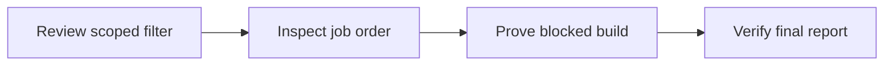

# Module 2 · Demo 3 — Enforce a security quality gate

<div align="center">


<sub>Illustrative workflow · Generated using ChatGPT · Verify actual evidence in your own lab</sub>

</div>

<!-- demo-navigation:start -->
<p align="center"><b>Student exercise · Demo 6 of 6</b></p>
<p align="center">
  <a href="https://github.com/rupeshtiwari/pluralsight-script-development-with-zap/blob/m2-demo2-before/demos/module2-demos/m2-demo2-zap-api-scan-evidence/README.md"></a>
  <a href="../../../README.md"></a>
</p>
<!-- demo-navigation:end -->

## Your Scenario

Your team has reviewed one benign header finding, but genuine High-risk reflected XSS must still stop the release. A failed build is not enough: the report must explain the policy decision.

**Your practical goal:** I will guide you through a narrowly scoped False Positive filter, job ordering, the real gate exit and the final report. You will preserve the genuine High-risk finding while checking the intended exception.

## Your Learning Goals

You will make a release decision from the final alert set instead of simply reacting to a red build:

- Apply a scoped alert filter rather than ignoring an entire security rule *(EO3c)*
- Order the automation jobs, verify final High-risk evidence, and confirm the CI exit status *(EO3c)*

You do not need the separate course outline to understand the objective or follow the exercises.

## Your Evidence Path



## Start Your Lab

Mac dependencies are prepared **once for the course** using `setup/setup-macos.sh`, as shown in the [course README](../../../README.md). Each demo must then start its **own local training stack**:

<details open>
<summary><b>Open the exact branch and start Module 2 Demo 3</b></summary>

**Where:** macOS Terminal or VS Code integrated Terminal, from the root of your existing Git checkout.

```bash
cd "$HOME/pluralsight-script-development-with-zap"
git fetch origin
git switch m2-demo3-before
cd demos/module2-demos/m2-demo3-security-quality-gates
./scripts/demo_up.sh
```

**Expected start:** healthy Globomantics, Postgres, MongoDB, and ZAP services, reported by the startup script. If they are not ready, stop and inspect the actual output before proceeding.

**URLs:** [Training application](http://localhost:8000/) · [ZAP GUI](http://localhost:8080/zap/) · [ZAP API and proxy](http://localhost:8090/). The starter intentionally omits the finished `ci/gate-plan.yaml`. Author it using the exercise before executing the quality gate.

</details>

## Your Four Steps

<details open>
<summary><b>Step 1 — Inspect the False Positive filter</b> · Review scoped filter</summary>

### Learning Goal

A global ignore list can hide risk elsewhere in the application.

**What you are learning:** Configure risk disposition without suppressing unrelated findings *(EO3c)*

### Demo Workspace

**Open VS Code**, inspect `ci/gate-plan.yaml` at `alertFilter`, and keep rule ID, URL and new disposition visible in the editor. Run the command in VS Code Terminal.

<!-- student-location:start -->
**Run in:** VS Code integrated Terminal.

```bash
cd "$HOME/pluralsight-script-development-with-zap/demos/module2-demos/m2-demo3-security-quality-gates"
```
<!-- student-location:end -->

### Run Command

**Where:** the VS Code integrated Terminal. **Current folder:** `demos/module2-demos/m2-demo3-security-quality-gates`.

```bash
./steps/01-inspect-false-positive-filter.sh
```

<!-- student-proof:start -->
**Where your result appears:** Stay in VS Code with ci/gate-plan.yaml and the terminal fields. Frame alertFilter, ruleId, newRisk and scoped URL.

**Inspect this evidence:** Configured 10021 False Positive exception and exact scope; whether it took effect is proved in the report.
<!-- student-proof:end -->

### Expected Results

This is the existing script's **output field contract**, not a manufactured scan result. The field values containing angle brackets vary and must be taken from the real output.

<table><thead><tr><th>Output field</th><th>Expected value or example</th><th>What to inspect</th></tr></thead>
<tbody><tr><td><b>Filtered rule (ruleId)</b></td><td><code>10021 (X-Content-Type-Options Header Missing)</code></td><td>Exactly which finding</td></tr>
<tr><td><b>New disposition (newRisk)</b></td><td><code>False Positive</code></td><td>Scoped treatment</td></tr>
<tr><td><b>Scope (url)</b></td><td><code>http://app:8000/greet.*</code></td><td>Do not globally disable</td></tr>
<tr><td><b>Result</b></td><td><code>✔ PASS filter configuration is correct</code></td><td>Report still needs verification</td></tr></tbody></table>

**Failure handling:** If the script reports FAIL, the required result is not established. Review the diagnostic and do not advance or substitute a prior run.

### Interpret Results

The filter records a reviewed disposition for one class of benign finding on a specific path. Static YAML proves configuration, not that the report actually applied it.

**How the investigation advances:** Make sure the filter applies before scans create alerts.

</details>

<details>
<summary><b>Step 2 — Verify scan and gate order</b> · Inspect job order</summary>

### Learning Goal

Applying the filter after scanning can leave earlier alerts unaffected.

**What you are learning:** Put filtering and reporting in a defensible pipeline sequence *(EO3c)*

### Demo Workspace

**Remain in VS Code**, scroll within `ci/gate-plan.yaml` to the jobs list. Show `alertFilter`, `requestor`, `activeScan`, `report`, and `exitStatus` in order.

<!-- student-location:start -->
**Run in:** VS Code integrated Terminal.

```bash
cd "$HOME/pluralsight-script-development-with-zap/demos/module2-demos/m2-demo3-security-quality-gates"
```
<!-- student-location:end -->

### Run Command

**Where:** the VS Code integrated Terminal. **Current folder:** `demos/module2-demos/m2-demo3-security-quality-gates`.

```bash
./steps/02-check-automation-job-order.sh
```

<!-- student-proof:start -->
**Where your result appears:** Stay in VS Code and the integrated terminal; scroll only to the ordered YAML jobs.

**Inspect this evidence:** alertFilter before scanning, report before exitStatus and exitStatus last for this plan.
<!-- student-proof:end -->

### Expected Results

This is the existing script's **output field contract**, not a manufactured scan result. The field values containing angle brackets vary and must be taken from the real output.

<table><thead><tr><th>Output field</th><th>Expected value or example</th><th>What to inspect</th></tr></thead>
<tbody><tr><td><b>Job order</b></td><td><code>alertFilter → requestor → activeScan → report → exitStatus</code></td><td>Correct order</td></tr>
<tr><td><b>alertFilter before activeScan</b></td><td><code>yes</code></td><td>New alerts inherit disposition</td></tr>
<tr><td><b>exitStatus runs last</b></td><td><code>yes</code></td><td>Gate uses final alert set</td></tr>
<tr><td><b>Result</b></td><td><code>✔ PASS job order checked</code></td><td>Config proof, not yet an exit code</td></tr></tbody></table>

**Failure handling:** If the script reports FAIL, the required result is not established. Review the diagnostic and do not advance or substitute a prior run.

### Interpret Results

The filter must exist when ZAP discovers alerts; the report follows scanning and exit status comes last.

**How the investigation advances:** Run the actual gate and distinguish expected policy failure from infrastructure errors.

</details>

<details>
<summary><b>Step 3 — Run the gate and read its actual exit code</b> · Prove blocked build</summary>

### Learning Goal

An arbitrary nonzero process code could mean the runner failed, not that a security rule blocked release.

**What you are learning:** Enforce High-risk threshold in a build pipeline *(EO3c)*

### Demo Workspace

**Open VS Code** at `ci/gate-plan.yaml` on `exitStatus`, then run the step in integrated Terminal. Also inspect **GitHub → Actions → quality-gate job** for the matching commit.

<!-- student-location:start -->
**Run in:** VS Code integrated Terminal.

```bash
cd "$HOME/pluralsight-script-development-with-zap/demos/module2-demos/m2-demo3-security-quality-gates"
```
<!-- student-location:end -->

### Run Command

**Where:** the VS Code integrated Terminal; Actions for hosted evidence. **Current folder:** `demos/module2-demos/m2-demo3-security-quality-gates`.

```bash
./steps/03-run-security-quality-gate.sh
```

<!-- student-proof:start -->
**Where your result appears:** Show local High count and process exit. Then open https://github.com/rupeshtiwari/pluralsight-script-development-with-zap/actions/workflows/zap-quality-gate.yml, select the matching run, quality-gate job and execution log.

**Inspect this evidence:** Real High finding plus exit 1 and the corresponding blocked hosted step; distinguish scanner errors.
<!-- student-proof:end -->

### Expected Results

This is the existing script's **output field contract**, not a manufactured scan result. The field values containing angle brackets vary and must be taken from the real output.

<table><thead><tr><th>Output field</th><th>Expected value or example</th><th>What to inspect</th></tr></thead>
<tbody><tr><td><b>Gate thresholds (errorLevel · warnLevel)</b></td><td><code>HIGH · MEDIUM</code></td><td>Declared release policy</td></tr>
<tr><td><b>High-risk alerts after filtering</b></td><td><code>&lt;actual positive count&gt;</code></td><td>Required genuine finding</td></tr>
<tr><td><b>Process exit code</b></td><td><code>1</code></td><td>Expected security block</td></tr>
<tr><td><b>Build decision</b></td><td><code>exit 1 → BLOCKED</code></td><td>Must correlate with report</td></tr>
<tr><td><b>Result</b></td><td><code>✔ PASS exit 1 with remaining High risk</code></td><td>Generic nonzero does not pass</td></tr></tbody></table>

**Failure handling:** If the script reports FAIL, the required result is not established. Review the diagnostic and do not advance or substitute a prior run.

### Interpret Results

The gate should block only when the configured risk threshold encounters a genuine remaining High finding. Exit code 1 and a positive High count need the report as corroboration.

**How the investigation advances:** Read the actual alert records to verify that the False Positive and High findings were both handled correctly.

</details>

<details>
<summary><b>Step 4 — Reconcile filtered and remaining findings</b> · Verify final report</summary>

### Learning Goal

A job failure alone cannot prove the scoped False Positive and the remaining High were handled correctly.

**What you are learning:** Confirm the policy decision against official alert disposition *(EO3c)*

### Demo Workspace

**In GitHub Actions**, open the matching run's report artifact (not an old run). Inspect rules 10021 and 40012 in the JSON report. Run the terminal step for local evidence.

<!-- student-location:start -->
**Run in:** VS Code integrated Terminal.

```bash
cd "$HOME/pluralsight-script-development-with-zap/demos/module2-demos/m2-demo3-security-quality-gates"
```
<!-- student-location:end -->

### Run Command

**Where:** the VS Code integrated Terminal; Actions artifact for CI proof. **Current folder:** `demos/module2-demos/m2-demo3-security-quality-gates`.

```bash
./steps/04-verify-filtered-alert-report.sh
```

<!-- student-proof:start -->
**Where your result appears:** Show local report fields. For hosted proof, open the same Actions run, Artifacts, globo-gate-report; download and open the JSON in VS Code.

**Inspect this evidence:** Actual 10021 False Positive and 40012 High from the same report, aligned with the gate exit.
<!-- student-proof:end -->

### Expected Results

This is the existing script's **output field contract**, not a manufactured scan result. The field values containing angle brackets vary and must be taken from the real output.

<table><thead><tr><th>Output field</th><th>Expected value or example</th><th>What to inspect</th></tr></thead>
<tbody><tr><td><b>Benign finding (rule 10021)</b></td><td><code>X-Content-Type-Options Header Missing — Low (False Positive)</code></td><td>Actual filtered disposition</td></tr>
<tr><td><b>Real finding (rule 40012)</b></td><td><code>Cross Site Scripting (Reflected) — High (Medium)</code></td><td>High-risk finding remains</td></tr>
<tr><td><b>Gate outcome</b></td><td><code>benign filtered, High kept → blocked</code></td><td>Both records explain exit 1</td></tr>
<tr><td><b>Result</b></td><td><code>✔ PASS report shows both intended findings</code></td><td>No fabricated fallback values</td></tr></tbody></table>

**Failure handling:** If the script reports FAIL, the required result is not established. Review the diagnostic and do not advance or substitute a prior run.

### Interpret Results

The JSON report confirms benign noise was scoped while real High risk was retained. Only then does the failed build represent an evidence-backed security gate.

**How the investigation advances:** This completes the security decision and gives another engineer an auditable release-block rationale.

</details>

<!-- student-achievement:start -->
## What You Achieved

After the four checks and matching gate evidence, you can explain why a release was blocked using the filtered report and actual process exit. You can separate a reviewed exception from blanket suppression and a security gate decision from an infrastructure failure.

**Your final check:** Explain the result using your own captured evidence. A README example, missing result or earlier run does not satisfy this exercise.
<!-- student-achievement:end -->

## Finish Your Lab

The gate blocks because real High risk remains after the benign alert was reviewed and filtered.

From the same demo directory, stop the local services:

```bash
./scripts/demo_down.sh
```

The `m2-demo3-after` branch contains the completed example or reference behavior. Preserve student changes before switching branches. For a safe comparison run `git diff m2-demo3-before..m2-demo3-after -- demos/module2-demos/m2-demo3-security-quality-gates` from the repository root; operational-only exercises may have no source diff.

**One batch validation command for the course:** `./setup/run-all-demo-preflights.sh` from the repository root. This checks all six finished branches and creates real evidence bundles for the production team. There are no separate per-demo preflight commands.

<!-- demo-navigation:start -->
<p align="center"><b>Student exercise · Demo 6 of 6</b></p>
<p align="center">
  <a href="https://github.com/rupeshtiwari/pluralsight-script-development-with-zap/blob/m2-demo2-before/demos/module2-demos/m2-demo2-zap-api-scan-evidence/README.md"></a>
  <a href="../../../README.md"></a>
</p>
<!-- demo-navigation:end -->

[← Module 2 catalog](../README.md) · [← Course home](../../../README.md)
