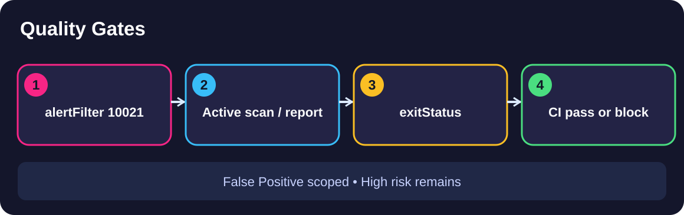

# Module 2 · Demo 3 — Security quality gates · Production guide

<div align="center">



<sub>Illustrative architecture · Generated using ChatGPT · Temporary PUBLIC production material</sub>

</div>

[← Production dashboard](README.md) · [Open student's Module 2 demo README](https://github.com/rupeshtiwari/pluralsight-script-development-with-zap/blob/m2-demo3-before/demos/module2-demos/m2-demo3-security-quality-gates/README.md)

<!-- demo-navigation:start -->
<p align="center"><b>Author production guide · Demo 6 of 6</b></p>
<p align="center">
  <a href="m2-demo2.md"></a>
  <a href="README.md"></a>
</p>
<!-- demo-navigation:end -->

## Recording assignment

**Record the `m2-demo3-before` branch**, completing the missing plan where applicable, and keep source changes traceable. The Developer runs the **one combined batch preflight before the recording team starts** and distributes `deliverables/m2-demo3/`: commands, verified logs, generated HTML and narration drafts.

**Off-camera preparation:** from the existing checkout root run `git switch m2-demo3-before`, then `cd demos/module2-demos/m2-demo3-security-quality-gates`, then `./scripts/demo_up.sh`. Check the local application at `http://localhost:8000/`. Confirm the lesson source/plan is ready before testing. One-time Mac preparation and the batch command live **only on the author dashboard**; do not repeat them during recorded steps.

**Recording sequence:** show code or GUI context, display exact command and its key parameters for about 8 seconds, execute once, then reveal real output in 6–8-second proof windows; show real GitHub Actions job and report where the LO requires hosted proof. The Editor cuts waiting and focus changes cleanly.

## Four fixed teaching steps

## Step 1 — Inspect the False Positive filter

<details open>
<summary><b>Open step 1 — where, command, output and production roles</b></summary>


### The specific problem

A global ignore list can hide risk elsewhere in the application.

**What you are learning:** Configure risk disposition without suppressing unrelated findings *(EO3c)*

### Which application and screen?


**Required directory navigation:** Open VS Code integrated Terminal manually. Do not browse through folders in Finder or type a relative path. Paste this complete command and press Enter before running the named step:

```bash
cd "$HOME/pluralsight-script-development-with-zap/demos/module2-demos/m2-demo3-security-quality-gates"
```

**Branch:** `m2-demo3-before` (complete any deliberately missing student source first). The separate `./steps/01-*.sh` command below is the only on-camera execution for this step.

**Open VS Code**, inspect `ci/gate-plan.yaml` at `alertFilter`, and keep rule ID, URL and new disposition visible in the editor. Run the command in VS Code Terminal.

### Run this exact command

**Where:** the VS Code integrated Terminal. **Current folder:** `demos/module2-demos/m2-demo3-security-quality-gates`.

```bash
./steps/01-inspect-false-positive-filter.sh
```

### Expected output and what it means

This is the existing script's **output field contract**, not a manufactured scan result. The field values containing angle brackets vary and must be taken from the real output.

<table><thead><tr><th>Output field</th><th>Expected value or example</th><th>What to inspect</th></tr></thead>
<tbody><tr><td><b>Filtered rule (ruleId)</b></td><td><code>10021 (X-Content-Type-Options Header Missing)</code></td><td>Exactly which finding</td></tr>
<tr><td><b>New disposition (newRisk)</b></td><td><code>False Positive</code></td><td>Scoped treatment</td></tr>
<tr><td><b>Scope (url)</b></td><td><code>http://app:8000/greet.*</code></td><td>Do not globally disable</td></tr>
<tr><td><b>Result</b></td><td><code>✔ PASS filter configuration is correct</code></td><td>Report still needs verification</td></tr></tbody></table>

**Failure handling:** If the script reports FAIL, the required result is not established. Review the diagnostic and do not advance or substitute a prior run.

### How to interpret this result

The filter records a reviewed disposition for one class of benign finding on a specific path. Static YAML proves configuration, not that the report actually applied it.

**How the investigation advances:** Make sure the filter applies before scans create alerts.

### Recorder — screen and timing

<details open><summary></summary>
<table><tr><th>Time Handle</th><th>Required Screen Action</th></tr>
<tr><td>Open source · 8s</td><td>VS Code: ci/gate-plan.yaml → alertFilter, near ruleId 10021, newRisk and URL; run named step</td></tr>
<tr><td>Show command · 8s</td><td>Display full `./steps/01-inspect-false-positive-filter.sh` in the terminal. Move pointer away from key text, press Enter once and do not type corrections.</td></tr>
<tr><td>Proof region A · 6–8s</td><td>Box ruleId 10021 and header alert name</td></tr>
<tr><td>Proof region B · 6–8s</td><td>Move box to newRisk False Positive and URL /greet.*; the report is not checked yet</td></tr>
<tr><td>Result · 6–8s</td><td>Keep the actual verified PASS or report result in view. Click handles are filmed for 8s before/after but trimmed; long scan waits are edited out.</td></tr>
</table></details>

### Narrator — spoken lines

<details><summary></summary>
<table><tr><th>Visible Focus</th><th>ElevenLabs Spoken Words</th><th>Word Count</th></tr>
<tr><td>Named command</td><td>Reclassify only the reviewed benign header finding. A blanket filter would conceal unrelated security risks.</td><td>15</td></tr>
<tr><td>Actual output A</td><td>Rule ten thousand twenty-one receives the False Positive disposition specifically for the greeting endpoint.</td><td>14</td></tr>
<tr><td>Actual output B</td><td>This proves the filter configuration. We still need the actual report to establish that its disposition took effect.</td><td>18</td></tr>
</table>
These spoken lines teach only the visible evidence. Never say placeholder values aloud or claim a GUI/API fact a different command did not establish.
</details>

### Editor — highlights and cuts

<details><summary></summary>
<p><b>Concrete Camtasia shot map — use actual values from the current recording, never sample values</b></p>
<table>
<tr><th>Moment</th><th>Exact action</th></tr>
<tr><td>Source then command</td><td>Cut code typing and corrections. Put one BLUE <code>#00A3FF</code> region box on the current source, then on the single named step command; remove the previous box on Enter. Source and command must be readable.</td></tr>
<tr><td>Real output appears</td><td>Cut long scan waiting. Put one BLUE region box around <b>Scoped alertFilter YAML block</b>. Keep the actual table readable for about 6–8 seconds, not the entire desktop.</td></tr>
<tr><td>Primary evidence</td><td>Inside the box, use a small PINK <code>#FF1675</code> label/underline for the actual value of <code>Filtered rule  (ruleId)</code>. Read the captured result first. Missing field → HOLD, never draw a hypothetical number.</td></tr>
<tr><td>Cause/effect relationship</td><td>When both fields are visible in the same take, use a slim PURPLE <code>#770EF7</code> arrow toward the actual value of <code>New disposition  (newRisk)</code>. Otherwise omit the arrow.</td></tr>
<tr><td>Only if still frame exceeds 12 seconds</td><td>If the narrator continues without a meaningful highlight, box or arrow change, show a short YELLOW <code>#FFC942</code> callout with Inky Blue text for 6–8 seconds: <b>A benign filter must stay narrow</b>. Omit this callout when focus already changes naturally.</td></tr>
<tr><td>Final</td><td>Remove all old highlights on pane change. Align with the approved AFTER-result narration beat, hold the real result, preserve eight-second raw handles around important clicks, and trim idle footage.</td></tr>
</table>
<p><b>Synchronize to Narrator:</b> The narrator's three lines immediately above govern the edits: BEFORE the command, DURING visible result, AFTER operator decision. After `narration-final.json` is imported into the batch portal, use the updated spoken lines rather than the old draft timings.</p>

<table><tr><th>Beat</th><th>Exact Camtasia Action</th></tr>
<tr><td>Source → command</td><td>Cut cleanly at window/pane change. Square the relevant config key, remove before introducing the named command.</td></tr>
<tr><td>Proof A/B</td><td>Separate squares on ID, newRisk and URL; use no persistent decoration after scrolling. Keep one callout at a time for 6–8s, moving to the next value as the narrator speaks.</td></tr>
<tr><td>Final result</td><td>Show observed alert/report/exit and the actual PASSED condition; no fake overlays or stale arrows.</td></tr>
<tr><td>Sync artifact</td><td>Compare `logs/preflight-step-01.log` and `logs/recorded-step-01.log` with the same branch SHA and raw `logs/.producer/` proof. A mismatch is a retake, never a cosmetic correction.</td></tr>
</table></details>

### Validation and confidence

- **Proof:** Compare filmed output against the Developer's actual `deliverables/m2-demo3/logs/preflight-step-01.log`, plus the matching live GUI or GitHub Actions artifact
- **Learning:** Validate the purpose and mechanism above; a command-only video does not meet the objective
- **Source review:** Source-review confidence: 95%. Do not inflate scores simply because documentation exists; release requires actua
- **Final release:** Do not invent an alert or inflate confidence. Unsupported GUI/CI steps remain explicitly NOT VERIFIED until corrected

</details>

## Step 2 — Verify scan and gate order

<details>
<summary><b>Open step 2 — where, command, output and production roles</b></summary>


### The specific problem

Applying the filter after scanning can leave earlier alerts unaffected.

**What you are learning:** Put filtering and reporting in a defensible pipeline sequence *(EO3c)*

### Which application and screen?


**Required directory navigation:** Open VS Code integrated Terminal manually. Do not browse through folders in Finder or type a relative path. Paste this complete command and press Enter before running the named step:

```bash
cd "$HOME/pluralsight-script-development-with-zap/demos/module2-demos/m2-demo3-security-quality-gates"
```

**Branch:** `m2-demo3-before` (complete any deliberately missing student source first). The separate `./steps/02-*.sh` command below is the only on-camera execution for this step.

**Remain in VS Code**, scroll within `ci/gate-plan.yaml` to the jobs list. Show `alertFilter`, `requestor`, `activeScan`, `report`, and `exitStatus` in order.

### Run this exact command

**Where:** the VS Code integrated Terminal. **Current folder:** `demos/module2-demos/m2-demo3-security-quality-gates`.

```bash
./steps/02-check-automation-job-order.sh
```

### Expected output and what it means

This is the existing script's **output field contract**, not a manufactured scan result. The field values containing angle brackets vary and must be taken from the real output.

<table><thead><tr><th>Output field</th><th>Expected value or example</th><th>What to inspect</th></tr></thead>
<tbody><tr><td><b>Job order</b></td><td><code>alertFilter → requestor → activeScan → report → exitStatus</code></td><td>Correct order</td></tr>
<tr><td><b>alertFilter before activeScan</b></td><td><code>yes</code></td><td>New alerts inherit disposition</td></tr>
<tr><td><b>exitStatus runs last</b></td><td><code>yes</code></td><td>Gate uses final alert set</td></tr>
<tr><td><b>Result</b></td><td><code>✔ PASS job order checked</code></td><td>Config proof, not yet an exit code</td></tr></tbody></table>

**Failure handling:** If the script reports FAIL, the required result is not established. Review the diagnostic and do not advance or substitute a prior run.

### How to interpret this result

The filter must exist when ZAP discovers alerts; the report follows scanning and exit status comes last.

**How the investigation advances:** Run the actual gate and distinguish expected policy failure from infrastructure errors.

### Recorder — screen and timing

<details open><summary></summary>
<table><tr><th>Time Handle</th><th>Required Screen Action</th></tr>
<tr><td>Open source · 8s</td><td>VS Code: ci/gate-plan.yaml → jobs list, keep five job names visible or scroll with short holds</td></tr>
<tr><td>Show command · 8s</td><td>Display full `./steps/02-check-automation-job-order.sh` in the terminal. Move pointer away from key text, press Enter once and do not type corrections.</td></tr>
<tr><td>Proof region A · 6–8s</td><td>Highlight alertFilter before activeScan</td></tr>
<tr><td>Proof region B · 6–8s</td><td>Move arrow from report to exitStatus and show PASS</td></tr>
<tr><td>Result · 6–8s</td><td>Keep the actual verified PASS or report result in view. Click handles are filmed for 8s before/after but trimmed; long scan waits are edited out.</td></tr>
</table></details>

### Narrator — spoken lines

<details><summary></summary>
<table><tr><th>Visible Focus</th><th>ElevenLabs Spoken Words</th><th>Word Count</th></tr>
<tr><td>Named command</td><td>Confirm the Automation Framework job order before running the gate. The filter must exist when the scan creates findings.</td><td>19</td></tr>
<tr><td>Actual output A</td><td>The report follows scanning, and exit status evaluates the resulting alert set at the end.</td><td>15</td></tr>
<tr><td>Actual output B</td><td>This sequence makes the policy repeatable. Moving the filter later could invalidate the intended noise suppression.</td><td>16</td></tr>
</table>
These spoken lines teach only the visible evidence. Never say placeholder values aloud or claim a GUI/API fact a different command did not establish.
</details>

### Editor — highlights and cuts

<details><summary></summary>
<p><b>Concrete Camtasia shot map — use actual values from the current recording, never sample values</b></p>
<table>
<tr><th>Moment</th><th>Exact action</th></tr>
<tr><td>Source then command</td><td>Cut code typing and corrections. Put one BLUE <code>#00A3FF</code> region box on the current source, then on the single named step command; remove the previous box on Enter. Source and command must be readable.</td></tr>
<tr><td>Real output appears</td><td>Cut long scan waiting. Put one BLUE region box around <b>Automation Framework ordered job list</b>. Keep the actual table readable for about 6–8 seconds, not the entire desktop.</td></tr>
<tr><td>Primary evidence</td><td>Inside the box, use a small PINK <code>#FF1675</code> label/underline for the actual value of <code>Job order (ci/gate-plan.yaml)</code>. Read the captured result first. Missing field → HOLD, never draw a hypothetical number.</td></tr>
<tr><td>Cause/effect relationship</td><td>When both fields are visible in the same take, use a slim PURPLE <code>#770EF7</code> arrow toward the actual value of <code>exitStatus runs last</code>. Otherwise omit the arrow.</td></tr>
<tr><td>Only if still frame exceeds 12 seconds</td><td>If the narrator continues without a meaningful highlight, box or arrow change, show a short YELLOW <code>#FFC942</code> callout with Inky Blue text for 6–8 seconds: <b>Filter before scanning, gate at the end</b>. Omit this callout when focus already changes naturally.</td></tr>
<tr><td>Final</td><td>Remove all old highlights on pane change. Align with the approved AFTER-result narration beat, hold the real result, preserve eight-second raw handles around important clicks, and trim idle footage.</td></tr>
</table>
<p><b>Synchronize to Narrator:</b> The narrator's three lines immediately above govern the edits: BEFORE the command, DURING visible result, AFTER operator decision. After `narration-final.json` is imported into the batch portal, use the updated spoken lines rather than the old draft timings.</p>

<table><tr><th>Beat</th><th>Exact Camtasia Action</th></tr>
<tr><td>Source → command</td><td>Cut cleanly at window/pane change. Square the relevant config key, remove before introducing the named command.</td></tr>
<tr><td>Proof A/B</td><td>Show short arrow filter → scan, then another report → exitStatus. Only one arrow at any moment. Keep one callout at a time for 6–8s, moving to the next value as the narrator speaks.</td></tr>
<tr><td>Final result</td><td>Show observed alert/report/exit and the actual PASSED condition; no fake overlays or stale arrows.</td></tr>
<tr><td>Sync artifact</td><td>Compare `logs/preflight-step-02.log` and `logs/recorded-step-02.log` with the same branch SHA and raw `logs/.producer/` proof. A mismatch is a retake, never a cosmetic correction.</td></tr>
</table></details>

### Validation and confidence

- **Proof:** Compare filmed output against the Developer's actual `deliverables/m2-demo3/logs/preflight-step-02.log`, plus the matching live GUI or GitHub Actions artifact
- **Learning:** Validate the purpose and mechanism above; a command-only video does not meet the objective
- **Source review:** Source-review confidence: 96%. Do not inflate scores simply because documentation exists; release requires actua
- **Final release:** Do not invent an alert or inflate confidence. Unsupported GUI/CI steps remain explicitly NOT VERIFIED until corrected

</details>

## Step 3 — Run the gate and read its actual exit code

<details>
<summary><b>Open step 3 — where, command, output and production roles</b></summary>


### The specific problem

An arbitrary nonzero process code could mean the runner failed, not that a security rule blocked release.

**What you are learning:** Enforce High-risk threshold in a build pipeline *(EO3c)*

### Which application and screen?


**Required directory navigation:** Open VS Code integrated Terminal manually. Do not browse through folders in Finder or type a relative path. Paste this complete command and press Enter before running the named step:

```bash
cd "$HOME/pluralsight-script-development-with-zap/demos/module2-demos/m2-demo3-security-quality-gates"
```

**Branch:** `m2-demo3-before` (complete any deliberately missing student source first). The separate `./steps/03-*.sh` command below is the only on-camera execution for this step.

**Open VS Code** at `ci/gate-plan.yaml` on `exitStatus`, then run the step in integrated Terminal. Also inspect **GitHub → Actions → quality-gate job** for the matching commit.

### Run this exact command

**Where:** the VS Code integrated Terminal; Actions for hosted evidence. **Current folder:** `demos/module2-demos/m2-demo3-security-quality-gates`.

```bash
./steps/03-run-security-quality-gate.sh
```

### Expected output and what it means

This is the existing script's **output field contract**, not a manufactured scan result. The field values containing angle brackets vary and must be taken from the real output.

<table><thead><tr><th>Output field</th><th>Expected value or example</th><th>What to inspect</th></tr></thead>
<tbody><tr><td><b>Gate thresholds (errorLevel · warnLevel)</b></td><td><code>HIGH · MEDIUM</code></td><td>Declared release policy</td></tr>
<tr><td><b>High-risk alerts after filtering</b></td><td><code>&lt;actual positive count&gt;</code></td><td>Required genuine finding</td></tr>
<tr><td><b>Process exit code</b></td><td><code>1</code></td><td>Expected security block</td></tr>
<tr><td><b>Build decision</b></td><td><code>exit 1 → BLOCKED</code></td><td>Must correlate with report</td></tr>
<tr><td><b>Result</b></td><td><code>✔ PASS exit 1 with remaining High risk</code></td><td>Generic nonzero does not pass</td></tr></tbody></table>

**Failure handling:** If the script reports FAIL, the required result is not established. Review the diagnostic and do not advance or substitute a prior run.

### How to interpret this result

The gate should block only when the configured risk threshold encounters a genuine remaining High finding. Exit code 1 and a positive High count need the report as corroboration.

**How the investigation advances:** Read the actual alert records to verify that the False Positive and High findings were both handled correctly.

### Recorder — screen and timing

<details open><summary></summary>
<table><tr><th>Time Handle</th><th>Required Screen Action</th></tr>
<tr><td>Open source · 8s</td><td>VS Code: gate-plan.yaml exitStatus errorLevel HIGH, warnLevel MEDIUM; Terminal run step; show current Actions gate log</td></tr>
<tr><td>Show command · 8s</td><td>Display full `./steps/03-run-security-quality-gate.sh` in the terminal. Move pointer away from key text, press Enter once and do not type corrections.</td></tr>
<tr><td>Proof region A · 6–8s</td><td>Square HIGH and MEDIUM thresholds, then the High count</td></tr>
<tr><td>Proof region B · 6–8s</td><td>Box exact exit code 1 and matching High-risk report; verify no setup failure</td></tr>
<tr><td>Result · 6–8s</td><td>Keep the actual verified PASS or report result in view. Click handles are filmed for 8s before/after but trimmed; long scan waits are edited out.</td></tr>
</table></details>

### Narrator — spoken lines

<details><summary></summary>
<table><tr><th>Visible Focus</th><th>ElevenLabs Spoken Words</th><th>Word Count</th></tr>
<tr><td>Named command</td><td>Set High as the error threshold and Medium as the warning threshold. Then run the actual headless gate.</td><td>18</td></tr>
<tr><td>Actual output A</td><td>At least one High-risk finding remains. That real finding must explain the build decision rather than an arbitrary failure.</td><td>19</td></tr>
<tr><td>Actual output B</td><td>The ZAP process exits one and blocks the build. A generic nonzero result would not establish the security cause.</td><td>19</td></tr>
</table>
These spoken lines teach only the visible evidence. Never say placeholder values aloud or claim a GUI/API fact a different command did not establish.
</details>

### Editor — highlights and cuts

<details><summary></summary>
<p><b>Concrete Camtasia shot map — use actual values from the current recording, never sample values</b></p>
<table>
<tr><th>Moment</th><th>Exact action</th></tr>
<tr><td>Source then command</td><td>Cut code typing and corrections. Put one BLUE <code>#00A3FF</code> region box on the current source, then on the single named step command; remove the previous box on Enter. Source and command must be readable.</td></tr>
<tr><td>Real output appears</td><td>Cut long scan waiting. Put one BLUE region box around <b>Gate report count plus actual exit</b>. Keep the actual table readable for about 6–8 seconds, not the entire desktop.</td></tr>
<tr><td>Primary evidence</td><td>Inside the box, use a small PINK <code>#FF1675</code> label/underline for the actual value of <code>High-risk alerts after filtering</code>. Read the captured result first. Missing field → HOLD, never draw a hypothetical number.</td></tr>
<tr><td>Cause/effect relationship</td><td>When both fields are visible in the same take, use a slim PURPLE <code>#770EF7</code> arrow toward the actual value of <code>Process exit code  (echo \$?)</code>. Otherwise omit the arrow.</td></tr>
<tr><td>Only if still frame exceeds 12 seconds</td><td>If the narrator continues without a meaningful highlight, box or arrow change, show a short YELLOW <code>#FFC942</code> callout with Inky Blue text for 6–8 seconds: <b>A blocked build requires High-risk proof and real process exit</b>. Omit this callout when focus already changes naturally.</td></tr>
<tr><td>Final</td><td>Remove all old highlights on pane change. Align with the approved AFTER-result narration beat, hold the real result, preserve eight-second raw handles around important clicks, and trim idle footage.</td></tr>
</table>
<p><b>Synchronize to Narrator:</b> The narrator's three lines immediately above govern the edits: BEFORE the command, DURING visible result, AFTER operator decision. After `narration-final.json` is imported into the batch portal, use the updated spoken lines rather than the old draft timings.</p>

<table><tr><th>Beat</th><th>Exact Camtasia Action</th></tr>
<tr><td>Source → command</td><td>Cut cleanly at window/pane change. Square the relevant config key, remove before introducing the named command.</td></tr>
<tr><td>Proof A/B</td><td>Three distinct proof frames: threshold, positive High count, actual exit 1. Never use a red run icon alone. Keep one callout at a time for 6–8s, moving to the next value as the narrator speaks.</td></tr>
<tr><td>Final result</td><td>Show observed alert/report/exit and the actual PASSED condition; no fake overlays or stale arrows.</td></tr>
<tr><td>Sync artifact</td><td>Compare `logs/preflight-step-03.log` and `logs/recorded-step-03.log` with the same branch SHA and raw `logs/.producer/` proof. A mismatch is a retake, never a cosmetic correction.</td></tr>
</table></details>

### Validation and confidence

- **Proof:** Compare filmed output against the Developer's actual `deliverables/m2-demo3/logs/preflight-step-03.log`, plus the matching live GUI or GitHub Actions artifact
- **Learning:** Validate the purpose and mechanism above; a command-only video does not meet the objective
- **Source review:** Source-review confidence: 84%. Do not inflate scores simply because documentation exists; release requires actua
- **Final release:** Do not invent an alert or inflate confidence. Unsupported GUI/CI steps remain explicitly NOT VERIFIED until corrected

</details>

## Step 4 — Reconcile filtered and remaining findings

<details>
<summary><b>Open step 4 — where, command, output and production roles</b></summary>


### The specific problem

A job failure alone cannot prove the scoped False Positive and the remaining High were handled correctly.

**What you are learning:** Confirm the policy decision against official alert disposition *(EO3c)*

### Which application and screen?


**Required directory navigation:** Open VS Code integrated Terminal manually. Do not browse through folders in Finder or type a relative path. Paste this complete command and press Enter before running the named step:

```bash
cd "$HOME/pluralsight-script-development-with-zap/demos/module2-demos/m2-demo3-security-quality-gates"
```

**Branch:** `m2-demo3-before` (complete any deliberately missing student source first). The separate `./steps/04-*.sh` command below is the only on-camera execution for this step.

**In GitHub Actions**, open the matching run's report artifact (not an old run). Inspect rules 10021 and 40012 in the JSON report. Run the terminal step for local evidence.

### Run this exact command

**Where:** the VS Code integrated Terminal; Actions artifact for CI proof. **Current folder:** `demos/module2-demos/m2-demo3-security-quality-gates`.

```bash
./steps/04-verify-filtered-alert-report.sh
```

### Expected output and what it means

This is the existing script's **output field contract**, not a manufactured scan result. The field values containing angle brackets vary and must be taken from the real output.

<table><thead><tr><th>Output field</th><th>Expected value or example</th><th>What to inspect</th></tr></thead>
<tbody><tr><td><b>Benign finding (rule 10021)</b></td><td><code>X-Content-Type-Options Header Missing — Low (False Positive)</code></td><td>Actual filtered disposition</td></tr>
<tr><td><b>Real finding (rule 40012)</b></td><td><code>Cross Site Scripting (Reflected) — High (Medium)</code></td><td>High-risk finding remains</td></tr>
<tr><td><b>Gate outcome</b></td><td><code>benign filtered, High kept → blocked</code></td><td>Both records explain exit 1</td></tr>
<tr><td><b>Result</b></td><td><code>✔ PASS report shows both intended findings</code></td><td>No fabricated fallback values</td></tr></tbody></table>

**Failure handling:** If the script reports FAIL, the required result is not established. Review the diagnostic and do not advance or substitute a prior run.

### How to interpret this result

The JSON report confirms benign noise was scoped while real High risk was retained. Only then does the failed build represent an evidence-backed security gate.

**How the investigation advances:** This completes the security decision and gives another engineer an auditable release-block rationale.

### Recorder — screen and timing

<details open><summary></summary>
<table><tr><th>Time Handle</th><th>Required Screen Action</th></tr>
<tr><td>Open source · 8s</td><td>GitHub Actions → matching run → Artifacts → globo-gate-report, inspect pluginid 10021 and 40012; Terminal named report step</td></tr>
<tr><td>Show command · 8s</td><td>Display full `./steps/04-verify-filtered-alert-report.sh` in the terminal. Move pointer away from key text, press Enter once and do not type corrections.</td></tr>
<tr><td>Proof region A · 6–8s</td><td>Box 10021 and riskdesc containing False Positive</td></tr>
<tr><td>Proof region B · 6–8s</td><td>Move box to 40012 High (Medium), then match exit 1. Must be actual same-run report</td></tr>
<tr><td>Result · 6–8s</td><td>Keep the actual verified PASS or report result in view. Click handles are filmed for 8s before/after but trimmed; long scan waits are edited out.</td></tr>
</table></details>

### Narrator — spoken lines

<details><summary></summary>
<table><tr><th>Visible Focus</th><th>ElevenLabs Spoken Words</th><th>Word Count</th></tr>
<tr><td>Named command</td><td>Read the JSON report to confirm the scoped header alert received its False Positive disposition.</td><td>15</td></tr>
<tr><td>Actual output A</td><td>The reflected XSS finding remains High, with Medium confidence. Filtering the benign alert did not weaken the risk policy.</td><td>19</td></tr>
<tr><td>Actual output B</td><td>Those two records explain the blocked build. The report and process exit must represent the same run.</td><td>17</td></tr>
</table>
These spoken lines teach only the visible evidence. Never say placeholder values aloud or claim a GUI/API fact a different command did not establish.
</details>

### Editor — highlights and cuts

<details><summary></summary>
<p><b>Concrete Camtasia shot map — use actual values from the current recording, never sample values</b></p>
<table>
<tr><th>Moment</th><th>Exact action</th></tr>
<tr><td>Source then command</td><td>Cut code typing and corrections. Put one BLUE <code>#00A3FF</code> region box on the current source, then on the single named step command; remove the previous box on Enter. Source and command must be readable.</td></tr>
<tr><td>Real output appears</td><td>Cut long scan waiting. Put one BLUE region box around <b>Two real entries in the same JSON report</b>. Keep the actual table readable for about 6–8 seconds, not the entire desktop.</td></tr>
<tr><td>Primary evidence</td><td>Inside the box, use a small PINK <code>#FF1675</code> label/underline for the actual value of <code>Benign finding  (rule 10021)</code>. Read the captured result first. Missing field → HOLD, never draw a hypothetical number.</td></tr>
<tr><td>Cause/effect relationship</td><td>When both fields are visible in the same take, use a slim PURPLE <code>#770EF7</code> arrow toward the actual value of <code>Real finding  (rule 40012)</code>. Otherwise omit the arrow.</td></tr>
<tr><td>Only if still frame exceeds 12 seconds</td><td>If the narrator continues without a meaningful highlight, box or arrow change, show a short YELLOW <code>#FFC942</code> callout with Inky Blue text for 6–8 seconds: <b>The reviewed False Positive must not hide the surviving High</b>. Omit this callout when focus already changes naturally.</td></tr>
<tr><td>Final</td><td>Remove all old highlights on pane change. Align with the approved AFTER-result narration beat, hold the real result, preserve eight-second raw handles around important clicks, and trim idle footage.</td></tr>
</table>
<p><b>Synchronize to Narrator:</b> The narrator's three lines immediately above govern the edits: BEFORE the command, DURING visible result, AFTER operator decision. After `narration-final.json` is imported into the batch portal, use the updated spoken lines rather than the old draft timings.</p>

<table><tr><th>Beat</th><th>Exact Camtasia Action</th></tr>
<tr><td>Source → command</td><td>Cut cleanly at window/pane change. Square the relevant config key, remove before introducing the named command.</td></tr>
<tr><td>Proof A/B</td><td>One rectangle on 10021 False Positive, then a separate one on 40012 High, then on exit 1. No fallbacks. Keep one callout at a time for 6–8s, moving to the next value as the narrator speaks.</td></tr>
<tr><td>Final result</td><td>Show observed alert/report/exit and the actual PASSED condition; no fake overlays or stale arrows.</td></tr>
<tr><td>Sync artifact</td><td>Compare `logs/preflight-step-04.log` and `logs/recorded-step-04.log` with the same branch SHA and raw `logs/.producer/` proof. A mismatch is a retake, never a cosmetic correction.</td></tr>
</table></details>

### Validation and confidence

- **Proof:** Compare filmed output against the Developer's actual `deliverables/m2-demo3/logs/preflight-step-04.log`, plus the matching live GUI or GitHub Actions artifact
- **Learning:** Validate the purpose and mechanism above; a command-only video does not meet the objective
- **Source review:** Source-review confidence: 78%. Do not inflate scores simply because documentation exists; release requires actua
- **Final release:** Do not invent an alert or inflate confidence. Unsupported GUI/CI steps remain explicitly NOT VERIFIED until corrected

</details>

## End the production take

Stop containers with `./scripts/demo_down.sh`, retain the before/after SHAs and proof, and deliver the take to the Editor. The Narrator uses the generated step transcripts plus the actual recorded output. Do not rerun the Developer's six-demo preflight in this per-demo process.

<!-- demo-navigation:start -->
<p align="center"><b>Author production guide · Demo 6 of 6</b></p>
<p align="center">
  <a href="m2-demo2.md"></a>
  <a href="README.md"></a>
</p>
<!-- demo-navigation:end -->
